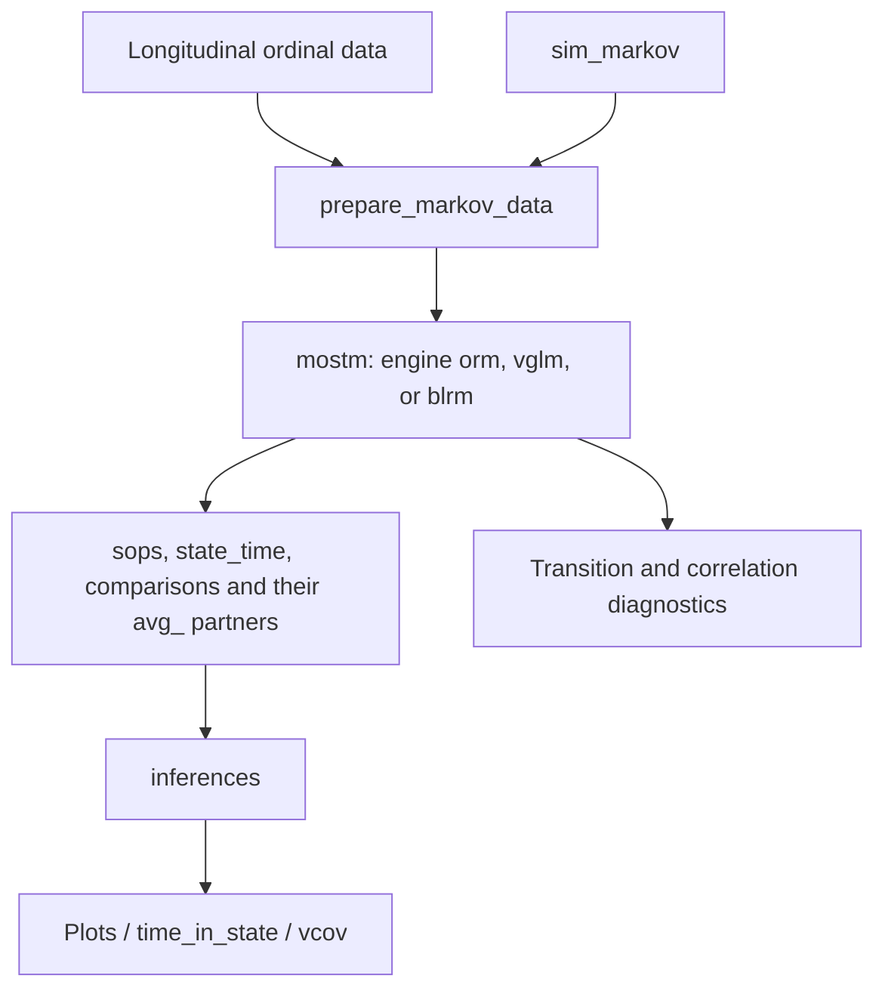
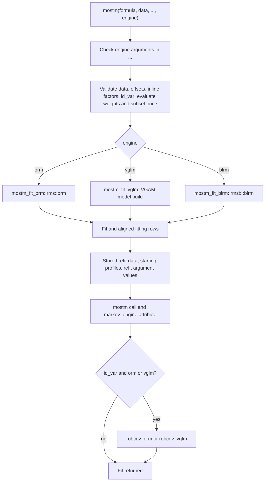
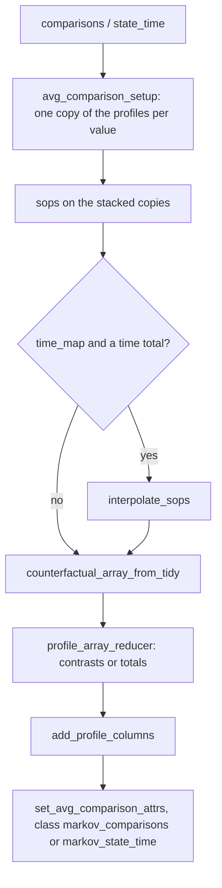

# mostr architecture

## Scope

`mostr` models longitudinal ordinal outcomes using discrete-time Markov
transitions. It retains first- and second-order prediction, absorbing states,
model diagnostics, and uncertainty for state occupancy and treatment contrasts.
It derives from markov.misc while preserving authorship and GPL (>= 2) licensing.
Non-Markov data generators, endpoint analyses, and repeated simulation-study
orchestration are outside this package. Coefficient draws and patient bootstrap
refits remain part of inference for a single fitted model.

## Package website

`_pkgdown.yml` groups the function reference and vignette articles and configures
the navigation for https://scjohannes.github.io/mostr/. pkgdown builds the homepage
from `README.md`, the reference from `man/`, articles from `vignettes/`, and release
notes from `NEWS.md`. Generated files in `docs/` are ignored by Git and excluded
from the R package build.
The template selects MathJax so the TeX emitted for reference-page equations is
rendered, along with equations in vignette articles. The website workflow checks
that every reference page containing equations loads the renderer.

`.github/workflows/pkgdown.yaml` builds the site with R 4.6.1 on pull requests,
pushes to `main`, and manual runs. Only pushes and manual runs publish, using the
GitHub Pages artifact and deployment actions. In repository Settings > Pages,
the source must be set to GitHub Actions. Local previews use
`pkgdown::build_site()` with Pandoc available; this executes the vignette articles.

`man/figures/logo.png` supplies the README and pkgdown logo. All vignettes source
`vignettes/_setup.R`, which keeps code and figures visible and wraps text output
longer than ten lines in native HTML `details` elements. Non-HTML output retains
the usual knitr formatting. The website workflow sets
`MOSTR_RUN_BAYESIAN_VIGNETTE=true` to execute the Bayesian model and its posterior
predictions; set the same variable for a complete local website build. Routine
package vignette builds retain the existing opt-in for this longer calculation.
Vignette transition heatmaps use up to sixteen evenly spaced visits in grids of
at most four rows and four columns. Observed, fitted, and difference plots share
the same visits, with tile labels omitted for readability.
Correlation diagnostics share `method = c("spearman", "pearson")`, defaulting to
Spearman. Observed trajectories use pairwise-complete ranks with average ties.
In `R/diagnostic-correlation.R`, model calculations assign each state's
mid-distribution score (cumulative probability minus half its probability)
from the stratum's profile-averaged marginal distribution at each time.
The existing first- and second-order cross-moment recursions accept different
scores at the two times; Pearson retains category-position scores. Posterior
ranks and correlations are calculated within each draw before averaging.
Vignette correlation heatmaps omit tile labels. `plot_correlation_heatmap()`
chooses a 0-1 fill scale for nonnegative finite correlations and -1 to 1 when
negative values occur or no finite values are available; explicit `fill_limits`
override this choice for both observed and model-based plots.
The introductory vignette documents the ACTT-2 population, NIAID eight-point
health-state scale, and data-access acknowledgment; its 400-patient, 28-day
description matches the simulation code.
Its plot chunks have descriptive names so inserting or renaming other chunks
cannot reuse a previous diagnostic's image URL for a different plot.

## Data flow

## Components and contracts

| Component | Source | Main symbols and role |
|---|---|---|
| Data generation | `R/simulate-markov.R`, `R/simulate-native.R`, `R/data.R` | `sim_markov` (one exported generator: `preset = "actt1"`, `"actt2"`, `"violet"`, or `NULL` for a user model), help topics `actt1_preset`, `actt2_preset`, `violet_preset`, `violet_baseline`; previous-state conditional categorical sampling |
| Data preparation | `R/markov-data.R`, `R/markov-model-data.R` | `prepare_markov_data`; store fitted patient profiles and refit data |
| Model fitting | `R/mostm.R`, `R/markov-model-data.R`, `R/vglm_helpers.R`, `R/robcov_orm.R`, `R/robcov_vglm.R` | `mostm` (the one exported fitter; `engine = "orm"`, `"vglm"`, or optional `"blrm"`); `mostm_fit_orm`, `mostm_fit_vglm`, `mostm_fit_blrm` fit each engine; stored data and `markov_engine` provenance |
| Prediction API | `R/sops-api.R`, `R/sops-avg-time.R`, `R/sops-state-time.R`, `R/sops-comparisons.R`, `R/sops-comparisons-individual.R`, `R/sops-times.R` | `sops`/`avg_sops`, `state_time`/`avg_state_time`, `comparisons`/`avg_comparisons`; probabilities, total time in states, and treatment contrasts for each profile, or averaged; `warn_skipped_sop_visits` checks requested `times` against the fitted visits |
| Recursion | `R/sops-dispatch.R`, `R/sops-engine.R`, `R/sops-native.R`, `src/sops.cpp` | Native propagation with supported R reference paths; first- and second-order histories |
| Analytical inference | `R/sops-delta-core.R`, `R/sops-delta-unconditional.R`, `R/sops-delta-inference.R`, `R/sops-delta-comparisons-individual.R` | Native derivative recursion, coefficient uncertainty, and patient sampling contributions |
| Draw and bootstrap inference | `R/sops-inference.R`, `R/sops-inference-draws.R`, `R/sops-bootstrap-inference.R`, `R/sops-score-bootstrap.R`, `R/bootstrap_helpers.R`, `R/sops-comparisons-individual-inference.R` | `inferences`; MVN draws, posterior draws, ordinary and fractional weighted refits, one-step score bootstrap |
| Summaries | `R/sops-time-in-state.R`, `R/sops-interpolate.R`, `R/sops-delta-accessors.R` | `time_in_state`, `interpolate_sops`, `vcov`; integration, visit-time mapping, covariance subsets |
| Diagnostics and plots | `R/diagnostic-*.R`, `R/viz-*.R` | Occupancy, average time in states (`plot_time`: stacked bars require non-overlapping state sets read from `time_args`), contrasts, transitions, correlation, variograms, and linear predictor comparisons |

Longitudinal rows use `id`, `time`, `y`, `yprev`, and covariates such as `tx`.
`mostm()` preserves the patient starting profiles used when `newdata` is omitted.
Second-order workflows additionally carry `ypprev` or the configured second lag.
The `markov_sops`, `markov_avg_sops`, `markov_state_time`,
`markov_avg_state_time`, `markov_comparisons`, and `markov_avg_comparisons` S3
classes describe result semantics. Package-qualified
calls, native registration symbols, and package options use `mostr`.

### Model fitting

`mostm()` in `R/mostm.R` is the only exported fitting function. Its `engine`
argument chooses the package that fits the cumulative-logit transition model:
`"orm"` (`rms::orm()`, the default), `"vglm"` (`VGAM::vglm()`), or `"blrm"`
(`rmsb::blrm()`, in Suggests). The name `engine` leaves `backend` free, so a
blrm fit can pass rmsb's own `backend` (rstan or cmdstan) through `...`.

- Shared arguments are named and handled once in `mostm()`: `id_var`,
  `time_var`, `first_followup_time`, `weights`, `subset`, and the
  patient-clustered covariance settings `type` and `cadjust`. `data` must be a
  data frame. A missing `id_var` warns (`warn_missing_markov_id_var()`), and
  duplicate ID-time rows warn (`warn_duplicate_markov_id_time()`).
- For `"orm"` and `"blrm"`, `mostm_check_inline_factors()` stops before
  fitting when the right-hand side of the formula calls `factor()`,
  `as.factor()`, `ordered()`, or `as.ordered()` (found at any depth by
  `formula_inline_factor_calls()`; the response is not searched). rms names
  the design columns of such a term after the variable (`x=2`), while
  `stats::model.matrix()` names them after the call (`factor(x)2`), so rms 8.1
  fails with "subscript out of bounds". The error asks for a factor column of
  `data`, and, when the time variable is converted, for a factor time column
  with `first_followup_time`. `"vglm"` builds its own model frame and fits
  these terms.
- Engine arguments go through `...`. `mostm_check_engine_args()` compares
  their names with `mostm_engine_args()`: the formals of `rms::orm()` and
  `rms::orm.fit()`; of `mostm_fit_vglm()`, `VGAM::vglm.control()`, and VGAM's
  categorical-family control; or of `rmsb::blrm()`. A name that belongs to
  another engine is an error naming that engine. Unknown names are errors for
  `"orm"` and `"vglm"`; `"blrm"` passes them on, because `rmsb::blrm()` hands
  its own `...` to the Stan optimizer. `x`, `y`, `x.arg`, `y.arg`, and `offset`
  are rejected (the design matrix and response are always kept), as are the
  former starting-profile arguments (`markov_reject_legacy_args()`). `type`,
  `cadjust`, and `weights` are rejected for `"blrm"`. The other engines'
  argument lists are looked up only when a name is not accepted, because the
  blrm list loads rmsb and rstan, which would slow every orm or vglm fit and
  bootstrap refit.
- `mostm_fit_orm()` and `mostm_fit_blrm()` call the engine with
  `x = TRUE, y = TRUE` and rebuild the fitting rows with
  `markov_rms_model_frame()`. `mostm_fit_orm()` stops when `rms::orm()`
  returns a failed fit (`fail = TRUE`). `mostm_fit_vglm()` in
  `R/vglm_helpers.R` builds the model as `VGAM::vglm()` does, with rms formula
  helpers and one VGAM assignment per inline rms basis column
  (`split_rms_basis_assign()`); its `family` defaults to
  `VGAM::cumulative(reverse = TRUE, parallel = TRUE)`, the same
  proportional-odds model as `"orm"`. It takes `etastart` and `mustart` from
  the model frame, so starting values lose the rows that `subset` or
  `na.action` remove.
- After the engine fit, `mostm()` stores the refit data and starting profiles
  (`markov_prepare_stored_data()`, `markov_attach_model_data()`), replaces the
  engine's call with the matched `mostm()` call including the resolved
  `engine` (`markov_set_model_call()`), and records the `markov_engine`
  attribute (`markov_set_engine()`). With `id_var`, `"orm"` fits receive the
  package-owned sandwich (`robcov_orm()`), and `"vglm"` fits are returned as a
  `robcov_vglm` object holding the `vglm` fit in `$vglm_fit`.
- `validate_markov_model()` in `R/sops-backends.R` accepts a model only when
  `markov_model_engine()` matches its class. Raw engine fits and fits from the
  removed `orm_markov()`, `vglm_markov()`, and `blrm_markov()` lack the
  attribute and are rejected with a pointer to `mostm(engine = ...)`.

`inferences()` adds Wald null tests (`statistic`, `p.value`, `s.value`, and a
`null` attribute) through `add_null_test()` in `R/sops-result-helpers.R`, after
every non-Bayesian inference method. `resolve_inference_null()` in
`R/sops-inference.R` turns the default `null = "auto"` into 0 for difference
comparisons, 1 for ratio comparisons (read from the stored
`comparison_args`), and no test for SOP and average-time objects. The same
function rejects a zero null for ratios before any method runs. Internal
replays that call `inferences()` on intermediate SOP objects therefore never
add tests, and the warnings for Bayesian outputs or missing standard errors
fire only when the user supplied a numeric null.

Ordinary and fractional weighted bootstrap refits (`update_bootstrap_model()` in
`R/bootstrap_helpers.R`) are restricted to `mostm()` fits. They always resample
the refit data stored on the fit (`markov_model_refit_data()`); the public API
(`sops()`, `avg_sops()`, `state_time()`, `avg_state_time()`, `comparisons()`,
`avg_comparisons()`, and the plots) has
no argument for separate refit data. SOP results carry the stored data in their
internal `refit_data` attribute, and `stored_refit_bootstrap_data()` in
`R/sops-bootstrap-inference.R` reads it back or errors when a model has none.
User-supplied `newdata` only changes the prediction profiles, never the refit
data. `bootstrap_model_coefs()` resamples the same stored data, clustered on the
fit's stored `id_var` unless the user names another column. The low-level
helpers (`fast_group_bootstrap()`, `materialize_bootstrap_sample_indexed()`,
`apply_to_bootstrap()`, `bootstrap_analysis_wrapper()`, and
`relevel_factors_consecutive()`) are internal.

The ordinary bootstrap refits each resample on all of its patients, so a state
missing from one `by` group but present elsewhere still has its coefficients.
A whole group can, however, be absent from a resample, leaving that draw
without an estimate for the group. For stored-profile averages with `by`,
`check_bootstrap_by_groups()` maps each resample's sampled IDs
(`fast_group_bootstrap()`) to the starting profiles' group values before any
refit, and stops with the missing groups, their resample counts, and a pointer
to FWB. It runs in `inferences_bootstrap()` (which also serves `avg_state_time()` and
the SOP and time-in-state estimands of `avg_comparisons()`) and in the
time-benefit bootstrap. Supplied `newdata` profiles are fixed, so every group
is always present.

Refits evaluate the fitted model's stored `mostm()` call
(`bootstrap_model_call()`), so every refit calls `mostm()` again with the
original engine, the resampled data, bootstrap weights, and optional starting
coefficients. Refits drop `id_var`: they need only the coefficients, so
`mostm()` skips the patient-clustered covariance and the starting profiles,
and a `"vglm"` refit is a plain `vglm` fit. `suppress_expected_refit_warnings()`
muffles the resulting missing-`id_var` warning and the rms warning that its own
bootstrap ignores weights. `mostm()` stores the values of the arguments the
user passed at fit time
(`markov_capture_refit_args()`, read back with `markov_model_refit_args()`),
and refits inline those values instead of re-evaluating the call's argument
expressions, which may refer to variables local to the user's fitting function
or changed after fitting; the refitted model's recorded call therefore holds
those values. A fit-time `coefstart` is inlined the same way unless the refit
supplies its own starting coefficients or drops starting values
(`drop_coefstart = TRUE`). `bootstrap_analysis_wrapper()` decides on starting
values in one place: when the sample contains every state, it refits with the
original coefficients (`use_coefstart = TRUE`, `vglm` only) or the stored
`coefstart`, and retries once without any starting values if that refit errors
(for example, VGAM's non-conformable arguments after a covariate level drops
out). When states are missing, the relevelled refit has fewer intercepts, so it
is fitted without any `coefstart`, including the stored one. Row-aligned
arguments are not stored as values:

- Row `weights` are evaluated once at fit time (in `data`, enclosed by the
  frame that called `mostm()`; `markov_eval_prior_weights()`) and stored as the
  reserved
  column `.mostr_prior_weight` of the fitted and refit data
  (`markov_prior_weight_column()`, recorded in the
  `markov_prior_weight_column` attribute). Resampled rows keep their own
  weights: ordinary refits use `weights = .mostr_prior_weight`, and FWB refits
  use `.mostr_fit_weight`, the stored weight times the random weight.
  `mostm()` fits never fall back to unweighted refits; bootstrap data without
  the column
  are rejected. The column is removed from stored starting profiles and
  excluded from bootstrap `datadist` data.
- `subset` is evaluated once at fit time (`mostm()` passes the evaluated rows
  to the engine) and the stored refit data contain only the
  selected rows, so refit calls drop `subset`. They also drop `etastart` and
  `mustart`, which are aligned with the original rows. `offset` is rejected.

`update_bootstrap_model()` still refits a model without stored argument values
with `stats::update()`, but the bootstrap workflows reach it only through
internal helpers because they require the refit data stored by `mostm()`.

The `vglm` reverse-coding check in `validate_markov_model()` reads `reverse`
from the fitted family object (`family@infos()`, `vglm_family_reverse()`), not
from the model call, so it holds however the family was supplied.

Conditional variance accounts for coefficient estimation with prediction
profiles held given. Unconditional variance also accounts for sampled patients
and their contribution to coefficient estimation. It is available for supported
averaged results using stored patient profiles; supplied `newdata` requires
conditional variance. Individual results support conditional variance only.

### Requested visit times

The recursion takes one transition per value of `times`, in the order given:
each value sets the time variable for that step, and, when `gap_var` is
supplied without a column in `time_covariates`, the elapsed gap is the
difference from the previous value (`assign_sop_visit()` in
`R/sops-backends.R`). A request that leaves out visits therefore relabels later
transitions rather than skipping time.

`warn_skipped_sop_visits()` in `R/sops-times.R` compares the requested times
with the fitted visit schedule: the fitted levels for factor time
(`get_time_info()`), or the distinct values of the time variable in the stored
refit data (`markov_model_refit_data()`) for numeric time. It signals a warning
of class `mostr_warning_skipped_visits` when the times are not increasing,
start before the first follow-up visit of the stored starting profiles, or
leave out fitted visits between the starting visit and the last requested
time. The starting visit is the stored `first_followup_time` when `newdata` is
omitted and the first requested visit when `newdata` is supplied, because
supplied rows may hold the state before a later visit. There is no check when
`gap_var` is supplied, when the schedule is unknown, or when requested times
inside the schedule's range are not fitted visits; times after the last fitted
visit are allowed.

The check runs once per user call. `sops()` and `avg_sops()` call it, and
`avg_state_time()` and the `"sop"` and `"time_in_state"` estimands of
`avg_comparisons()` reach it through `avg_sops()`. The `"time_benefit"`
estimand of `avg_comparisons()`, `comparisons()`, and `state_time()` call it
directly, with the caller's data and `newdata_supplied` from
`avg_comparison_setup()`, because their internal `sops()` call receives the
counterfactual or stacked prediction rows as `newdata`. That inner check would
treat the stored starting profiles as supplied rows and accept `times` that
begin after the first follow-up visit. `comparisons()` and `state_time()` hand
`by` averages to `avg_comparisons()` and `avg_state_time()` before the check,
so it still runs once. Internal `sops()` calls and inference replays
(`avg_comparison_replay_avg_sops(warn_skipped_visits = FALSE)`, used by
`replay_avg_time_sops()` and the comparison replays) run inside
`muffle_skipped_sop_visits()`. The per-profile intervals
(`inferences_profile_results()`, `inferences_delta_profile_results()`) call
`soprob_markov()` or the native recursion without going through `sops()`, so
`inferences()` never repeats the warning. `soprob_markov()` does not check. The model-based diagnostic plots expand
sparse plot times to the full recursion grid (`complete_plot_recursion_times()`
in `R/markov-plot-helpers.R`) and never call `sops()`.

### Average time in states

`avg_state_time()` builds average SOPs and reduces selected states over the
requested visits. Its `state_sets` convention matches average comparisons:
separate states by default, one pooled vector, or a named list. The result has `estimate` and
`state_set`, plus counterfactual/grouping columns, but no SOP-scale time column.
It therefore has its own class rather than inheriting from `markov_avg_sops`.
Stored `avg_args`, `time_args`, and model/data metadata allow inference to replay
the same prediction cohort without retaining a duplicate nested SOP object.
Argument checks that do not need predictions (duplicate `times`, `state_sets`
structure via `validate_avg_time_state_sets()`, reserved output names, and
`baseline_time` without `time_map`) run before the average SOPs are predicted;
only the check that states exist in the model's levels runs afterwards.

Both `avg_sops()` and `avg_state_time()` accept `variables = NULL` for averages under
observed covariates. `create_counterfactual_grid()` represents this as one row
with no columns; the existing cohort expansion and marginalization then operate
on one unchanged cohort. Prediction, simulation, bootstrap, and analytical
replay all use that same grid contract. Subgroups still use `by`.

`reduce_state_time_df()` is shared with time-in-state comparisons. Visit-scale
totals sum probabilities; mapped real-time totals use linear interpolation and
trapezoidal integration. With omitted `target_times`,
`comparison_real_time_target_times()` builds the grid as `baseline_time`
followed by the mapped visit times (visit times only when
`baseline_time = NULL`); average times, all real-time average comparisons,
tidy-SOP `time_in_state()`, and `delta_real_time_weights()` share this default so point, draw, and analytical
totals cover the same period.
Simulation, bootstrap, and posterior inference reduce each draw before computing
time-total summaries. `summarize_comparison_draws()` keeps groups in their
first-appearance order, and `avg_state_time()` additionally joins posterior summaries
onto the point reduction so posterior rows follow `state_sets` order. Score and refit bootstrap retain their draw-specific
baseline anchors until interpolation; posterior medians summarize reduced draws.
Only reduced draws are retained on average-time results.
Draw-based Wald intervals are centered on the point estimate from the same
reduction, never on the draw mean: every caller of `compute_ci_from_draws()`,
including `interpolate_sops()` and SOP and time-in-state comparisons reduced
from average SOPs, passes its point estimates as `point_estimates`.

`R/sops-delta-avg-time.R` propagates weighted sums of the original SOP coefficient
derivatives or patient contributions using the shared analytical operators.
`delta_real_time_weights()` returns visit and baseline weights. The baseline
contributes no coefficient derivative under conditional variance; unconditional
variance adds each aligned patient's starting-state deviation times the baseline
weight before forming covariance. This preserves baseline/follow-up covariance.
Average comparisons cancel the shared observed baseline only when their
scenarios do not set the starting state. When `variables` sets `p_var`,
`state_distribution_anchor()` (`R/sops-interpolate.R`) makes each scenario's
anchor a point mass at the set state, for point estimates and for every draw
path that builds anchors from it. The analytical average-time and comparison
operators then add the baseline weight times that constant anchor (which
differs between compared starting states) before checking stored estimates.
Because a set starting state has no sampling distribution in the observed
cohort, `sets_starting_state()` makes `delta_resolve_vcov()` reject
unconditional variance and `inferences_impl()` reject score bootstrap,
bootstrap, and FWB for such averages; conditional delta and MVN remain
available. Only `p_var` defines the anchor; `p2_var` does not.
Time inference uses Wald intervals and the existing memory guards and covariance
accessors; it does not modify the native recursion or infer uncertainty by
interpolating standard errors. Fresh replay replaces previous uncertainty
metadata when callers change inference methods.

### Per-profile results and `by`

Each summary comes in a pair, following the marginaleffects package: a
per-profile function and its average, `sops()`/`avg_sops()`,
`state_time()`/`avg_state_time()`, and `comparisons()`/`avg_comparisons()`.
All six read `by` the same way (`resolve_by_choice()` in
`R/sops-result-helpers.R`): `TRUE` averages over all profiles, a character
vector averages within groups (`character(0)`, no groups, is the overall
average), and `FALSE` or `NULL` keeps one row per profile. The pairs differ
only in their default (`FALSE` for the per-profile function, `TRUE` for the
average), and each function hands the other case to its partner, for example
`sops(by = "x")` returns `avg_sops(by = "x")` and `avg_state_time(by = FALSE)`
returns `state_time()`. Hand-offs between the time functions pass
`baseline_time` only when the caller supplied it, because supplying it without
`time_map` is an error.

Internally, averaged results still store `by = NULL` for the overall average
(`avg_args$by`), and the averaging code is unchanged. Every internal replay of
average SOPs goes through `avg_comparison_replay_avg_sops()`, which passes
`by %||% TRUE` so it keeps getting averages.

Grouping therefore exists only on averaged results, in `avg_args$by`. A
`markov_sops` result always has one row per profile, time, and state, and
stores no `by` attribute or `call_args$by`. The code that reads it assumes
this: `sops()` and `sops_blrm()` (`R/sops-api.R`) and
`array_to_df_individual()` (`R/sops-result-helpers.R`) build per-profile rows
only; `inferences_simulation()` (`R/sops-inference.R`) and
`inferences_bootstrap_sops_fwb()` (`R/sops-bootstrap-inference.R`) match draws
to rows by `rowid`, `time`, and `state`, attach score-bootstrap or FWB patient
weights for stored profiles, and build no baseline-anchor draws, because each
profile's anchor is its own fixed starting state. `generate_sop_coefficient_draws()`
(`R/sops-inference-draws.R`) uses only `is_avg` to decide between averaging
with the patient weights and attaching them to the draws.
In `R/sops-interpolate.R`, `empirical_baseline_anchor()` anchors per-profile
SOPs at each row's `p_var` value and errors if that column is missing, while
`empirical_baseline_anchor_from_data()` and `baseline_rows_for_anchor()` serve
averaged results, reading their scenarios and groups from `avg_args`.

`sops(variables = ...)` predicts each profile once per combination of values,
as marginaleffects' `predictions()`: `stack_prediction_profiles()` stacks the
copies, renumbers `rowid` over them, and records the profile in `rowidcf`.
Score-bootstrap and FWB draw weights are drawn and validated on one row per
patient (`prediction_weight_profiles()`) and given to every copy by `rowidcf`.

Bare variable names are resolved before other validation, with values read
from the model's stored refit data, or `newdata` when there is none
(`bare_variable_data()`). `bare_variable_values()` chooses observed factor
levels in level order, sorted character values, `FALSE`/`TRUE`, or `0`/`1`.
For other numeric variables, predictions (`resolve_prediction_variables()`,
used by `sops()`, `avg_sops()`, `state_time()`, and `avg_state_time()`) use
the five-number summary, as `predictions()` does, while comparisons
(`resolve_comparison_variables()`) stop: marginaleffects' default for them,
each row's value plus one, is not a comparison of fixed values. Inference
replays use the resolved list stored in `avg_args$variables`.

### Comparisons and times for each profile

`comparisons()` (`R/sops-comparisons-individual.R`) returns one comparison per
prediction profile, and `state_time()` (`R/sops-state-time.R`) one total per
profile, value of `variables`, and state set. Both share the machinery below;
they differ in how `profile_array_reducer()` reduces the array of SOPs:
`individual_comparisons_from_array()` contrasts scenarios, and
`individual_times_from_array()` totals each scenario. Averaged comparison
ratios remain ratios of averaged summaries.

- Argument checks, including `profile_output_columns()`, which rejects
  profile columns that would reuse an output name, run before any prediction.
- `avg_comparison_setup()` accepts no variables (one copy) or several; for
  `state_time()` the stacked rows are numbered by `rowid`, with `rowidcf` for
  the profile when `variables` is given, and the `variables` columns hold the
  values used, as in `sops()`.
- Prediction reuses `avg_comparison_setup()`: the profiles are stacked once per
  value of the compared variable and predicted with one `sops()` call. `sops()`
  renumbers `rowid` over the stacked rows, and `counterfactual_array_from_tidy()`
  recovers each row's scenario and profile from its block position, giving a
  scenario x profile x time x state array.
- Real-time time totals interpolate the stacked individual SOPs, so each row
  starts from its own starting state, or from the state set in `variables` when
  it sets `p_var`. As in `avg_comparisons()`, `time_map` does not apply to
  `estimand = "sop"`.
- `individual_comparisons_from_array()` sums each state set
  (`state_set_occupancy()`), totals time per profile (`profile_time_totals()`),
  and applies `comparison_value()`. Rows are ordered by state set, comparison
  level, visit, then profile. Time benefit uses
  `time_benefit_profile_values()`, `comparison_scenario()`, and
  `trapezoid_row_totals()` in `R/sops-comparisons-reduce.R`, which
  `time_benefit_from_counterfactual_array()` also uses before averaging.
- The output keeps each profile's observed covariates and starting state; in
  `comparisons()` the compared variable keeps its observed value (the contrast
  spans the scenarios), while in `state_time()` it holds the scenario's value.
  The profile's visit column is
  dropped because output times are prediction times. Bookkeeping columns that
  mostr adds to stored profiles (names starting with `.markov_`, such as
  `.markov_source_row`) are dropped too.
- For `blrm`, every posterior draw is reduced to the same rows, and
  `summarize_posterior_draw_matrix()` summarizes them column by column, so
  estimates come from paired draws rather than from SOP summaries. Draws are
  returned only with `return_draws = TRUE`.
- Attributes use the same layout as average comparisons (`avg_args` with
  `by = NULL`, `comparison_args`, the stacked prediction data, and the setup
  fields), so inference can replay the calculation.

`markov_comparisons` and `markov_state_time` inherit from neither
`markov_sops` nor their averaged classes, because analytical and draw-based
inference dispatch on those classes. `inferences()` returns `blrm` results
unchanged and sends frequentist ones to `inferences_profile_results()`
(`R/sops-comparisons-individual-inference.R`):

- `method = "mvn"` and `"score_bootstrap"` draw coefficients with
  `generate_sop_coefficient_draws()`, as for individual `sops()`, and predict
  the stacked profiles through the compiled execution plan
  (`comparison_coefficient_predictor()`, with the `soprob_markov()` fallback).
  `method = "fwb"` refits with `bootstrap_analysis_wrapper()` on the stored
  refit data and predicts the same stacked profiles. The ordinary resampling
  bootstrap is rejected, as for individual `sops()`. `sets_starting_state()`
  covers only averaged classes, so a set starting state keeps these methods:
  no patient average is formed.
- The comparisons are not averaged, but for stored profiles the score-bootstrap
  and FWB patient weights of each draw are kept (`baseline_weights_draws`, or
  `fwb_baseline_weights()` per refit) and returned with the draws as
  `score_weight` or `fwb_weight`, matched to rows by profile
  (`profile_index()`: `rowidcf` when present, else `rowid`), with the same
  `draw_weights_attached`, `draw_weight_col`, and
  `draw_weight_omission_reason` metadata as `sops()`. The weighted mean of a
  draw's rows equals the averaged function's draw. Supplied profiles cannot
  be matched to bootstrap patients, so they get no weights and the same
  warning as `sops()`.
- `profile_draw_reducer()` turns each draw's stacked array into the result
  rows immediately: visit-scale results reshape it
  (`stacked_to_counterfactual_array()`) for the class's reducer; real-time
  totals rebuild individual SOPs with only the previous-state column
  (`time_benefit_sops_from_array()`) and reuse
  `profile_results_from_individual_sops()`, so draws and point estimates
  share the interpolation and anchors. Only the draws x rows matrix is kept.
- `check_comparison_replay()` first reduces the fitted model's predictions and
  requires them to reproduce the stored estimates, because draws are matched
  to rows by position. `validate_comparison_draw_cells()` stops before drawing
  when draws x rows exceeds `mostr.max_sops_draw_cells`.
- Intervals come from `summarize_sop_draw_matrix()`; returned draws carry only
  the comparison key columns (plus any draw weight), and `get_draws()` joins
  the profile columns.
  Earlier inference columns and metadata are cleared first
  (`clear_comparison_inference()`).

Analytical inference (`inferences_delta_profile_results()` in
`R/sops-delta-comparisons-individual.R`) supports conditional variance only:
`delta_individual_subject()` makes `delta_resolve_vcov()` and
`delta_validate_target()` treat both classes like individual `markov_sops`,
and names the functions that make them in the error for unconditional
variance. Scope matches analytical averages: Wald intervals on first-order
full proportional-odds models, and for comparisons, differences with
`estimand = "sop"` or `"time_in_state"`.

- `delta_comparison_block()` runs the native derivative recursion
  (`run_sop_delta_plan()`, individual output) on one scenario's block of the
  stacked profiles at a time, so only two scenarios' derivative arrays are
  held at once. It sums states into each state set and, for time totals,
  applies `delta_comparison_time_weights()`: ones on the visit scale, or
  `delta_real_time_weights()` for real time, plus the baseline weight times
  each row's starting-state indicator, which has no coefficient derivative.
- A comparison row's derivative row is the comparison block's row minus the
  reference block's row for the same profile, time, and state set
  (`delta_comparison_row_index()`); a `state_time()` row's is its own
  scenario block's row (`delta_time_row_index()`). The same weights reproduce
  the stored estimates, which are checked before `delta_coefficient_state()`
  forms the standard errors. The coefficient representation is stored, so
  `vcov.markov_comparisons()` and `vcov.markov_state_time()` return
  covariance blocks through `delta_vcov()`.

`plot_comparisons()` (`R/viz-comparisons.R`) draws one estimate per time,
state set, and contrast, so `plot_comparisons_validate_data()` accepts
`comparisons()` rows only when their `rowid` column holds a single profile,
and otherwise errors with how to select, average, or plot the profiles
directly; the title then names one profile instead of an average. Displays
across profiles, such as distributions of the comparisons, are left to
ggplot2 on the data frame.

## Dependencies and execution

`VGAM` and `rms` fit frequentist transitions; optional `rmsb` fits Bayesian
models. `cpp11` registers native routines. `mvtnorm` supports coefficient draws;
`future`, `future.callr`, and `furrr` support parallel inference. `ggplot2`
produces plots. `data.table` handles repeated row binding, ordered joins,
grouped reductions, bootstrap row extraction, and baseline selection internally.
`patchwork` is only suggested for vignette composition. Arrow,
sdprisk, survival, and ordinal are not required.

`sim_markov()` is the only exported generator. `preset` has no default: a
string selects a published model from the internal registry `markov_preset()`,
and `NULL` means the caller supplies `baseline_data`, `intercepts`, and
`lp_function`. Each registry entry provides a patient sampler, thresholds in
the engine's order (worst state first), a linear-predictor function, its
coefficients, the covariates passed to it, and the default treatment effect.
Any non-`NULL` model argument replaces that part of the preset and keeps the
rest, so a preset with changed thresholds or user-supplied patients needs no
new code. `n_patients` and `treatment_prob` only drive the preset's patient
sampler: combining them with `baseline_data`, or using them with
`preset = NULL`, is an error rather than being ignored. With a preset, the
random-number order is seed, patient sampling, treatment assignment, then
trajectories; the removed per-trial wrappers used the same order, so their
outputs are reproduced exactly.

The unexported engine `simulate_markov_trajectories()` runs the daily
transitions. It passes `lp_function` the previous state, the day, the
requested covariates (always `tx` when present), `extra_params`, and
`treatment_effect` already multiplied by `exp(-treatment_effect_decay * (t - 1))`,
so decay works for user models as well as presets and the preset linear
predictors only multiply that value by `tx`. The worst state is absorbing by
default.

The package linear predictors, `actt2_markov_lp()` (used by `"actt1"` and
`"actt2"`) and `violet_markov_lp()`, carry the internal attribute
`mostr_vectorized_lp`. The engine then calls them once per day with all active
patients' values, and `normalize_vectorized_markov_lp()` accepts one value per
patient or a matrix with one row per patient and one column per threshold. Any
other function, including every user-supplied `lp_function`, is called once
per active patient through `mapply()`, and `normalize_markov_lp()` validates
each result. Both paths give the same linear predictors, so the attribute
changes only speed, not the trajectories or the random-number stream; a test
compares the ACTT presets with a per-patient wrapper of `actt2_markov_lp()`.

The `"actt2"` preset uses coefficients from a fit with states 1 and 2 merged;
an added lowest threshold splits them again, with `yprev = 1` and `yprev = 2`
sharing the reference coefficient. `follow_up_time = 60` extrapolates its
fitted time spline beyond 28 days; no alternate 60-day calibration is kept.
The `"actt1"` preset (`actt1_markov_parameters()`) is the ACTT-2 model with
two changes: starting states follow ACTT-1's reported counts (Beigel et al.,
2020), and the death threshold is -21.4071 instead of -22.0693, the value at
which the exact control-arm state probabilities (the product of the 28 daily
transition matrices) put 18% in the dead state on day 28. Tests check that
calibration with a test-only transition-matrix product. The earlier ACTT-1
model based on Rohde et al. (2024) has been removed.

The `"violet"` preset reproduces Frank Harrell's `simlongord` model: a 4-state
partial proportional-odds Markov fit to VIOLET whose time spline (knot at day
2) has threshold-specific slopes. `violet_markov_parameters()` stores his
printed coefficients with signs flipped, because mostr numbers states from
best (home) to worst (dead). The age coefficient is 0.0105 rather than the
printed (rounded) 0.011, because refitting the model to `simlongord` recovers
0.0105 and only that value reproduces its state proportions. Patients are
drawn from `violet_baseline`, an
858-row table of distinct starting state, age, and SOFA combinations with
counts `n` summing to the 1,351 VIOLET patients; `data-raw/violet_baseline.R`
recovers these counts from `simlongord` and checks them against Harrell's
published summaries.

### Data-frame processing

Public results remain data frames with their existing SOP classes and metadata.
Internal table operations copy inputs with `as.data.table()` and convert results
back with `as.data.frame()`; no caller-owned object is changed by reference.
Binding, joining, and bootstrap extraction retain a base-R path for matrix and
list columns, so matrix-valued model predictors remain intact. The join helper
also uses that path for Cartesian joins and overlapping non-key column names.
Data-table query syntax is enabled only in the functions that use it, including
the bootstrap materializer serialized to parallel workers. Other functions keep
their existing data-frame subsetting semantics.

| Path | Implementation and contract |
|---|---|
| Draw chunks, bootstrap results, diagnostic panels, interpolation pieces | `utils.R`: `bind_rows_fill` uses `rbindlist(use.names = TRUE, fill = TRUE)` and resets row names. |
| Interpolation, time-in-state and empirical plot metadata | `utils.R`: `left_join_preserve_order` uses a typed data-table join, preserves left row/column order and repeated right matches, and permits many-to-many expansion. Missing keys match missing keys, not the literal string `"NA"`. |
| Treatment state-set sums, unweighted averages, time-in-state draw totals | `sops-comparisons-reduce.R`: `aggregate_value` groups observed rows without constructing formulas. It preserves aggregate's missing-value omission, factor levels, and ordering with the first grouping column varying fastest. |
| Weighted averages | `sops-result-helpers.R`: `aggregate_sops_estimates` groups through data.table and retains `weighted_sop_mean`, including missing estimates and zero-total-weight groups. |
| Percentile and Wald intervals | `sops-draws.R`: `compute_ci_from_draws` groups through data.table and retains R's quantile and standard-deviation calculations and point-estimate centering. |
| Patient bootstrap materialization | `bootstrap_helpers.R`: the existing cached row plan still determines sampled copies and row order; data.table extracts the rows without constructing data-frame row names. |
| Repeated-ID prediction data | `markov-model-data.R`: sort a private row-index table by factor-coded ID and visit, then select the first row per ID. This preserves factor ID order, earliest visits, first-row ties, and missing visits ordered last. |

The package-wide review also covered simulation output, model-frame preparation,
backend prediction, analytical inference, diagnostics, reshaping utilities,
vignettes, and dataset creation. Matrix/array construction and native recursions
remain unchanged. Small metadata construction and joins, matrix-to-long reshaping,
the common-grid interpolation matrix path, and one-off vignette/data-generation
code retain their existing implementations. Diagnostic panels benefit from the
shared binder; their specialized aggregates retain their distinct missing-value
rules. No package-wide data-table conversion or thread-setting override is used.

Reproducible local timing scripts, original implementations, and measured results
are in ignored `benchmarks/local/`. Benchmarks include data-frame conversion and
output ordering, check old/new equivalence before timing, and distinguish helper
speedups from whole model fitting or inference performance.

## Validation

### Mathematical notation in documentation

Vignettes and roxygen descriptions use the same symbols, defined locally so each
page can be read independently:

- `i = 1,...,n` indexes patients or independent clusters; `r = 1,...,m` indexes
  fitting rows. `p` counts all model coefficients. HC1 uses `(m-1)/(m-p)`;
  the finite-cluster correction uses `n/(n-1)`.
- `t = 1,...,d` indexes follow-up visits, with supplied starting states at 0
  (and -1 for second-order models). `K` counts all states, including absorbing
  states in `\mathcal{A}`. Older, previous, and current states are `h`, `k`, and `l`.
- `Y` denotes the outcome; `S` denotes occupancy probabilities, `T` transition
  probabilities, and `J` second-order joint probabilities. Bold symbols denote
  explicitly defined vectors or arrays; scalar entries retain `S_it(l)` and
  `J_it(k,l)`. Treatment scenarios use `z`.
- Coefficients are `beta`, fitted coefficients `beta-hat`, their estimated
  covariance `V_beta`, and prediction derivatives `G` (`G-bar` for an average).
  Use `\top` for transpose. Scores are column vectors: `psi_r` for a fitting
  row and `s_i` for their sum within a patient. The sandwich uses inverse total
  information `B`; unconditional inference uses `A^{-1} = n B`.
- `L` counts linear predictors (`K-1` for ordinal models) and `q` counts small
  design-matrix columns. `Gamma` is `L x q`; it is distinct from the coefficient
  covariance and from the sandwich score crossproduct `M`.

These conventions govern mathematical prose, not existing R argument names,
result fields, or local implementation variables.

### Package checks

`tests/testthat` retains model, recursion, inference, and diagnostic coverage.
Shared synthetic fixtures use explicit proportional-odds Markov transitions.
Every native routine in `src/sops.cpp` is checked against an independent
test-only R reference written from the mathematics of the calculation
(`tests/testthat/helper-sops-native-reference.R` and
`tests/testthat/helper-sops-delta-oracle.R`); these references are never
production fallbacks. GitHub Actions runs R CMD check and runs the native and
analytical-inference tests under address/undefined sanitizers and Valgrind.
The ten vignettes demonstrate Markov-generated data, including a custom
30-state generator and a waning-treatment-effect simulation study comparing
constant and time-varying treatment models on full-grid SOP and time-in-state
contrasts.

Numerical inference snapshots use a relative tolerance of 1e-7 to accommodate
platform-dependent rounding while preserving the stored regression baselines.
