# Detailed Architecture of `mostr` (`main` Branch)

This document is the comprehensive developer and AI-agent reference for the `mostr` R package on the `main` branch (`NAMESPACE`, `R/`, `R/sysdata.rda`, `src/`). It provides:

- **End-to-End Architecture & Core Contracts**: Data conventions, fit metadata, `markov_settings`, result S3 classes/attributes, memory options, and error handling.
- **Part I — Exported Functions & Registered S3 Methods (27 Subsections)**: Every exported function (all 26 `export()` symbols) and every registered S3 method (all 16 `S3method()` entries), each with its signature, a Mermaid orchestration diagram, a complete location table of helper functions used, and a prose explanation of how they collaborate to produce the output.
- **Part II — Shared Engine Deep-Dives (5 Subsystems)**: Internal flowcharts and contracts for (1) SOP prediction & propagation, (2) the analytical delta-method engine for conditional variance and unconditional variance, (3) MVN coefficient-simulation inference, (4) patient-clustered bootstrap & fractional weighted bootstrap (FWB), and (5) native C++ kernels.
- **Part III — Complete File-by-File & Symbol Reference Index**: Every file in `R/`, `R/sysdata.rda`, and `src/`, accounting for all 663 top-level R symbols (661 functions and 2 data/state objects) and all 9 `[[cpp11::register]]` C++ kernels.

## Scope and Package Snapshot

| Artifact Category | Count / Inventory | Location |
| :--- | :--- | :--- |
| Exported R functions | 26 functions | `NAMESPACE` |
| Registered S3 methods | 16 methods (`coef`, `print`, `summary`, `vcov.robcov_vglm`, 6x `set_coef`, 6x `vcov.markov_*`) | `NAMESPACE` |
| R source files | 62 files (`R/*.R`) | `R/` |
| Internal package dataset | 1 object (`violet_baseline`, 858 x 4 data frame) | `R/sysdata.rda` |
| Top-level R symbols | 663 total (661 functions, 2 objects: `markov_preset_names`, `markov_refit_state`) | `R/*.R` |
| Compiled C++ sources | 2 files (`src/sops.cpp`, `src/cpp11.cpp`) + `R/cpp11.R` wrappers | `src/` |
| Compiled C++ kernels | 9 `[[cpp11::register]]` functions | `src/sops.cpp` |

---

## End-to-End Package Architecture

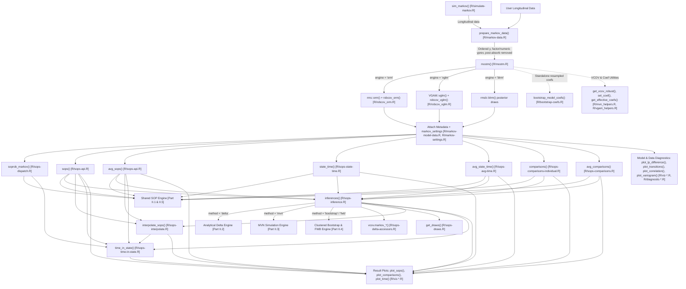

---

## Core Contracts

### 1. Input Data & Internal Column Conventions

Standard longitudinal transition datasets use one row per patient transition:

- **Primary state & index columns**: `id` (patient identifier, or `id_var`), `time` (visit index or factor/character visit label, or `time_var`), `y` (current state), `yprev` (state at the previous visit, or `p_var`), optional second-order lag column (`p2_var`, state two visits back), and optional `gap_var` (continuous elapsed duration since the previous visit).
- **Reserved internal columns**:
  - `.mostr_prior_weight`: Stored on `markov_refit_data` by `mostm()` (`markov_prior_weight_column()` in `R/markov-model-data.R`) whenever `weights` was supplied at fit time, preserving observation weights across bootstrap refits.
  - `.mostr_weight`: Temporary weight column used internally during marginalization in `marginalize_sops_array()` / `array_to_df_individual()` (`R/sops-result-helpers.R`) and weighted inference reductions.
  - `.mostr_observed_<var>`: Temporary copy of a variable modified in `variables` when `avg_comparisons(..., by = "<var>")` groups by patients' observed baseline values (`observed_by_column()` in `R/sops-result-helpers.R`), later restored to `<var>` via `restore_observed_by_names()`.
  - `.markov_*` prefix (specifically `.markov_source_row`): Internal bookkeeping columns identified by `markov_internal_column()` and stripped from user-facing results via `drop_markov_internal_columns()` (`R/markov-model-data.R`).
  - `rowid` / `rowidcf`: Row identifiers attached by `ensure_markov_rowid()` and `stack_prediction_profiles()` (`R/sops-result-helpers.R`) to align individual profiles across counterfactual scenarios.

### 2. Fitted Model Metadata Contract (`mostm()`)

Every model returned by `mostm()` is either a native `orm` or `blrm` object, or a `robcov_vglm` wrapper around `VGAM::vglm()` (or an unrobustified fit when `coefficients_only = TRUE` or `engine = "blrm"`). `mostm()` records immutable fit provenance on the returned object via `markov_attach_model_data()`, `markov_set_settings()`, and `markov_set_engine()` (`R/markov-model-data.R`, `R/markov-settings.R`):

| Attribute Name | Reader Helper | Purpose |
| :--- | :--- | :--- |
| `markov_engine` | `markov_model_engine()` | Fit provenance (`"orm"`, `"vglm"`, or `"blrm"`). SOP/inference functions refuse fits lacking this attribute unless it is present on `model$vglm_fit`. |
| `markov_settings` | `markov_model_settings()` | Validated `markov_settings` list recording column names, Markov `order`, `y_levels`, `absorb`, `gap_var`, and `from_fit`. |
| `markov_id_var` | `markov_model_id_var()`, `markov_require_id_var()` | Patient cluster ID column name used for robust SEs, cohort alignment, and bootstrap clustering. |
| `markov_data` | `markov_model_data()` | Aligned model rows (`data` subsetted to rows actually retained by `na.action` and `subset` in the fitted model frame). |
| `markov_refit_data` | `markov_model_refit_data()` | Stored longitudinal data filtered to fitted patient IDs (excluding patients dropped on every row), plus `.mostr_prior_weight` if weights were used, ready for cluster resampling. |
| `markov_starting_profile_data` | Accessed via `markov_validate_starting_profiles()` | Exactly one baseline/starting-profile row per fitted patient at `first_followup_time`, carrying `.markov_source_row`. |
| `markov_starting_profile_metadata` | `markov_model_starting_profile_metadata()` | List containing `id_var`, `first_followup_time`, `required_variables`, `predictor_variables`, and `fitted_ids`. |
| `markov_refit_args` | `markov_model_refit_args()` | Pre-evaluated `mostm()` / engine arguments captured by `markov_capture_refit_args()` so bootstrap refits need not re-evaluate expressions in the original calling frame. |
| `markov_prior_weight_column` | `markov_model_prior_weight_column()` | Name of the stored prior-weight column (`.mostr_prior_weight`) when non-null `weights` was supplied. |

All metadata accessors use `markov_model_metadata_attr()`, which checks `attr(model, name, exact = TRUE)` first and falls back to `attr(model$vglm_fit, name, exact = TRUE)` for `robcov_vglm` objects.

### 3. `markov_settings` Contract

Created by `markov_settings()` (`R/markov-settings.R`), this S3 list of class `"markov_settings"` eliminates positional column-argument drift across SOP, comparison, inference, and diagnostic modules:

- **Fields**: `id_var`, `time_var` (default `"time"`), `p_var` (default `"yprev"`), `p2_var` (`NULL` for first-order, column name for second-order), `order` (`1L` or `2L`), `y_levels` (character labels in fitted state order), `absorb` (absorbing state labels), `gap_var` (`NULL` or elapsed-gap column name), `from_fit` (character vector of fields locked by `mostm()`).
- **Resolution**: Public SOP, comparison, and diagnostic functions call `resolve_markov_settings(model, ...)`, ensuring `y_levels`, `absorb`, `gap_var`, and `p2_var` come from the fit and rejecting conflicting user arguments in diagnostic plots (`stop_setting_contradicts_fit()`, `stop_y_levels_contradict_fit()`).
- **Replay**: Results stamp their effective settings into `attr(result, "settings")` via `set_sops_attrs()` (`R/sops-result-helpers.R`) and read them back with `markov_result_settings()` during `inferences()`, `time_in_state()`, `interpolate_sops()`, and `vcov()`.

### 4. Result S3 Classes & Attribute Contracts

Six primary estimate classes inherit from `"data.frame"` and are constructed via `set_sops_attrs()` (`R/sops-result-helpers.R`), while derived or model-wrapper objects carry dedicated S3 classes:

| S3 Class | Producer(s) | Key Identifiers & Attributes | Registered S3 Methods |
| :--- | :--- | :--- | :--- |
| `robcov_vglm` | `robcov_vglm()`, `mostm(engine = "vglm")` | List holding `vglm_fit`, `coefficients`, `var`, `se`, `model_vcov`, `bread`, `meat`, `scores`, `scores_clustered`, `influence_beta_obs`, `cluster_var`, `n_clusters`, `type`, `cadjust` | `coef.robcov_vglm`, `print.robcov_vglm`, `summary.robcov_vglm`, `vcov.robcov_vglm`, `set_coef.robcov_vglm` |
| `markov_sops` | `sops()` | Individual SOP rows (`rowid`, `time`, `state`, `estimate`, predictors); replay attrs `model`, `call_args`, `settings`, `newdata_orig`, `avg_args` | `vcov.markov_sops` |
| `markov_avg_sops` | `avg_sops()` | Marginalized SOP rows (`time`, `state`, counterfactual `variables`, optional `by`, `estimate`); replay attrs + `avg_args`, `newdata_pred`, `refit_data`, `newdata_supplied` (plus `posterior_summary` for `blrm`) | `vcov.markov_avg_sops` |
| `markov_state_time` | `state_time()` | Patient-level expected time in state (`rowid`, `state_set`, profile cols, `estimate`); stamped by `set_avg_comparison_attrs()` (`R/sops-comparisons-setup.R`) with `model`, `avg_args`, `comparison_args`, `newdata_orig`, `newdata_pred`, `refit_data`, `newdata_supplied`, `comparison_baseline_data`, `comparison_grid`, `comparison_n_each`, `call_args`, `settings` (plus posterior attrs for `blrm`) | `vcov.markov_state_time` |
| `markov_avg_state_time` | `avg_state_time()` | Population-average expected time in state (`state_set`, optional `by`, `variables`, `estimate`); stamped by `set_avg_time_attrs()` (`R/sops-avg-time.R`), inheriting attributes from `markov_avg_sops` (excluding `draws`, `analytical`, `baseline_anchor_draws`) and adding `time_args` and `follow_up` | `vcov.markov_avg_state_time` |
| `markov_comparisons` | `comparisons()` | Patient-level counterfactual contrasts (`estimand`, `term`, `contrast`, optional `time`/`state`/`state_set`, `estimate`); stamped by `set_avg_comparison_attrs()` (`R/sops-comparisons-setup.R`) with the same metadata set as `markov_state_time` | `vcov.markov_comparisons` |
| `markov_avg_comparisons` | `avg_comparisons()` | Marginal counterfactual contrasts; stamped by `set_avg_comparison_attrs()` (`R/sops-comparisons-setup.R`) with `model`, `avg_args`, `comparison_args` (`estimand`, `state_sets`, `comparison`, `include_re`, `n_draws`, `seed`, `posterior_summary`, `conf_level`, `time_map`, `baseline_time`, `target_times`, `time_unit`, `extra_args`), `newdata_orig`, `newdata_pred`, `refit_data`, `newdata_supplied`, `comparison_baseline_data`, `comparison_grid`, `comparison_n_each`, `call_args`, `settings` (plus posterior attrs for `blrm`) | `vcov.markov_avg_comparisons` |
| `markov_interpolated_sops` | `interpolate_sops()` | Prepended (`c("markov_interpolated_sops", class(x))`); adds `time_map`, `baseline_time`, optional interpolated `draws`, `baseline_anchor`, `baseline_anchor_draws` | Inherits inner `markov_*` attributes (refused by `inferences()`) |
| `data.frame` / array | `time_in_state()`, `soprob_markov()`, `get_draws()`, `bootstrap_model_coefs()` | `soprob_markov()` returns a 3D numeric array `[patient, time, state]` for frequentist fits or a 4D numeric array `[draw, patient, time, state]` for `blrm` fits; `time_in_state()` returns an array summary, `data.frame`, or updated input class | Standard base R / `data.frame` methods |

**Standard Estimate & Inference Columns (`inference_columns()` in `R/sops-result-helpers.R`)**:
`estimate`, `std.error`, `statistic`, `p.value`, `s.value`, `conf.low`, `conf.high`.

**Inference & Posterior Metadata (`inference_attributes()` in `R/sops-result-helpers.R`)**:
When `inferences()` runs, `clear_inference_results()` strips all prior non-`estimate` inference columns and these attributes before re-computing:
`analytical`, `draws`, `baseline_anchor`, `baseline_anchor_draws`, `method`, `engine`, `n_draws`, `n_successful`, `conf_level`, `conf_type`, `null`, `target`, `covariance_source`, `covariance_metadata`, `fwb_weight_type`, `fwb_weight_scale`, `draw_weights_attached`, `draw_weight_col`, `draw_weight_omission_reason`.
(Posterior results from `blrm` models carry overlapping names such as `draws`, `method = "posterior"`, `conf_level`, and `conf_type` directly from `sops()` / `avg_sops()` / `comparisons()` / `avg_comparisons()`, without passing through `clear_inference_results()`.)

### 5. Memory & Splitting Options (`mostr_options` in `R/mostr-options.R`)

All options are read via `getOption("mostr.<name>", <default>)` where needed:

| Option | Default | Role |
| :--- | :--- | :--- |
| `mostr.max_batched_design_rows` | `5e4` | Row threshold per visit switching `compile_sop_execution_plan()` / `run_sop_execution_plan()` between building all previous-state design matrices in one batch vs. one previous state at a time (identical results). |
| `mostr.second_order_working_bytes` | `32 * 1024^2` (32 MiB) | Per-chunk working buffer cap inside the R second-order recursion (`soprob_markov_second_order_run()` in `R/sops-engine.R`); peak memory is roughly 6x this setting (identical results). |
| `mostr.execution_plan_max_bytes` | `256 * 1024^2` (256 MiB) | Maximum total design-matrix bytes retained in memory by compiled execution plans (`preflight_execution_plan_designs()`). Above this limit, point predictions fall back to `soprob_markov_r_engine()` and `inferences(method = "delta")` aborts with the required size. |
| `mostr.delta_max_bytes` | `256 * 1024^2` (256 MiB) | Maximum single allocation for analytical derivatives, native delta workspaces, and `vcov()` blocks, enforced via `delta_max_bytes()`, `delta_assert_bytes()`, and `stop_sop_delta_too_large()` (`R/sops-delta-core.R`). |
| `mostr.posterior_working_bytes` | `256 * 1024^2` (256 MiB) | Working-memory budget for grouping `blrm` posterior draws in `posterior_chunk_size()` (`R/sops-api.R`). |
| `mostr.max_sops_draw_cells` | `5e7` (~400 MB) | Hard cell cap (`n_draws * n_profiles * n_times * n_states`) on retained posterior draw arrays, checked inline in `sops_blrm()` (`R/sops-api.R`) and in `validate_comparison_draw_cells()` (`R/sops-comparisons-individual-inference.R`). |

### 6. Structured Error Handling (`mostr_abort()` in `R/mostr-abort.R`)

Every package error uses `mostr_abort(..., class = NULL, data = list(), call = mostr_error_call())` instead of `stop()`:

- **Literal messages**: Arguments in `...` are pasted with zero separator and `use_cli_format = FALSE` so `%` and `{}` never interpolate unexpectedly.
- **Class hierarchy**: Raises an `rlang_error` inheriting `c(class, "mostr_error")` (e.g., `class = "mostr_crossed_thresholds"` with structured `data` metadata in `stop_crossed_thresholds()`). Passing a caught error `mostr_abort(e)` preserves the condition while ensuring `"mostr_error"` is in its class vector.
- **Call attribution**: `mostr_error_call()` inspects the call stack and selects the innermost exported `mostr` function called from outside the namespace (or outermost exported function when called inside namespace-evaluated tests), returning `NULL` in worker subprocesses so users never see internal helper names.

---

## Part I — Exported Functions and Registered S3 Methods

Each subsection documents an exported function (and any co-located registered S3 methods) with its exact signature, return contract, `flowchart TD` orchestration diagram, function-location table, and an operational explanation of how its helpers collaborate. Shared multi-export computation engines are factored into **Part II** and cross-referenced directly.

---

### 1. `sim_markov()`

- **Defined in**: `R/simulate-markov.R` (with internal `violet_baseline` in `R/sysdata.rda` and native categorical sampling in `src/sops.cpp`)
- **Signature**:
  `sim_markov(preset, n_patients = 1000, treatment_prob = 0.5, treatment_effect = NULL, treatment_effect_decay = 0, times = 1:28, baseline_data = NULL, intercepts = NULL, lp_function = NULL, extra_params = NULL, absorb = NULL, covariate_names = NULL, seed = NULL)`
- **Return contract**: A patient-major longitudinal `data.frame` with columns `id`, `time`, `y`, all baseline columns from `baseline_data` (or sampled from the preset), and `yprev`. Absorbed patients stay in their absorbing state through remaining `times`.

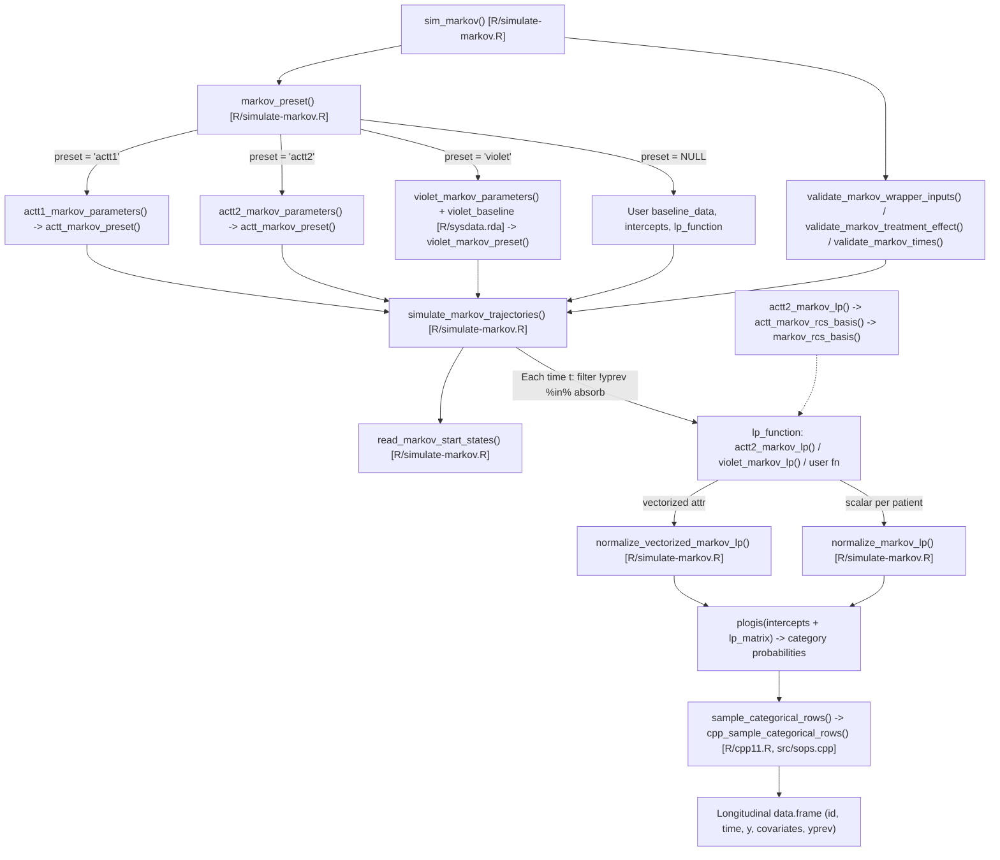

| Function | Defined In | Role in Producing Output |
| :--- | :--- | :--- |
| `sim_markov()` | `R/simulate-markov.R` | Public entrypoint validating preset vs. custom configuration, RNG seed, treatment parameters, and visit schedule. |
| `markov_preset()`, `markov_preset_names` | `R/simulate-markov.R` | Maps `"actt1"`, `"actt2"`, or `"violet"` (listed in exported-internal vector `markov_preset_names`) to preset parameter bundles or `NULL`. |
| `actt_markov_preset()`, `actt2_markov_parameters()`, `actt1_markov_parameters()` | `R/simulate-markov.R` | Supply 8-state NIAID baseline distributions, ordered cutpoints (`orm_intercepts`), and covariate/time effects (`extra_params`). |
| `actt2_markov_lp()`, `actt_markov_rcs_basis()`, `markov_rcs_basis()` | `R/simulate-markov.R` | Vectorized ACTT linear predictor evaluating a 6-knot restricted cubic spline in day plus `yprev` and `tx` effects. |
| `violet_markov_preset()`, `violet_markov_parameters()`, `violet_markov_lp()` | `R/simulate-markov.R`, `R/sysdata.rda` | Samples joint `(yprev, age, sofa)` empirically from internal `violet_baseline` and evaluates non-proportional day-spline linear predictors (`lsp(day, 2)`). |
| `validate_markov_wrapper_inputs()`, `validate_markov_treatment_effect()`, `validate_markov_times()` | `R/simulate-markov.R` | Enforce positive integer `n_patients`, `[0, 1]` `treatment_prob`, finite `treatment_effect`, nonnegative `treatment_effect_decay`, and strictly increasing positive `times`. |
| `simulate_markov_trajectories()` | `R/simulate-markov.R` | Allocates `[N x (length(times) + 1)]` state matrix and marches step-by-step across `times` for active (non-absorbed) patients before reshaping to long format. |
| `read_markov_start_states()` | `R/simulate-markov.R` | Extracts integer starting states from labels (`as.character()` for factors so levels like `"4".."7"` map to states 4..7 rather than factor codes 1..4). |
| `normalize_vectorized_markov_lp()`, `normalize_markov_lp()` | `R/simulate-markov.R` | Coerces linear-predictor outputs into finite `[n_active x n_thresholds]` matrices, expanding proportional-odds scalars across thresholds. |
| `sample_categorical_rows()`, `cpp_sample_categorical_rows()` | `R/simulate-markov.R`, `R/cpp11.R`, `src/sops.cpp` | Samples one new ordinal category per active row in C++, using R's RNG stream (`GetRNGstate`/`PutRNGstate` via `R::unif_rand`). |

**How they play together**:
`sim_markov()` first resolves whether the user chose a built-in trial preset (`"actt1"`, `"actt2"`, or `"violet"`) via `markov_preset()` or supplied a custom model (`preset = NULL` with `baseline_data`, `intercepts`, and `lp_function`). Any explicit override (`baseline_data`, `intercepts`, `treatment_effect`, `covariate_names`) replaces that piece of the preset. After validating scalars and `times`, setting an optional seed once, and sampling baseline rows (for `"violet"`, preserving the empirical joint correlation of starting state, age, and SOFA from `violet_baseline`), `simulate_markov_trajectories()` steps through each `t` in `times`. At each transition, only active patients (`!yprev %in% absorb`) are evaluated by `lp_function` with decayed treatment effect `treatment_effect * exp(-treatment_effect_decay * (t - 1))`. Cumulative probabilities `plogis(intercepts + lp)` are checked against `-1e-12` for non-crossing, differenced into state probabilities, sampled in C++ via `cpp_sample_categorical_rows()`, carried forward into absorbed rows, and flattened into patient-major longitudinal rows.

---

### 2. `prepare_markov_data()`

- **Defined in**: `R/markov-data.R`
- **Signature**: `prepare_markov_data(data, absorb, ordered_response = TRUE, factor_previous = TRUE, y_var = "y", p_var = "yprev")`
- **Return contract**: Filtered `data.frame` containing only transitions starting from non-absorbing `p_var` states, with `y_var` converted to an ordered factor (if requested) and `p_var` converted to a factor (if requested).

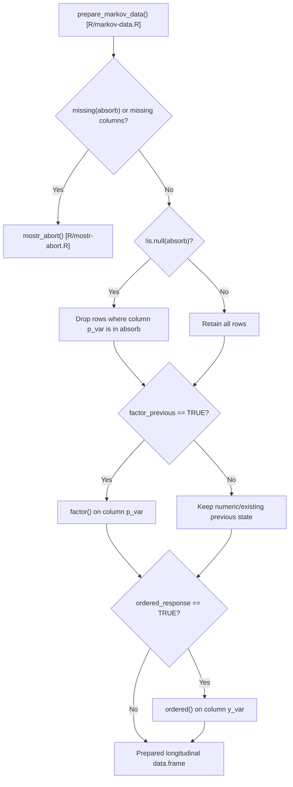

| Function | Defined In | Role in Producing Output |
| :--- | :--- | :--- |
| `prepare_markov_data()` | `R/markov-data.R` | Validates required `absorb` and column names, removes post-absorbing transitions, and formats state columns for `mostm()`. |
| `mostr_abort()` | `R/mostr-abort.R` | Signals structured `mostr_error` if `absorb` is omitted or `y_var` / `p_var` is missing from `data`. |

*(Related internal helpers in `R/markov-data.R` — `drop_absent_states()`, `observed_state_labels()`, `state_factor()`, and `state_column_labels()` — are used by `mostm()` validation and cluster-bootstrap refits rather than by `prepare_markov_data()` itself.)*

**How they play together**:
Unlike naive longitudinal filtering, `prepare_markov_data()` explicitly requires `absorb` (even `NULL` when there are no absorbing states) so death states are never silently misidentified. Checking `c(y_var, p_var) %in% names(data)` before subsetting guarantees a misspelled `p_var` does not accidentally evaluate `NULL %in% absorb` and empty the dataset. Filtering out rows with `data[[p_var]] %in% absorb` leaves the absorbing entry row intact while excluding deterministic self-transitions afterward, and optional coercion prepares ordered responses (`VGAM::vglm()` requirement) and categorical/numeric previous states before `mostm()`.

---

### 3. `mostm()`

- **Defined in**: `R/mostm.R` (with engine helpers in `R/vglm_helpers.R`, `R/robcov_orm.R`, `R/robcov_vglm.R`, `R/markov-model-data.R`, `R/markov-settings.R`)
- **Signature**:
  `mostm(formula, data, ..., engine = c("orm", "vglm", "blrm"), id_var, time_var = "time", p_var = "yprev", p2_var = NULL, absorb = NULL, gap_var = NULL, first_followup_time = NULL, weights = NULL, subset = NULL, type = c("HC0", "HC1"), cadjust = NULL)`
- **Return contract**: A fitted transition model object (`orm` for `"orm"`, `robcov_vglm` wrapping `vglm` for `"vglm"`, `blrm` for `"blrm"`, or unrobustified `orm`/`vglm` during coefficient-only bootstrap refits) stamped with full provenance, data, starting profiles, and `markov_settings`.

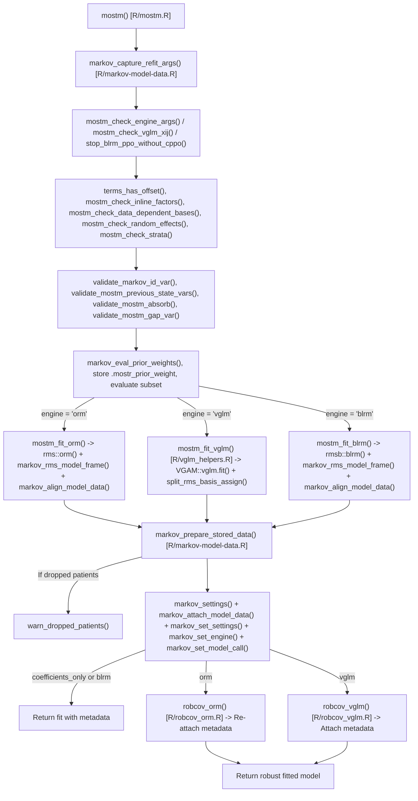

| Function | Defined In | Role in Producing Output |
| :--- | :--- | :--- |
| `mostm()` | `R/mostm.R` | Main model-fitting orchestrator capturing refit arguments, validating formulas/columns/weights, dispatching to engines, attaching metadata, and computing patient-clustered sandwich covariances. |
| `markov_capture_refit_args()` | `R/markov-model-data.R` | Evaluates and stores user arguments (except `data`, `subset`, `weights`, `etastart`, `mustart`, `offset`) so bootstrap refits replay deterministically. |
| `mostm_check_engine_args()`, `mostm_engine_args()`, `mostm_fixed_args()`, `mostm_check_vglm_xij()`, `vglm_categorical_control()`, `stop_blrm_ppo_without_cppo()` | `R/mostm.R` | Reject unnamed `...`, cross-engine arguments, kept `x`/`y` flags, `offset`, VGAM `xij`/`form2`, and unconstrained `blrm` `ppo` without `cppo`. |
| `mostm_check_inline_factors()`, `mostm_check_data_dependent_bases()`, `mostm_check_random_effects()`, `mostm_check_strata()`, `formula_inline_factor_calls()`, `formula_rhs_calls()` | `R/mostm.R` | Pre-flight AST formula checks blocking silent prediction bugs: inline `factor()` in `orm`/`blrm`, data-dependent `ns()`/`bs()`/`poly()` without `raw = TRUE` in `orm`/`blrm`, unsupported `cluster()`/`mix_re()`, and Cox `strat()`. |
| `validate_mostm_previous_state_vars()`, `validate_mostm_absorb()`, `validate_mostm_gap_var()`, `warn_outcome_only_states()`, `state_column_labels_sorted()` | `R/markov-settings.R` | Validate lag columns (`p_var`, `p2_var`), ensure `absorb` labels exist in observed state columns (refusing transitions leaving absorbing states), and validate nonnegative finite `gap_var`. |
| `markov_eval_prior_weights()`, `markov_prior_weight_column()`, `mostm_subset_row_index()` | `R/markov-model-data.R`, `R/mostm.R` | Evaluate `weights` and `subset` in caller frame once, storing `.mostr_prior_weight` inside `data` and rejecting zero weights on `vglm`. |
| `mostm_fit_orm()`, `mostm_fit_blrm()`, `markov_rms_model_frame()`, `markov_align_model_data()`, `stop_failed_orm_fit()`, `suppress_orm_weights_warning()` | `R/mostm.R`, `R/markov-model-data.R`, `R/robcov_orm.R` | Fit `rms::orm(..., x = TRUE, y = TRUE)` or `rmsb::blrm(..., x = TRUE, y = TRUE)` and align the exact non-omitted rows via model-frame rownames. |
| `mostm_fit_vglm()`, `add_rms_formula_helpers()`, `split_rms_basis_assign()`, `rms_basis_handlers_for_term()`, `rms_basis_registry()`, `vglm_family_parallel_term_labels()`, `stop_parallel_formula_on_split_basis()`, `make_vgam_vcontrol_eval()` | `R/vglm_helpers.R`, `R/sops-basis-registry.R` | Expose `rms::rcs()`, `rms::lsp()`, and `%ia%` to `vglm` formulas; handle per-basis-column PPO constraint assignments cleanly; construct S4 `vglm` object. |
| `markov_prepare_stored_data()`, `markov_subset_source_data()`, `markov_first_followup_time()`, `warn_dropped_patients()` | `R/markov-model-data.R`, `R/mostm.R` | Identify the fitted cohort, build filtered `refit_data`, extract one starting profile row per fitted patient at `first_followup_time` (with `.markov_source_row`), and warn on completely dropped patients. |
| `markov_settings()`, `markov_set_settings()`, `markov_attach_model_data()`, `markov_set_engine()`, `markov_set_model_call()` | `R/markov-settings.R`, `R/markov-model-data.R`, `R/mostm.R` | Construct locked `markov_settings` (`from_fit` fields) and stamp all provenance attributes onto the fitted object. |
| `robcov_orm()`, `robcov_vglm()` | `R/robcov_orm.R`, `R/robcov_vglm.R` | Compute patient-clustered sandwich covariance (`type`, `cadjust`) anchored on `id_var` for `"orm"` (logit link) and `"vglm"` fits. |

**How they play together**:
`mostm()` acts as the single validated gatekeeper for the entire package. Before fitting, it inspects both `...` engine arguments and the right-hand side of `formula` (including `ppo` for `blrm`) so mismatches such as unstored `splines::ns()` knots or Cox `strat()` terms fail immediately instead of corrupting downstream SOP recursions. It evaluates `weights` and `subset` once in the caller frame, embedding `.mostr_prior_weight` inside `data` so bootstrap resamples retain exact row weights. After fitting with `"orm"`, `"vglm"` (via `mostm_fit_vglm()`, which also bridges `rms::rcs()`, `rms::lsp()`, and `%ia%` into VGAM), or `"blrm"`, `markov_prepare_stored_data()` constructs both `refit_data` (fitted patients only) and `starting_profile_data` (exact designated starting visit rows). Finally, unless running inside a lightweight `coefficients_only` bootstrap refit or Bayesian `"blrm"`, it attaches patient-clustered robust covariances via `robcov_orm()` or `robcov_vglm()`, preserving all fit attributes across the outer object.

---

### 4. `soprob_markov()`

- **Defined in**: `R/sops-dispatch.R`
- **Signature**: `soprob_markov(model, newdata, times = NULL, include_re = FALSE, n_draws = 100L, seed = NULL, ...)`
- **Return contract**: For `"orm"` and `"vglm"`, a 3D numeric array `[patient, time, state]` with `dimnames` `(rownames(newdata), times, y_levels)`. For `"blrm"`, a 4D numeric array `[draw, patient, time, state]`. Unlike `sops()`, suppresses skipped-visit warnings.

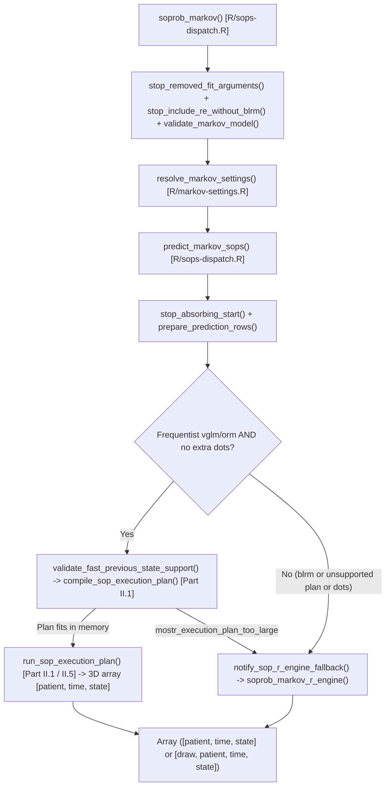

| Function | Defined In | Role in Producing Output |
| :--- | :--- | :--- |
| `soprob_markov()` | `R/sops-dispatch.R` | Low-level public entrypoint returning raw state-occupancy probability arrays without data-frame tidying or visit-skip warnings. |
| `stop_removed_fit_arguments()` | `R/markov-settings.R` | Rejects legacy per-call override arguments (`id_var`, `time_var`, `p_var`, `p2_var`, `absorb`, `y_levels`, `gap_var`) removed in favor of `mostm()` fit metadata. |
| `stop_include_re_without_blrm()`, `validate_markov_model()` | `R/sops-backends.R` | Enforce `mostm()` provenance, reverse cumulative logit link on `vglm`, logistic link on `orm`, and block `include_re = TRUE` outside `blrm`. |
| `resolve_markov_settings()`, `stop_no_fitted_states()` | `R/markov-settings.R` | Reads locked `markov_settings` from the fitted model and ensures non-empty `y_levels`. |
| `predict_markov_sops()`, `stop_absorbing_start()`, `prepare_prediction_rows()`, `validate_fast_previous_state_support()` | `R/sops-dispatch.R` | Core internal SOP array engine shared by all package estimators; refuses absorbing starts, checks non-missing predictors, normalizes previous states, dispatches to compiled execution plan (**Part II.1**) or `soprob_markov_r_engine()` fallback. |

**How they play together**:
`soprob_markov()` acts as the array-returning sister to `sops()`: after verifying model provenance, link functions, and fit settings, it delegates directly to `predict_markov_sops()`. Inside `predict_markov_sops()`, input rows are checked for absorbing starting states (`stop_absorbing_start()`) and missing predictors (`stop_missing_predictors()`), and previous-state columns are coerced to the fitted types (`normalize_prediction_states()`). For `"orm"` and `"vglm"` fits without internal posterior dots, it attempts to build a reusable design-matrix execution plan via `compile_sop_execution_plan()` and run C++/R fast propagation via `run_sop_execution_plan()`; if the design matrices exceed `mostr.execution_plan_max_bytes`, it notifies via `notify_sop_r_engine_fallback()` and computes the exact same result row-by-row/visit-by-visit using `soprob_markov_r_engine()`. Bayesian `"blrm"` models go directly to `soprob_markov_r_engine()`.

---

### 5. `sops()`

- **Defined in**: `R/sops-api.R`
- **Signature**:
  `sops(model, newdata = NULL, times, variables = NULL, by = FALSE, include_re = FALSE, n_draws = 100L, seed = NULL, posterior_summary = c("mean", "median"), conf_level = 0.95, return_draws = FALSE, ...)`
- **Return contract**: With `by = FALSE` (or `NULL`), a `markov_sops` data frame (`rowid`, optional `rowidcf` when `variables` is supplied, profile columns without `.markov_*`, `time`, `state`, `estimate`, plus posterior uncertainty columns if `"blrm"`) stamped via `set_sops_attrs()`. With `by = TRUE` or grouping columns, delegates to `avg_sops_impl()` and returns `markov_avg_sops`.

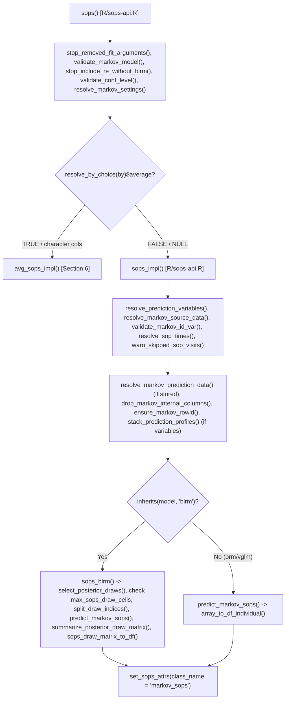

| Function | Defined In | Role in Producing Output |
| :--- | :--- | :--- |
| `sops()` | `R/sops-api.R` | Public individual-SOP entrypoint; validates arguments/settings and routes averaging `by` requests to `avg_sops_impl()`. |
| `sops_impl()` | `R/sops-api.R` | Core unaveraged worker handling variable stacking, stored vs. supplied profile resolution, visit checks, and dispatch to frequentist or Bayesian paths. |
| `sops_blrm()` | `R/sops-api.R` | Enforces `mostr.max_sops_draw_cells`, chunks posterior draws via `posterior_chunk_size()` / `split_draw_indices()`, shares first-order `prediction_cache`, summarizes intervals, and optionally attaches `draws`. |
| `resolve_prediction_variables()`, `stack_prediction_profiles()`, `drop_markov_internal_columns()`, `ensure_markov_rowid()`, `array_to_df_individual()`, `set_sops_attrs()` | `R/sops-comparisons-setup.R`, `R/sops-result-helpers.R`, `R/markov-model-data.R` | Resolve bare variable names, expand `newdata` across counterfactual `variables` with `rowid`/`rowidcf`, strip `.markov_*` bookkeeping columns, and reshape arrays into `markov_sops` data frames with replay metadata. |
| `select_posterior_draws()`, `cache_blrm_gamma_draws()`, `subset_cached_draw_matrix()`, `summarize_posterior_draw_matrix()`, `sops_draw_matrix_to_df()` | `R/sops-backends.R`, `R/sops-api.R` | Draw management and posterior quantile/mean/median/SD summarization for `"blrm"` models. |

**How they play together**:
`sops()` resolves fit settings cleanly and immediately checks `resolve_by_choice(by)` so `sops(..., by = TRUE)` and `avg_sops(...)` produce identical `markov_avg_sops` outputs. For individual predictions, `sops_impl()` fetches either user `newdata` or `mostm()`'s stored cohort (`resolve_markov_source_data()` / `resolve_markov_prediction_data()`), strips `.markov_*` internal bookkeeping columns, stamps `rowid`, and stacks counterfactual combinations via `stack_prediction_profiles()` if `variables` is non-null. Frequentist fits call `predict_markov_sops()` once and convert the 3D array with `array_to_df_individual()`. Bayesian `blrm` fits enter `sops_blrm()`, which verifies the draw-cell memory budget (`mostr.max_sops_draw_cells`), caches first-order design matrices and `cluster()` random-effect draws across chunks (`split_draw_indices()`), computes cell-wise posterior summaries, and stores `newdata_pred` + `call_args` + `settings` so `inferences()`, `time_in_state()`, `interpolate_sops()`, and `vcov()` can operate seamlessly afterward.

---

### 6. `avg_sops()`

- **Defined in**: `R/sops-api.R`
- **Signature**:
  `avg_sops(model, newdata = NULL, variables = NULL, by = TRUE, times, include_re = FALSE, n_draws = 100L, seed = NULL, posterior_summary = c("mean", "median"), conf_level = 0.95, return_draws = FALSE, ...)`
- **Return contract**: With `by = FALSE` (or `NULL`), delegates to `sops_impl()` and returns `markov_sops`. Otherwise returns a `markov_avg_sops` data frame (`time`, `state`, set `variables`, grouping `by` columns, `estimate`, plus posterior intervals for `"blrm"`).

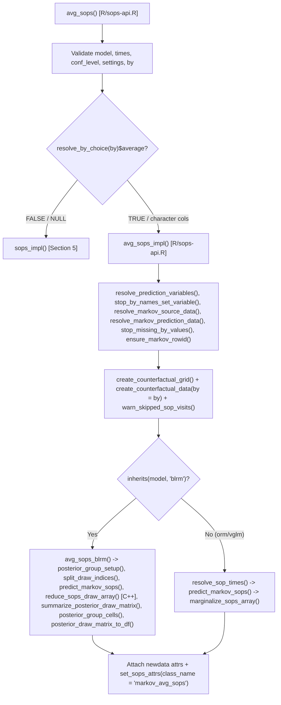

| Function | Defined In | Role in Producing Output |
| :--- | :--- | :--- |
| `avg_sops()` | `R/sops-api.R` | Public population-average (G-computation) SOP entrypoint; delegates `by = FALSE` back to `sops_impl()`. |
| `avg_sops_impl()` | `R/sops-api.R` | Resolves baseline profiles, guards against missing `by` values and `by` vs. `variables` column clashes, builds stacked counterfactual datasets, and invokes frequentist or Bayesian marginalization. |
| `avg_sops_blrm()` | `R/sops-api.R` | Streams `"blrm"` posterior chunks into `reduce_sops_draw_array()` (`cpp_reduce_sops_draws`) to marginalize on-the-fly by `(variables, by)` groups without materializing huge `[draw x profile x time x state]` arrays. |
| `stop_by_names_set_variable()`, `stop_missing_by_values()`, `create_counterfactual_grid()`, `create_counterfactual_data()`, `marginalize_sops_array()` | `R/sops-result-helpers.R` | Enforce `by` invariants and marginalize frequentist `[n_cf * n_each x time x state]` arrays cleanly with equal or supplied profile weights. |
| `posterior_group_setup()`, `posterior_group_cells()`, `posterior_draw_matrix_to_df()`, `posterior_chunk_size()`, `reduce_sops_draw_array()` | `R/sops-api.R`, `R/sops-native.R` | Precompute complete-case group index maps (`1..n_groups`) and aggregate draw arrays directly in C++. |

**How they play together**:
`avg_sops()` implements parametric G-computation over the baseline cohort (`newdata` or `mostm()`'s stored starting profiles). After verifying that no `by` column contains `NA` values (`stop_missing_by_values()`, which would silently drop patients from subgroup averages) and that `by` does not collide with columns modified by `variables` (`stop_by_names_set_variable()`), `avg_sops_impl()` expands every baseline profile across each combination in `variables`. For `"orm"` and `"vglm"`, `marginalize_sops_array()` averages the predicted `[profile x time x state]` array directly within each counterfactual block or `by` group. For `"blrm"`, `avg_sops_blrm()` allocates output space only at the marginalized `(group x time x state)` resolution, chunks posterior draws via `posterior_chunk_size()`, and reduces each chunk immediately with `cpp_reduce_sops_draws` via `reduce_sops_draw_array()`. Result metadata (`avg_args`, `newdata_pred`, `refit_data`) enable downstream replay in `inferences()`, `avg_state_time()`, and `avg_comparisons()`.

---
### 7. `avg_state_time()`

- **Defined in**: `R/sops-avg-time.R`
- **Signature**:
  `avg_state_time(model, newdata = NULL, variables = NULL, state_sets = NULL, by = TRUE, times, time_map = NULL, baseline_time = 0, target_times = NULL, time_unit = NULL, include_re = FALSE, n_draws = 100L, seed = NULL, posterior_summary = c("mean", "median"), conf_level = 0.95, return_draws = FALSE, ...)`
- **Return contract**: With `by = FALSE` (or `NULL`), delegates to `state_time()` and returns `markov_state_time`. Otherwise returns a `markov_avg_state_time` data frame (`state_set`, optional `variables`/`by`/`time_unit`, `estimate`, plus posterior summaries for `blrm`), carrying `time_args` and `follow_up` attributes.

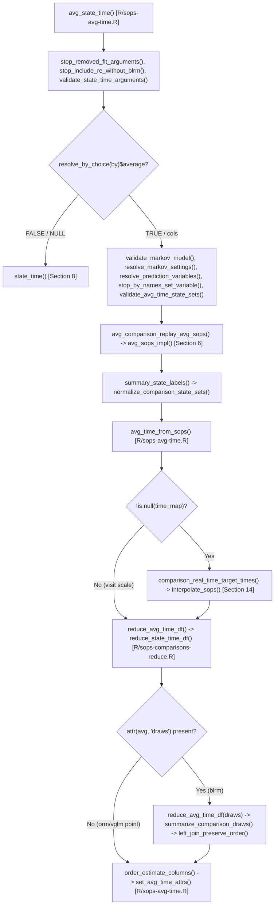

| Function | Defined In | Role in Producing Output |
| :--- | :--- | :--- |
| `avg_state_time()` | `R/sops-avg-time.R` | Public entrypoint validating time-integration flags, reserved columns, and `state_sets` before delegating to average SOP computation and reduction. |
| `validate_state_time_arguments()`, `validate_avg_time_state_sets()` | `R/sops-avg-time.R` | Reject duplicate `times`, `baseline_time` or `target_times` without `time_map`, invalid `time_unit`, and empty/unnamed/duplicated `state_sets`. |
| `avg_comparison_replay_avg_sops()` | `R/sops-comparisons-setup.R` | Computes the underlying `markov_avg_sops` table via `avg_sops_impl()` (retaining `draws` whenever `model` is `blrm`). |
| `summary_state_labels()`, `normalize_comparison_state_sets()` | `R/sops-interpolate.R`, `R/sops-comparisons-setup.R` | Expand state vocabulary with any unobserved starting states anchored at `baseline_time` and normalize `state_sets` labels. |
| `avg_time_from_sops()`, `reduce_avg_time_df()` | `R/sops-avg-time.R` | Computes `follow_up` span, optionally calls `interpolate_sops()`, sums visit SOPs or integrates trapezoidal real-time curves per state set, and summarizes Bayesian/resampling draws when present. |
| `comparison_real_time_target_times()`, `reduce_state_time_df()`, `aggregate_value()`, `aggregate_auc()`, `summarize_comparison_draws()` | `R/sops-comparisons-reduce.R` | Build default integration grids (`baseline_time` + mapped visits), sum within state sets and times, and summarize draw-level totals. |
| `set_avg_time_attrs()` | `R/sops-avg-time.R` | Copies replay attributes from `avg` (excluding stale draw/analytical attrs), stores `time_args`, and sets class `"markov_avg_state_time"`. |

*(Internal helpers `replay_avg_time_sops()` and `inferences_avg_time()` in `R/sops-avg-time.R` are invoked later during `inferences()`.)*

**How they play together**:
Rather than duplicating the marginal SOP loop, `avg_state_time()` computes average total time in states directly on top of `avg_sops_impl()`. On the visit scale (`time_map = NULL`), `reduce_avg_time_df()` sums occupancy probabilities over the requested visits within each state set. When `time_map` is supplied, `avg_time_from_sops()` first maps and linearly interpolates SOPs (and baseline-anchored starting states) via `interpolate_sops()` onto `target_times`, then integrates with `trapezoid_auc()` (`aggregate_auc()`). For Bayesian `blrm` fits, `return_draws = TRUE` is forced on the intermediate `avg_sops_impl()` call so that each posterior draw is integrated independently before calling `summarize_comparison_draws()`, preserving exact total follow-up additivity on each draw.

---

### 8. `state_time()`

- **Defined in**: `R/sops-state-time.R`
- **Signature**:
  `state_time(model, newdata = NULL, variables = NULL, state_sets = NULL, by = FALSE, times, time_map = NULL, baseline_time = 0, target_times = NULL, time_unit = NULL, include_re = FALSE, n_draws = 100L, seed = NULL, posterior_summary = c("mean", "median"), conf_level = 0.95, return_draws = FALSE, ...)`
- **Return contract**: With `by = TRUE` or grouping columns, delegates to `avg_state_time()`. Otherwise returns a `markov_state_time` data frame (`rowid`, optional `rowidcf`, `state_set`, optional `time_unit`, profile covariate/starting-state columns, `estimate`, plus posterior summaries for `blrm`).

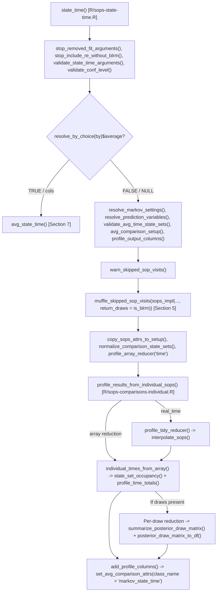

| Function | Defined In | Role in Producing Output |
| :--- | :--- | :--- |
| `state_time()` | `R/sops-state-time.R` | Public individual-profile expected-time entrypoint; delegates averaging `by` calls to `avg_state_time()`. |
| `avg_comparison_setup()`, `copy_sops_attrs_to_setup()` | `R/sops-comparisons-setup.R`, `R/sops-comparisons-reduce.R` | Resolves stored/supplied profiles, checks `absorb` starts, expands scenarios (`newdata_pred`), and syncs resolved `times`/`settings`. |
| `profile_output_columns()`, `add_profile_columns()` | `R/sops-comparisons-individual.R` | Checks for name clashes against reserved output columns (`state_set`, `time_unit`, `inference_columns()`, etc.), strips `.markov_*`/`rowid`/`rowidcf`/`time_var`, and appends profile covariates cleanly. |
| `sops_impl()` | `R/sops-api.R` | Computes individual `[profile x time x state]` SOPs (and posterior draws for `blrm`). |
| `profile_array_reducer()`, `profile_tidy_reducer()`, `profile_results_from_individual_sops()` | `R/sops-comparisons-individual.R` | Bridges tidy SOP tables and optional real-time interpolation into 4D counterfactual array reductions `[scenario, profile, time, state]`. |
| `individual_times_from_array()`, `state_set_occupancy()`, `profile_time_totals()`, `trapezoid_row_totals()` | `R/sops-comparisons-individual.R`, `R/sops-comparisons-reduce.R` | Sums state-set occupancies across time (or integrates piecewise-linear curves over real time) vectorized across all scenarios and profiles. |
| `set_avg_comparison_attrs()` | `R/sops-comparisons-setup.R` | Attaches replay metadata (`comparison_args`, `comparison_baseline_data`, `comparison_grid`, `comparison_n_each`, `settings`) with class `"markov_state_time"`. |

**How they play together**:
`state_time()` shares the profile-level array pipeline built for `comparisons()` so every profile keeps its own covariate/starting-state metadata and exact counterfactual alignment. First, `avg_comparison_setup()` resolves the baseline rows and stacks counterfactual `variables` without overwriting `baseline_data` attributes. `sops_impl()` predicts all profile-scenario combinations once (silencing duplicate visit-skip warnings already emitted by `state_time()`). `profile_results_from_individual_sops()` converts the tidy SOP table via `counterfactual_array_from_tidy()` into a 4D array `[scenario, profile, time, state]`, running `interpolate_sops()` first when `time_map` is provided, and calls `individual_times_from_array()` on the point estimates and on every posterior draw when `model` is `blrm`. Finally, `add_profile_columns()` attaches each row's covariate profile and `set_avg_comparison_attrs()` stamps unified metadata for `inferences()` and `vcov()`.

---

### 9. `avg_comparisons()`

- **Defined in**: `R/sops-comparisons.R` (orchestration in `R/sops-comparisons-setup.R`, `R/sops-comparisons-reduce.R`)
- **Signature**:
  `avg_comparisons(model, newdata = NULL, variables, estimand = c("sop", "time_in_state", "time_benefit"), state_sets = NULL, comparison = c("difference", "ratio"), by = TRUE, times, time_map = NULL, baseline_time = 0, target_times = NULL, time_unit = NULL, include_re = FALSE, n_draws = 100L, seed = NULL, posterior_summary = c("mean", "median"), conf_level = 0.95, return_draws = FALSE, ...)`
- **Return contract**: With `by = FALSE` (or `NULL`), delegates to `comparisons()`. Otherwise returns a `markov_avg_comparisons` data frame with contrast columns (`estimand`, `state_set`/`time`, `term`, `reference_level`, `comparison_level`, `contrast`, `comparison`, `estimate`, optional `by`/`time_unit`, plus posterior summaries for `blrm`), with `NA` uncertainty columns for unused model variables via `drop_unused_comparison_uncertainty()`.

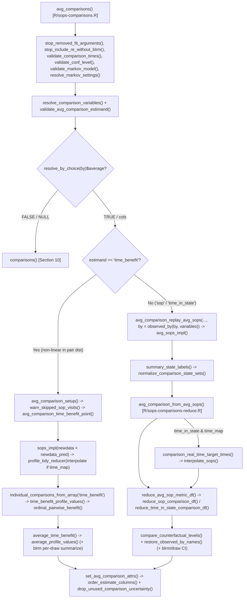

| Function | Defined In | Role in Producing Output |
| :--- | :--- | :--- |
| `avg_comparisons()` | `R/sops-comparisons.R` | Public population-average counterfactual contrast entrypoint supporting `"sop"`, `"time_in_state"`, and `"time_benefit"`. |
| `resolve_comparison_variables()`, `bare_variable_data()`, `comparison_variable_values()`, `bare_variable_values()`, `validate_avg_comparison_variables()`, `match_previous_state_variables()`, `previous_state_prototype()`, `stop_visit_columns_in_variables()`, `validate_avg_comparison_estimand()` | `R/sops-comparisons-setup.R` | Enforce single comparison variable with >= 2 distinct levels, expand bare names (`0/1`, factors, logicals, strings), forbid `time_var`/`gap_var`, coerce previous-state contrasts, and validate `time_benefit` constraints. |
| `observed_by()`, `observed_by_column()`, `add_observed_by_columns()`, `restore_observed_by_names()` | `R/sops-result-helpers.R` | Preserve observed values of a compared variable when `by` names that same variable (e.g., `by = "tx"` with `variables = list(tx = c(0, 1))`), restoring its column name after contrasts replace the set column. |
| `avg_comparison_replay_avg_sops()`, `avg_comparison_setup_from_sops()` | `R/sops-comparisons-setup.R` | Compute marginal SOPs via `avg_sops_impl()` and extract uniform setup metadata for `estimand %in% c("sop", "time_in_state")`. |
| `avg_comparison_from_avg_sops()`, `reduce_avg_sop_metric_df()`, `reduce_sop_comparison_df()`, `reduce_time_in_state_comparison_df()`, `compare_counterfactual_levels()`, `comparison_contrast_label()`, `comparison_value()` | `R/sops-comparisons-reduce.R` | Linearly aggregate marginal SOPs across `state_sets` and visits (or trapezoidal real time) and contrast every level against the reference level (`hi - lo` or `hi / lo`). |
| `avg_comparison_time_benefit_point()`, `average_time_benefit()`, `average_profile_values()`, `time_benefit_profile_values()`, `ordinal_pairwise_benefit()`, `trapezoid_row_totals()` | `R/sops-comparisons-reduce.R` | Evaluate paired counterfactual distributions per profile before averaging: computes $P(Y_{\text{trt}} \text{ better than } Y_{\text{ctrl}}) - P(Y_{\text{trt}} \text{ worse})$ at each visit, integrates across visits/real time, then averages over profiles. |
| `set_avg_comparison_attrs()`, `drop_unused_comparison_uncertainty()`, `comparison_variable_unused()` | `R/sops-comparisons-setup.R`, `R/sops-result-helpers.R` | Stamp unified replay attributes (`class = "markov_avg_comparisons"`) and blank SE/CI/test columns to `NA` if the compared variable is absent from the model formula/previous-state columns. |

**How they play together**:
`avg_comparisons()` splits sharply along linearity. For linear estimands (`"sop"` and `"time_in_state"`), averaging commutes with summation/integration across states and times, so `avg_comparisons()` delegates marginalization to `avg_comparison_replay_avg_sops()` (using `observed_by()` so `by = "tx"` groups by observed treatment even while `variables` sets counterfactual `tx`) and reduces the resulting `markov_avg_sops` table via `avg_comparison_from_avg_sops()`. In contrast, `"time_benefit"` is bilinear/nonlinear in each individual's two counterfactual state distributions, so `avg_comparison_time_benefit_point()` runs unaveraged individual SOPs (`sops_impl()`), interpolates if requested, scores every profile's pairwise ordinal win-minus-loss benefit with `ordinal_pairwise_benefit()`, and averages across profiles afterward via `average_time_benefit()`. Both paths converge in `set_avg_comparison_attrs()`.

---

### 10. `comparisons()`

- **Defined in**: `R/sops-comparisons-individual.R`
- **Signature**:
  `comparisons(model, newdata = NULL, variables, estimand = c("sop", "time_in_state", "time_benefit"), state_sets = NULL, comparison = c("difference", "ratio"), by = FALSE, times, time_map = NULL, baseline_time = 0, target_times = NULL, time_unit = NULL, include_re = FALSE, n_draws = 100L, seed = NULL, posterior_summary = c("mean", "median"), conf_level = 0.95, return_draws = FALSE, ...)`
- **Return contract**: With `by = TRUE` or grouping columns, delegates to `avg_comparisons()`. Otherwise returns a `markov_comparisons` data frame with one row per `(profile, state_set, contrast[, time])`, observed profile columns (keeping each profile's observed value even of the compared variable), `estimate`, and posterior columns for `blrm`.

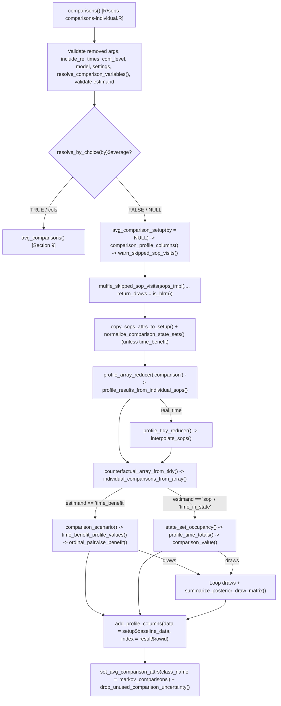

| Function | Defined In | Role in Producing Output |
| :--- | :--- | :--- |
| `comparisons()` | `R/sops-comparisons-individual.R` | Public individual-profile comparison entrypoint supporting `"sop"`, `"time_in_state"`, and `"time_benefit"`. |
| `comparison_profile_columns()`, `profile_output_columns()`, `add_profile_columns()` | `R/sops-comparisons-individual.R` | Reserve output names (adding `"time"` when `estimand == "sop"`) and copy each profile's observed baseline covariates onto contrast rows via `result$rowid`. |
| `profile_array_reducer()`, `profile_tidy_reducer()`, `profile_results_from_individual_sops()` | `R/sops-comparisons-individual.R` | Orchestrate optional `time_map` interpolation, convert tidy SOPs to `[scenario, profile, time, state]` arrays, and aggregate `blrm` posterior draws draw-by-draw. |
| `individual_comparisons_from_array()`, `scenario_slice()`, `state_set_occupancy()`, `profile_time_totals()` | `R/sops-comparisons-individual.R` | Compute per-profile contrasts against reference scenario 1 across all states/time totals or `time_benefit` distributions. |
| `counterfactual_array_from_tidy()`, `comparison_scenario()`, `time_benefit_profile_values()`, `ordinal_pairwise_benefit()`, `comparison_value()`, `comparison_contrast_label()` | `R/sops-comparisons-reduce.R` | Shared tidy-to-array mapper, ordinal win-minus-loss scoring, and arithmetic contrast builders. |
| `set_avg_comparison_attrs()` | `R/sops-comparisons-setup.R` | Stamps unified comparison metadata and drops uncertainty columns if the compared variable is unused by the model. |

**How they play together**:
`comparisons()` treats each row of `newdata` (or each stored patient baseline profile) as its own counterfactual experiment: `avg_comparison_setup()` expands every profile across every level of `variables[[1]]`, `sops_impl()` computes the `[scenario x profile]` SOPs once, and `individual_comparisons_from_array()` slices scenario 1 as the reference against scenarios `2..K`. Notice how profile columns are joined using `baseline_data[result$rowid, ]` rather than `newdata_pred`, so every row retains the profile's *observed* covariate value in that column alongside `reference_level`, `comparison_level`, and `contrast`.

---

### 11. `inferences()`

- **Defined in**: `R/sops-inference.R`
- **Signature**:
  `inferences(x, method = "mvn", n_draws = 1000, vcov = NULL, cluster = NULL, workers = NULL, seed = NULL, conf_level = 0.95, conf_type = "auto", null = "auto", return_draws = TRUE, use_coefstart = FALSE)`
- **Return contract**: Returns the input object (`markov_sops`, `markov_avg_sops`, `markov_state_time`, `markov_avg_state_time`, `markov_comparisons`, or `markov_avg_comparisons`) augmented with `std.error`, `conf.low`, `conf.high`, optional Wald hypothesis test columns (`statistic`, `p.value`, `s.value`), and either `attr(x, "draws")` (when `return_draws = TRUE` for simulation/bootstrap methods) or `attr(x, "analytical")` (for `method = "delta"`).

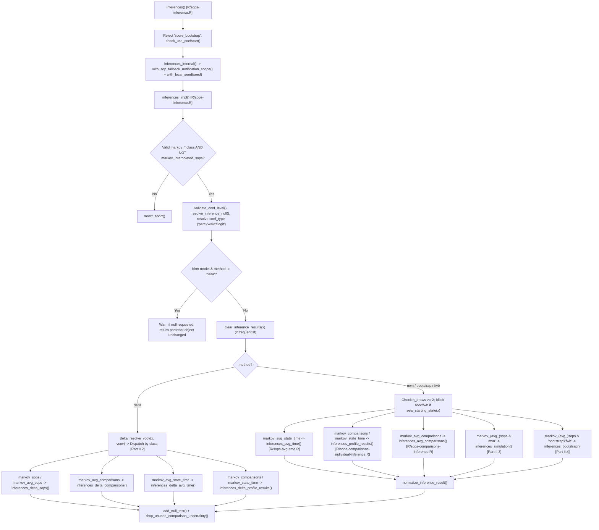

| Function | Defined In | Role in Producing Output |
| :--- | :--- | :--- |
| `inferences()`, `inferences_public_methods()`, `inferences_internal()`, `inferences_impl()` | `R/sops-inference.R` | Public and internal dispatchers validating classes, rejecting `markov_interpolated_sops` and `blrm` delta requests, seeding safely via `with_local_seed()`, scoping fallback notifications, resolving defaults, and clearing prior inference attributes. |
| `resolve_inference_null()`, `add_null_test()`, `drop_unused_comparison_uncertainty()`, `order_estimate_columns()`, `clear_inference_results()`, `normalize_inference_result()` | `R/sops-inference.R`, `R/sops-result-helpers.R` | Resolve `"auto"` null hypotheses (0 for differences, 1 for ratios), compute Wald or logit-scale `statistic`/`p.value`/`s.value` matching the interval scale, strip stale inference attrs, and enforce column order. |
| `with_local_seed()`, `with_sop_fallback_notification_scope()`, `check_use_coefstart()`, `validate_conf_level()` | `R/sops-result-helpers.R`, `R/utils.R`, `R/bootstrap_helpers.R` | Isolate RNG state restoration, deduplicate fallback warnings per inference call, and validate `use_coefstart` and `conf_level`. |
| `delta_resolve_vcov()`, `inferences_delta_sops()`, `inferences_delta_comparisons()`, `inferences_delta_avg_time()`, `inferences_delta_profile_results()` | `R/sops-delta-inference.R`, `R/sops-delta-comparisons.R`, `R/sops-delta-avg-time.R`, `R/sops-delta-comparisons-individual.R` | Analytical delta-method handlers (**Part II.2**). |
| `inferences_simulation()`, `inferences_avg_time()`, `inferences_avg_comparisons()`, `inferences_profile_results()` | `R/sops-inference.R`, `R/sops-avg-time.R`, `R/sops-comparisons-inference.R`, `R/sops-comparisons-individual-inference.R` | Dispatch draw-based inference across MVN coefficient simulation (**Part II.3**) and clustered bootstrap/FWB (**Part II.4**) for every object class. |
| `inferences_bootstrap()` | `R/sops-bootstrap-inference.R` | Clustered bootstrap and FWB inference worker for `markov_avg_sops` and `markov_sops` (**Part II.4**). |

**How they play together**:
`inferences()` separates *what estimand you want* (already encapsulated in the result object's `class`, `settings`, `model`, `newdata_pred`, `avg_args`, `comparison_args`, and `time_args`) from *how uncertainty is quantified* (`"mvn"`, `"delta"`, `"bootstrap"`, or `"fwb"`). Notice two key safeguards inside `inferences_impl()`: first, `markov_interpolated_sops` objects are refused immediately because replay happens on the fitted visit grid (`interpolate_sops(inferences(x), ...)` is the required order); second, `clear_inference_results()` strips any prior `std.error`, `analytical`, or `draws` attributes so re-running `inferences()` on an already-inferred object never leaks old metadata. Each of the six result classes routes to its dedicated handler inside **Part II**, and all handlers pass back through `add_null_test()` (aligning significance tests strictly to the chosen interval scale) and `drop_unused_comparison_uncertainty()`.

---
### 12. `vcov()` S3 Methods (`vcov.markov_*`)

- **Defined in**: `R/sops-delta-accessors.R`
- **Registered S3 methods (6)**:
  - `vcov.markov_sops(object, rows = NULL, ...)`
  - `vcov.markov_avg_sops(object, rows = NULL, ...)`
  - `vcov.markov_state_time(object, rows = NULL, ...)`
  - `vcov.markov_avg_state_time(object, rows = NULL, ...)`
  - `vcov.markov_comparisons(object, rows = NULL, ...)`
  - `vcov.markov_avg_comparisons(object, rows = NULL, ...)`
- **Return contract**: Symmetric covariance matrix `[(m x m)]` with dimnames matching the selected current rows of `object` (`current$key[selected]`), computed on demand from the low-rank `"analytical"` representation stored by `inferences(method = "delta")`.

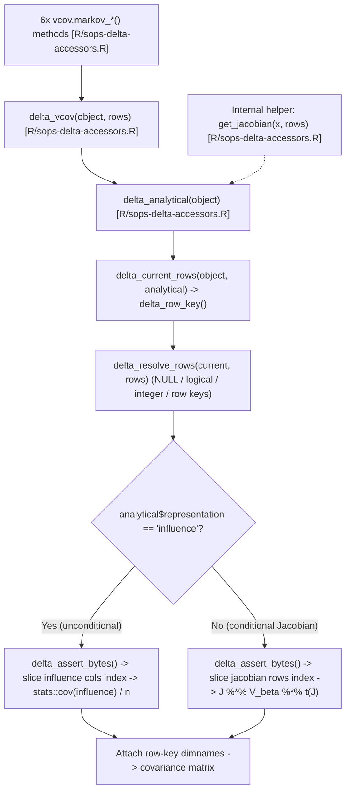

| Function | Defined In | Role in Producing Output |
| :--- | :--- | :--- |
| `vcov.markov_sops()`, `vcov.markov_avg_sops()`, `vcov.markov_state_time()`, `vcov.markov_avg_state_time()`, `vcov.markov_comparisons()`, `vcov.markov_avg_comparisons()` | `R/sops-delta-accessors.R` | Six registered `stats::vcov()` S3 methods forwarding all six analytical result classes to `delta_vcov()`. |
| `delta_vcov()` | `R/sops-delta-accessors.R` | Validates memory budget (`mostr.delta_max_bytes`), selects row subset, and forms either $J V_\beta J^\top$ (conditional) or `stats::cov(influence) / n` (unconditional). |
| `delta_analytical()`, `delta_current_rows()`, `delta_resolve_rows()`, `delta_row_key()`, `delta_row_key_frame()` | `R/sops-delta-accessors.R` | Re-align filtered, sorted, or repeated result rows back to stored row keys (`analytical$row_key`) while handling matrix-valued predictor columns cleanly. |
| `delta_storage_bytes()`, `delta_attach_byte_accounting()`, `delta_assert_bytes()` | `R/sops-delta-accessors.R`, `R/sops-delta-core.R` | Enforce `mostr.delta_max_bytes` before materializing quadratic `m x m` covariance blocks. |
| `get_jacobian()` *(unexported internal helper)* | `R/sops-delta-accessors.R` | Internal accessor returning the coefficient-derivative block (`analytical$jacobian` or `analytical$average_jacobian`) for selected rows without forming $V$. |

**How they play together**:
During `inferences(method = "delta")`, standard errors are computed row-wise without ever allocating an $M \times M$ matrix; only the low-rank `analytical` state (`jacobian` + `coefficient_vcov` for conditional variance, or per-patient `influence` matrix plus `average_jacobian` for unconditional variance) and identifying `row_keys` are retained. When `vcov(object, rows = ...)` is called later, `delta_current_rows()` rebuilds row keys from `object` so filtering, reordering, or repeating rows with `[` still maps each row to its exact derivative or influence slice. `delta_assert_bytes()` guards `mostr.delta_max_bytes` before forming either the quadratic block or influence slice covariance, ensuring $O(m^2)$ memory is requested only for selected rows.

---

### 13. `get_draws()`

- **Defined in**: `R/sops-draws.R`
- **Signature**: `get_draws(x)`
- **Return contract**: A `data.frame` with one row per `(draw_id, result row)` containing `draw_id`, the draw value renamed to `draw`, joined point `estimate` and summary/metadata columns (`time`, `state`, `state_set`, `conf.low`, `conf.high`, `std.error`, covariates), and `fwb_weight` when attached to stored-cohort FWB draws.

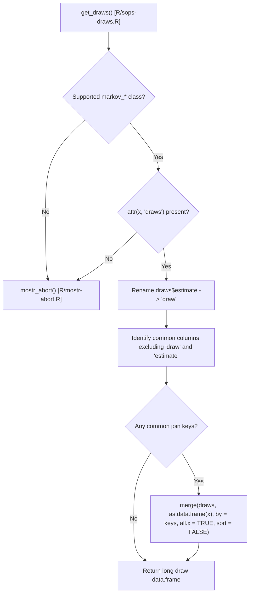

| Function | Defined In | Role in Producing Output |
| :--- | :--- | :--- |
| `get_draws()` | `R/sops-draws.R` | Validates class and presence of `"draws"`, avoids column clash by renaming draw `estimate` to `draw`, and merges point/profile/summary columns back onto each draw row. |
| `mostr_abort()` | `R/mostr-abort.R` | Signals class errors or missing-draw guidance (`return_draws = TRUE`). |

*(Internal siblings `draw_summary_function()`, `compute_ci_from_draws()`, and `warn_undefined_draws()` in `R/sops-draws.R` summarize draw data frames into `std.error`/`conf.low`/`conf.high` during `inferences()`, `time_in_state()`, `interpolate_sops()`, and `avg_comparisons()`.)*

**How they play together**:
`inferences(..., return_draws = TRUE)` and `blrm` estimators (`sops()`, `avg_sops()`, `state_time()`, `avg_state_time()`, `comparisons()`, `avg_comparisons()`) store compact draw tables in `attr(x, "draws")` with only key columns, `draw_id`, optional `fwb_weight`, and draw value column `estimate`. `get_draws()` renames that draw column to `draw`, determines the intersection of non-value columns with `as.data.frame(x)`, and performs a key-preserving left join so downstream custom contrasts or quantile checks retain every point estimate, confidence bound, and profile covariate on every draw row.

---

### 14. `interpolate_sops()`

- **Defined in**: `R/sops-interpolate.R`
- **Signature**: `interpolate_sops(x, time_map, target_times = NULL, baseline_time = 0, normalize = TRUE)`
- **Return contract**: A `markov_interpolated_sops` data frame (retaining inner `markov_sops` or `markov_avg_sops` class) with `time` on the real-time grid `target_times`, linearly interpolated estimates (and uncertainty/test columns when re-evaluated), optional re-normalized probabilities, and interpolated `draws` when available.

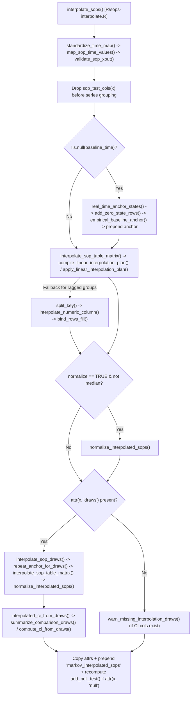

| Function | Defined In | Role in Producing Output |
| :--- | :--- | :--- |
| `interpolate_sops()` | `R/sops-interpolate.R` | Public visit-to-real-time interpolator for `markov_sops` and `markov_avg_sops`. |
| `standardize_time_map()`, `map_sop_time_values()`, `validate_sop_xout()` | `R/sops-interpolate.R` | Normalize vector or data-frame `time_map`, check visit coverage, and validate sorted target times inside `[lower, upper]`. |
| `real_time_anchor_states()`, `fitted_state_labels()`, `summary_state_labels()`, `insert_states_by_levels()`, `extend_state_column()`, `add_zero_state_rows()` | `R/sops-interpolate.R` | Identify starting states never observed as outcomes (e.g., admission screening states), place them in factor order, and insert 0-probability rows at visits so probabilities sum to 1 from `baseline_time` onward. |
| `baseline_rows_for_anchor()`, `empirical_baseline_anchor()`, `empirical_baseline_anchor_from_data()`, `state_distribution_anchor()`, `rows_match_values()`, `coerce_state_like()` | `R/sops-interpolate.R` | Build probability-1 indicators per profile or cohort empirical state shares per `(variables, by)` group at `baseline_time` (respecting counterfactual starting-state scenarios). |
| `compile_linear_interpolation_plan()`, `apply_linear_interpolation_plan()`, `interpolate_sop_table_matrix()`, `interpolate_numeric_column()`, `split_key()` | `R/sops-interpolate.R` | Vectorized matrix linear interpolation when all series share an aligned time grid, with safe per-series fallback (`aggregate`/`approx`) without extrapolation. |
| `normalize_interpolated_sops()`, `sop_measure_cols()`, `sop_test_cols()`, `warn_missing_interpolation_draws()`, `sop_draw_value_col()`, `repeat_anchor_for_draws()`, `combine_baseline_anchor_draws()`, `interpolate_sop_draws()`, `interpolated_ci_from_draws()` | `R/sops-interpolate.R` | Re-normalize state probabilities (skipping un-normalized posterior medians unless backed by draws), interpolate draw-level trajectories (using `baseline_anchor_draws` when bootstrap resampled baseline cohorts), recompute CIs, and update Wald/logit tests via `add_null_test()`. |

**How they play together**:
When follow-up visits occur at irregular elapsed times (e.g., visits `1..4` representing days `3, 7, 14, 28`), `interpolate_sops()` maps discrete visits onto real elapsed time and linearly interpolates between `baseline_time` (where each patient's observed or counterfactual starting state is anchored via `empirical_baseline_anchor()`) and the mapped visits. Crucially, `real_time_anchor_states()` discovers starting states that never occur as outcomes so the baseline probability distribution sums to 1 before normalization, while bootstrap/FWB draws propagate their own `baseline_anchor_draws` or `fwb_weight` shares in `repeat_anchor_for_draws()`. Stored `draws` are interpolated draw-by-draw via `interpolate_sop_draws()` so confidence limits are recomputed from the interpolated draw distribution rather than by interpolating visit-level CIs; prior null-hypothesis test columns are recomputed at the new estimates afterward.

---

### 15. `time_in_state()`

- **Defined in**: `R/sops-time-in-state.R`
- **Signature**: `time_in_state(x, state_sets = 1, time_map = NULL, baseline_time = 0, target_times = NULL)`
- **Return contract**: Adapts to input: (1) 3D array -> numeric vector `[n_patients]`; (2) 4D array -> matrix `[n_draws x n_patients]`; (3) `markov_sops` / `markov_avg_sops` / `markov_interpolated_sops` -> grouped data frame with `total_time` and preserved uncertainty (`NA` with warning if limits exist without draws; exact analytical propagation if `method = "delta"`).

*(Note: `time_in_state()` assigns its input to a local variable named `sops <- x`; it never invokes the exported `sops()` function.)*

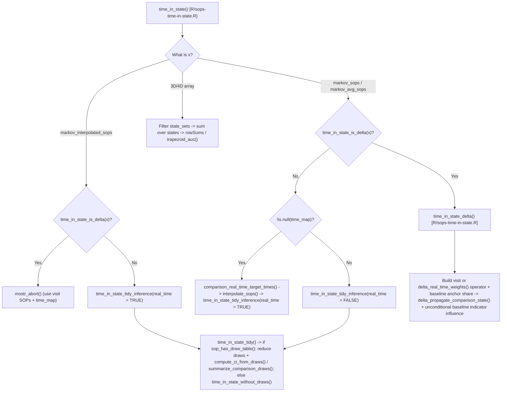

| Function | Defined In | Role in Producing Output |
| :--- | :--- | :--- |
| `time_in_state()` | `R/sops-time-in-state.R` | Polymorphic total-time integrator across raw arrays, tidy SOPs, interpolated SOPs, and analytical delta SOPs. |
| `time_in_state_tidy()`, `trapezoid_auc()`, `sop_has_draw_table()`, `sop_point_estimates()`, `time_in_state_without_draws()`, `time_in_state_uncertainty_cols()`, `time_in_state_tidy_inference()` | `R/sops-time-in-state.R` | Group tidy SOPs across `time`/`state`, integrate unit sums or trapezoidal AUCs, reduce draw tables in parallel to point totals, or set CIs to `NA` with an informative warning when draws are absent. |
| `time_in_state_is_delta()`, `time_in_state_delta()` | `R/sops-time-in-state.R` | Propagate analytical uncertainty through the linear time-integration operator $\sum_r w_{gr} p_r + b a_g$ without materializing full SOP covariance matrices; adds unconditional baseline-state indicator influence when `time_map` anchors at `baseline_time`. |
| `interpolate_sops()`, `comparison_real_time_target_times()`, `delta_real_time_weights()`, `delta_propagate_comparison_state()` | `R/sops-interpolate.R`, `R/sops-comparisons-reduce.R`, `R/sops-delta-comparisons.R` | Real-time interpolation and delta-operator propagation helpers shared with `avg_state_time()` and `avg_comparisons()`. |

**How they play together**:
`time_in_state()` provides unified follow-up summation or trapezoidal real-time integration over a single vector of target `state_sets`. For array outputs from `soprob_markov()`, it slices the target states along the state dimension and sums across times or integrates via `trapezoid_auc()`. For tidy SOP objects with draw tables (`return_draws = TRUE`), `time_in_state_tidy_inference()` reduces both point estimates and every `draw_id` independently so interval bounds account for temporal correlation across visits. For objects from `inferences(method = "delta")`, `time_in_state_delta()` bypasses draw simulation altogether: it constructs sparse `(index, weight)` row operators directly on the visit-scale SOP rows via `delta_real_time_weights()`, verifies identity against integrated estimates, and applies `delta_propagate_comparison_state()` (plus sampled starting-state indicator influence when unconditional variance includes a `baseline_time` anchor).

---

### 16. `plot_sops()`

- **Defined in**: `R/viz-sops.R` (with `R/viz-helpers.R`)
- **Signature**:
  `plot_sops(x, time_var = "time", y_var = "y", facet_var = "tx", linetype_var = NULL, geom = c("line", "bar"), estimate_var = NULL, n_draws = 50, draw_alpha = 0.06, ribbon_alpha = 0.12, show_uncertainty = TRUE)`
- **Return contract**: A `ggplot` object displaying empirical state occupancy shares (from raw trajectory data) or model-derived SOP trajectories (`line` with optional confidence ribbons, or `bar` with optional transparent draw overlays).

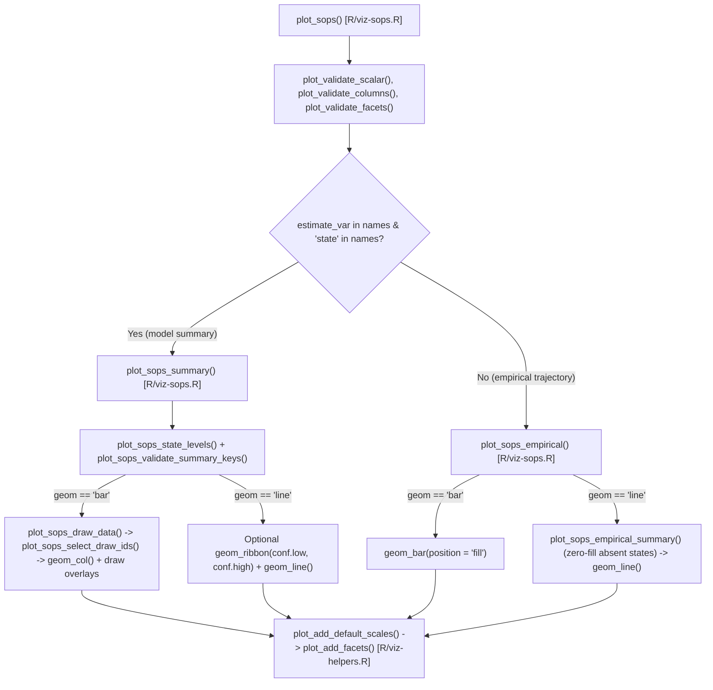

| Function | Defined In | Role in Producing Output |
| :--- | :--- | :--- |
| `plot_sops()` | `R/viz-sops.R` | Validates scalar aesthetics, detects empirical vs. model-summary input, and orchestrates plotting layers. |
| `plot_sops_empirical()`, `plot_sops_empirical_summary()` | `R/viz-sops.R` | Compute observed state proportions per time/facet/linetype, zero-filling unvisited states at each time so line plots never bridge gaps across unvisited times. |
| `plot_sops_summary()`, `plot_sops_state_levels()`, `plot_sops_validate_summary_keys()` | `R/viz-sops.R` | Preserve state factor ordering, reject ambiguous multi-row summary keys unless faceted or mapped to linetype, and build ribbon lines or stacked bars. |
| `plot_sops_draw_data()`, `plot_sops_select_draw_ids()` | `R/viz-sops.R` | Extract deterministically spaced subsets of `attr(x, "draws")` to overlay draw-level stacked bars with low `draw_alpha`. |
| `plot_add_default_scales()`, `plot_add_facets()`, `plot_validate_columns()`, `plot_validate_facets()`, `plot_validate_scalar()` | `R/viz-helpers.R` | Shared viridis discrete color/fill scales, 1D `facet_wrap` / 2D `facet_grid`, and column/range checks. |

**How they play together**:
`plot_sops()` inspects whether `x` already carries `state` and `estimate_var` (`"estimate"` by default). Raw trajectory data frames branch to `plot_sops_empirical()`, where `plot_sops_empirical_summary()` explicitly inserts `0` rows for states absent at a particular time point so trend lines drop accurately to zero. Model outputs (`markov_avg_sops`, `markov_sops` filtered to one profile, or `markov_interpolated_sops`) branch to `plot_sops_summary()`, which enforces one row per plotted key (`plot_sops_validate_summary_keys()`), attaches `geom_ribbon()` bands for `line` plots, or overlays deterministic `attr(x, "draws")` columns on `bar` plots.

---

### 17. `plot_comparisons()`

- **Defined in**: `R/viz-comparisons.R` (with `R/viz-helpers.R`)
- **Signature**:
  `plot_comparisons(x, x_var = NULL, color_var = NULL, linetype_var = NULL, facet_var = NULL, geom = c("auto", "line", "point"), estimate_var = "estimate", show_uncertainty = TRUE, ribbon_alpha = 0.12, point_size = 2, line_width = 0.7)`
- **Return contract**: A `ggplot` object displaying treatment/covariate contrasts over `time` (lines + confidence ribbons) or over `state_set` / `contrast` (dodged points + error bars), anchored by a dashed null reference line at 0 (`"difference"`) or 1 (`"ratio"`).

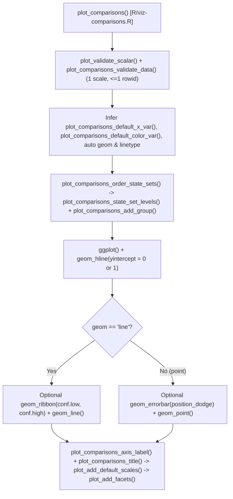

| Function | Defined In | Role in Producing Output |
| :--- | :--- | :--- |
| `plot_comparisons()` | `R/viz-comparisons.R` | Main comparison plotting entrypoint inferring defaults and assembling layers. |
| `plot_comparisons_validate_data()` | `R/viz-comparisons.R` | Verifies required contrast columns, enforces a single comparison scale (`"difference"` or `"ratio"`), and stops multi-profile `comparisons()` objects cleanly (`rowid` > 1). |
| `plot_comparisons_default_x_var()`, `plot_comparisons_default_color_var()`, `plot_comparisons_has_multiple()` | `R/viz-comparisons.R` | Auto-select `x_var` (`"time"` -> `"state_set"` -> `"contrast"`) and distinguish multiple state sets or contrasts by color/linetype. |
| `plot_comparisons_order_state_sets()`, `plot_comparisons_state_set_levels()`, `plot_comparisons_add_group()`, `plot_comparisons_axis_label()`, `plot_comparisons_title()` | `R/viz-comparisons.R` | Order state-set factors numerically or by factor levels, build `.plot_group` interactions, and format titles (`"Average SOP Comparisons"`, etc.). |
| `plot_add_default_scales()`, `plot_add_facets()`, `plot_validate_columns()`, `plot_validate_facets()`, `plot_validate_scalar()` | `R/viz-helpers.R` | Shared scale, facet, and validation helpers. |

**How they play together**:
`plot_comparisons()` renders contrast tables from `avg_comparisons()` or single-profile slices of `comparisons()`. `plot_comparisons_validate_data()` ensures only one scale (`"difference"` vs. `"ratio"`) and at most one `rowid` appear so the reference line (`0` vs. `1`) and connected curves remain meaningful. Automatic defaults pick `"time"` along the x-axis (switching `"auto"` to `"line"`) for SOP contrasts and `"state_set"`/`"contrast"` (switching `"auto"` to `"point"`) for expected-time and time-benefit contrasts, preserving natural numeric ordering for numeric state labels via `plot_comparisons_state_set_levels()`.

---

### 18. `plot_time()`

- **Defined in**: `R/viz-time.R` (with `R/viz-helpers.R` and `plot_comparisons_state_set_levels()` in `R/viz-comparisons.R`)
- **Signature**:
  `plot_time(x, geom = c("bar", "pointrange"), group_var = NULL, facet_var = NULL, scale = c("time", "proportion"), show_labels = TRUE, digits = 1, show_uncertainty = TRUE, bar_width = 0.6, point_size = 2, line_width = 0.7)`
- **Return contract**: A `ggplot` object displaying `markov_avg_state_time` estimates either as horizontal stacked follow-up allocation bars ("Grotta bars", `geom = "bar"`) or greyscale dodged points with lineranges (`geom = "pointrange"`).

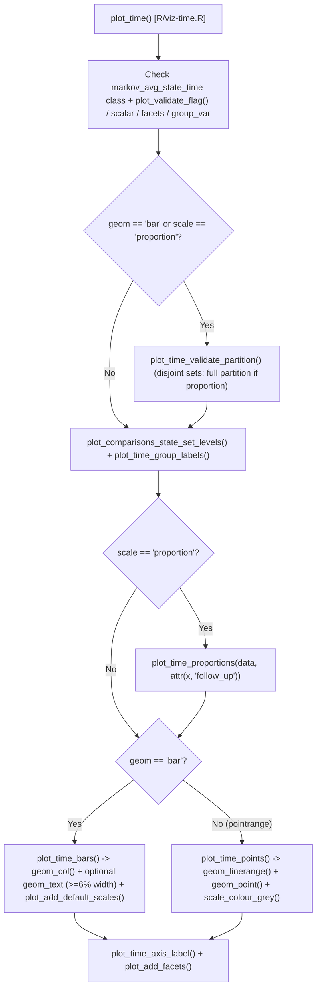

| Function | Defined In | Role in Producing Output |
| :--- | :--- | :--- |
| `plot_time()` | `R/viz-time.R` | Main `markov_avg_state_time` plotting entrypoint validating inputs, partition rules, and layout. |
| `plot_time_validate_partition()` | `R/viz-time.R` | Ensures state sets do not overlap when stacking bars, and cover every fitted state when `scale = "proportion"`. |
| `plot_time_group_labels()`, `plot_time_proportions()`, `plot_time_axis_label()`, `plot_validate_flag()` | `R/viz-time.R` | Build `.group` scenario labels, divide by stored `follow_up` span (avoiding median re-normalization drift), and format `time_unit` labels. |
| `plot_time_bars()`, `plot_time_points()` | `R/viz-time.R` | Render horizontal `position_stack(reverse = TRUE)` bars with internal labels (`>= 6%` max width) or black-to-grey `pointrange` comparisons. |
| `plot_comparisons_state_set_levels()`, `plot_add_default_scales()`, `plot_add_facets()`, `plot_validate_*()` | `R/viz-comparisons.R`, `R/viz-helpers.R` | Reuse ordered state-set factors, viridis scales, and facet wrappers. |

**How they play together**:
`plot_time()` visualizes follow-up time budgets produced by `avg_state_time()`. Before stacking bars (`geom = "bar"`) or normalizing to shares of follow-up (`scale = "proportion"`), `plot_time_validate_partition()` inspects `attr(x, "time_args")$state_sets` against the model's `y_levels` so overlapping sets cannot inflate total bar length and partial sets cannot pretend to sum to 100%. Crucially, `plot_time_proportions()` divides by `attr(x, "follow_up")` stored by `avg_state_time()` rather than rescaling each bar's row sum, so posterior median bars reflect exact marginal follow-up shares.

---

### 19. `plot_lp_difference()`

- **Defined in**: `R/viz-lp.R` (with `R/markov-plot-helpers.R`, `R/sops-backends.R`)
- **Signature**: `plot_lp_difference(model, newdata, variables, times, previous_states = NULL, line_width = 0.7)`
- **Return contract**: A `ggplot` object displaying threshold-specific counterfactual differences in linear predictors over `times`, faceted by non-absorbing `previous_state`.

*(Note: `plot_lp_difference_data()` assigns local vector `comparisons <- as.character(values[-1])`; it does not call the exported `comparisons()` function.)*

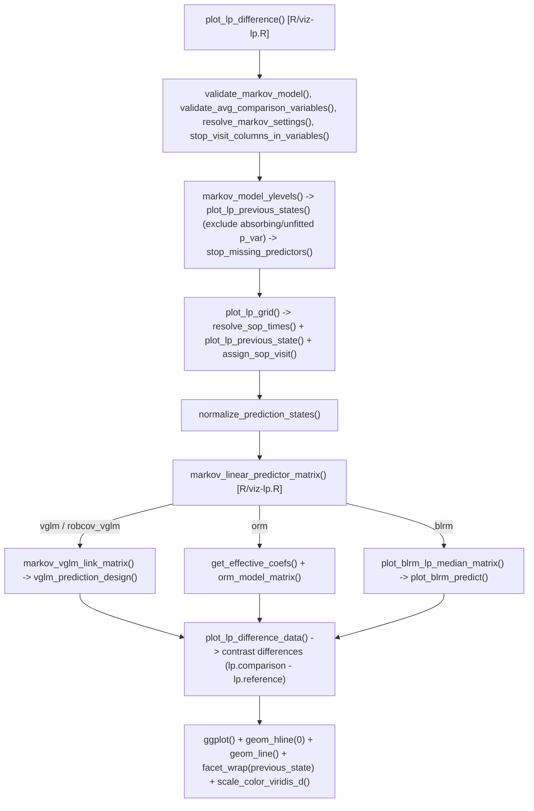

| Function | Defined In | Role in Producing Output |
| :--- | :--- | :--- |
| `plot_lp_difference()` | `R/viz-lp.R` | Model-based diagnostic plot comparing linear predictors ($\eta_k$) across counterfactual levels of one covariate for a fixed profile. |
| `plot_lp_previous_states()`, `plot_lp_grid()`, `plot_lp_previous_state()` | `R/viz-lp.R` | Exclude absorbing/unfitted `p_var` states, construct the `[previous_state x time x value]` evaluation grid, coerce `p_var` to fitted types/levels, and update `time_var`/`gap_var` per step. |
| `markov_linear_predictor_matrix()`, `markov_vglm_link_matrix()`, `plot_blrm_lp_median_matrix()`, `plot_blrm_predict()` | `R/viz-lp.R` | Compute exact threshold linear predictor matrices $\eta$ across `vglm`/`robcov_vglm` (using `lm2vlm.model.matrix`), `orm` ($X \Gamma^\top$), and `blrm` (`predict(..., type = "lp", posterior.summary = "median")`). |
| `plot_lp_difference_data()` | `R/viz-lp.R` | Verify row alignment (`nrow(eta) == nrow(data)`) and compute pairwise linear-predictor contrasts (`lp.comparison - lp.reference`) across thresholds and `previous_state` panels. |
| `markov_model_ylevels()`, `resolve_sop_times()`, `assign_sop_visit()`, `normalize_prediction_states()`, `stop_visit_columns_in_variables()`, `stop_missing_predictors()` | `R/markov-plot-helpers.R`, `R/sops-backends.R`, `R/sops-comparisons-setup.R`, `R/sops-dispatch.R` | Shared grid/state/predictor checks and design builders across engines. |

**How they play together**:
`plot_lp_difference()` diagnoses proportional-odds vs. partial proportional-odds structure and time-varying treatment effects directly on the log-odds scale before simulating probabilities. `plot_lp_previous_states()` restricts facets to previous states that actually occur in the fitted data (`markov_fitted_previous_states()`), refusing absorbing states with no linear predictors. `plot_lp_grid()` evaluates all `(previous_state, time, variable value)` combinations while updating elapsed `gap_var` if fitted. Notice how `markov_vglm_link_matrix()` explicitly reuses VGAM's constraint-aware `lm2vlm.model.matrix` for `mostm`-split basis fits, making non-parallel spline effects (`eta1`, `eta2`, ...) directly inspectable across thresholds.

---
### 20. `plot_transitions()`

- **Defined in**: `R/viz-transitions.R` (with `R/diagnostic-transitions.R`, `R/diagnostic-data.R`, `R/diagnostic-trace.R`, `R/markov-plot-helpers.R`)
- **Signature**:
  `plot_transitions(x, newdata = NULL, variables = NULL, times = NULL, y_levels = NULL, comparison = c("none", "difference"), time_var = NULL, y_var = "y", p_var = NULL, p2_var = NULL, id_var = NULL, facet_var = NULL, seed = NULL, n_draws = 100L, show_values = TRUE, digits = NULL, fill_limits = NULL)`
- **Return contract**: A `ggplot` object displaying faceted `geom_tile()` heatmaps (`previous_state` on x, current `state` on y) of empirical transition proportions, model-implied transition proportions, or counterfactual transition-proportion differences (`scale_fill_gradient2()`).

*(Note: `plot_transition_difference()` assigns a local vector `comparisons <- as.character(values[-1])`; it does not invoke the exported `comparisons()` function.)*

```mermaid
flowchart TD
    Entry["plot_transitions() [R/viz-transitions.R]"] --> Settings["plot_markov_settings() -> resolve_markov_settings() (if model) or markov_settings()"]
    Settings --> IsModel{"markov_supported_model(x)?"}

    IsModel -->|"No (data.frame)"| EmpData["plot_transitions_empirical_data() [R/diagnostic-transitions.R] -> plot_transition_summary()"]
    IsModel -->|"Yes (orm / vglm / blrm)"| ModData["plot_transitions_model_data() [R/diagnostic-transitions.R]"]

    ModData --> ModVal["validate_plot_counterfactual_variables() + stop_visit_columns_in_variables()"]
    ModVal --> Setup["plot_transition_model_setup() [R/diagnostic-data.R] -> complete_plot_recursion_times()"]
    Setup --> Summ["plot_transition_model_summary() -> plot_model_trace_summaries(return_kernels = FALSE)"]
    Summ --> Trace["markov_transition_trace() [R/diagnostic-trace.R] (1st or 2nd order + blrm draw chunks)"]
    Trace --> TraceAgg["plot_transition_trace_summary() -> plot_transition_trace_group_summary() (+ plot_transition_summarize_draws if blrm)"]
    TraceAgg --> DiffChk{"comparison == 'difference'?"}
    DiffChk -->|"Yes"| Diff["plot_transition_difference() -> estimate.comparison - estimate.reference"]
    DiffChk -->|"No"| Heat["plot_transitions_heatmap() [R/viz-transitions.R] -> plot_value_label()"]
    Diff --> Heat
    EmpData --> Heat
```

| Function | Defined In | Role in Producing Output |
| :--- | :--- | :--- |
| `plot_transitions()`, `plot_transitions_heatmap()` | `R/viz-transitions.R` | Public entrypoint and `ggplot2` tile/text/color renderer (`scale_fill_viridis_c` for proportions, symmetric `scale_fill_gradient2` for differences). |
| `markov_supported_model()`, `plot_markov_settings()`, `markov_model_ylevels()`, `validate_plot_counterfactual_variables()`, `complete_plot_recursion_times()`, `complete_plot_factor_times()`, `complete_plot_numeric_times()`, `stop_plot_times_before_first_followup()` | `R/markov-plot-helpers.R` | Validate model-vs-plot column consistency and fill in intermediate fitted visits when `times` skips visits (`plot_transitions()` requires full recursion chains from baseline). |
| `plot_transition_model_setup()`, `plot_model_trace_summaries()`, `plot_ordered_values()`, `plot_facet_groups()`, `plot_group_subset()`, `plot_generic_panel()` | `R/diagnostic-data.R` | Shared diagnostic profile builder, posterior chunk runner (`blrm`), ordering helpers, and `NA`-preserving facet stratum filter. |
| `markov_transition_trace()`, `trace_draw_layers()`, `markov_transition_trace_result()`, `markov_transition_trace_first_order()`, `markov_transition_trace_second_order()` | `R/diagnostic-trace.R` | Step-by-step R recursion tracking both state occupancy `P` and joint `(previous_state, current_state)` transition mass tensors (`transitions`, optional `kernels`). |
| `plot_transitions_empirical_data()`, `plot_transitions_model_data()`, `plot_transition_model_summary()`, `plot_transition_trace_summary()`, `plot_transition_trace_group_summary()`, `plot_transition_summarize_draws()`, `plot_transition_finalize_summary()`, `plot_transition_summary()`, `plot_transition_difference()`, `plot_transition_state_levels()`, `plot_transition_panel()`, `plot_transition_panel_levels()` | `R/diagnostic-transitions.R` | Aggregate empirical counts or joint transition mass arrays across patients, posterior draws, and counterfactual contrasts into `.panel`-faceted tiles. |

**How they play together**:
Unlike marginal SOPs (`sops()`), transition heatmaps visualize the *joint* probability mass flowing from each `previous_state` to each `state` at every plotted time ($P(Y_{t-1}=j, Y_t=k)$), divided by total profiles in that stratum. On raw data frames, `plot_transitions_empirical_data()` cross-tabulates `(p_var, y_var)` directly. On fitted models, `plot_transition_model_setup()` automatically inserts any intermediate fitted visits omitted from sparse `times` via `complete_plot_recursion_times()` (so cumulative state propagation stays exact), runs `markov_transition_trace()`, extracts slice mass at `plot_indices`, averages over posterior draws when `model` is `blrm`, and optionally subtracts counterfactual levels inside `plot_transition_difference()`.

---

### 21. `plot_correlation()`

- **Defined in**: `R/viz-correlation.R` (with `R/diagnostic-correlation.R`, `R/diagnostic-data.R`, `R/diagnostic-trace.R`)
- **Signature**:
  `plot_correlation(x, newdata = NULL, times = NULL, y_levels = NULL, id_var = NULL, time_var = NULL, y_var = "y", p_var = NULL, p2_var = NULL, facet_var = NULL, seed = NULL, n_draws = 100L, triangle = c("upper", "full"), show_values = TRUE, digits = 2, fill_limits = NULL, method = c("spearman", "pearson"))`
- **Return contract**: A `ggplot` heatmap of `(time_1, time_2)` correlation tiles (`upper` triangle or `full` off-diagonal matrix) summarizing either pairwise-complete empirical state correlations or exact Markov model-implied longitudinal correlations without Monte Carlo path sampling.

```mermaid
flowchart TD
    Entry["plot_correlation() [R/viz-correlation.R]"] --> Settings["plot_markov_settings(..., data_id_var = 'id')"]
    Settings --> Dispatch["plot_correlation_input_data() [R/diagnostic-correlation.R]"]

    Dispatch -->|"data.frame"| Emp["plot_correlation_data() -> plot_state_time_matrix() -> plot_state_scores() -> stats::cor(pairwise.complete.obs)"]
    Dispatch -->|"model"| Mod["plot_correlation_model_data() -> plot_transition_model_setup()"]
    Mod --> ModSumm["plot_correlation_model_summary() -> plot_model_trace_summaries(return_kernels = TRUE)"]
    ModSumm --> Trace["markov_transition_trace(return_kernels = TRUE)"]
    Trace --> TraceGrp["plot_correlation_trace_summary() -> plot_correlation_trace_group_summary()"]
    TraceGrp --> Calc["plot_correlation_matrix_from_trace() -> plot_trace_state_means()"]
    Calc -->|"first-order"| First["plot_first_order_cross_moment() (backward Chapman-Kolmogorov kernels)"]
    Calc -->|"second-order"| Second["plot_second_order_cross_moment_matrix() -> anchor_pair/step/cross_moment"]
    First --> Long["plot_correlation_matrix_long() + plot_correlation_finalize()"]
    Second --> Long
    Emp --> Long
    Long -->|"If blrm draws"| AggDraws["plot_correlation_summarize_draws()"]
    AggDraws --> Heat["plot_correlation_heatmap() [R/viz-correlation.R]"]
    Long --> Heat
```

| Function | Defined In | Role in Producing Output |
| :--- | :--- | :--- |
| `plot_correlation()`, `plot_correlation_heatmap()` | `R/viz-correlation.R` | Public entrypoint and heatmap tile renderer selecting `[0, 1]` vs `[-1, 1]` color limits automatically when `fill_limits = NULL`. |
| `plot_correlation_input_data()`, `plot_correlation_model_data()`, `plot_correlation_model_summary()`, `plot_correlation_trace_summary()`, `plot_correlation_trace_group_summary()`, `drop_first_array_dim()`, `plot_correlation_summarize_draws()` | `R/diagnostic-correlation.R` | Shared empirical vs. model correlation router computing draw-wise correlation matrices for `blrm` before averaging correlations across posterior draws. |
| `plot_correlation_matrix_from_trace()`, `plot_trace_state_means()`, `plot_first_order_cross_moment()` | `R/diagnostic-correlation.R` | Exact longitudinal Pearson and mid-rank Spearman score correlation calculator using first-order backward transition-kernel contractions $K_t \dots K_{s+1} s_{\text{end}}$. |
| `plot_second_order_cross_moment_matrix()`, `plot_second_order_anchor_pair_array()`, `plot_second_order_anchor_step_array()`, `plot_second_order_anchor_cross_moment()` | `R/diagnostic-correlation.R` | Exact second-order joint anchor-state pair propagation tracking $(Y_{\text{start}}, Y_{t-1}, Y_t)$ to compute cross-moments across arbitrary lags without simulation error. |
| `plot_correlation_data()`, `plot_state_time_matrix()`, `plot_state_scores()`, `plot_correlation_matrix_long()`, `plot_correlation_finalize()` | `R/diagnostic-correlation.R` | Reshapes empirical trajectories into `[id x time]` state-score matrices (refusing duplicate `id x time`), runs `stats::cor()`, and extracts `upper` or `full` triangles. |

**How they play together**:
`plot_correlation()` compares empirical within-patient serial dependence against the exact correlation structure implied by a first- or second-order Markov fit. For data frames, `plot_state_time_matrix()` enforces unique `id x time` pairs and maps states to scores (`plot_state_scores()`). For models, `markov_transition_trace(..., return_kernels = TRUE)` retains per-step conditional transition probability kernels (`kernels`). When `method = "spearman"`, `plot_correlation_matrix_from_trace()` replaces raw scores `1..K` at each plotted time with affine-equivalent mid-distribution ranks computed directly from the stratum's marginal SOPs. First-order cross-moments $E[S(Y_s) S(Y_t)]$ propagate backward expectations across `kernels`, while second-order fits propagate 4D `anchor_pair` arrays forward from $s$ to $t$. For `blrm`, every draw computes its own correlation matrix before averaging correlations across draws.

---

### 22. `plot_variogram()`

- **Defined in**: `R/viz-correlation.R` (with `R/diagnostic-correlation.R`)
- **Signature**:
  `plot_variogram(x, newdata = NULL, times = NULL, y_levels = NULL, id_var = NULL, time_var = NULL, y_var = "y", p_var = NULL, p2_var = NULL, facet_var = NULL, seed = NULL, n_draws = 100L, smooth = TRUE, method = c("spearman", "pearson"))`
- **Return contract**: A `ggplot` scatter plot (plus optional loess smooth via `geom_smooth(method = "loess")`) of pairwise time-lag correlations vs. absolute time difference `delta`, faceted by `.panel` when `facet_var` is supplied.

```mermaid
flowchart TD
    Entry["plot_variogram() [R/viz-correlation.R]"] --> Settings["plot_markov_settings(..., data_id_var = 'id')"]
    Settings --> Corr["plot_correlation_input_data(..., triangle = 'upper') [Section 21]"]
    Corr --> Lag["plot_variogram_data(corr) [R/diagnostic-correlation.R] (compute delta = |t1 - t2|)"]
    Lag --> Plot["ggplot() + geom_point() + coord_cartesian() + optional geom_smooth('loess') + facet_wrap(.panel)"]
```

| Function | Defined In | Role in Producing Output |
| :--- | :--- | :--- |
| `plot_variogram()` | `R/viz-correlation.R` | Public entrypoint sharing all data/model correlation logic with `plot_correlation()` and plotting correlation decay vs. time lag. |
| `plot_markov_settings()`, `plot_correlation_input_data()` | `R/markov-plot-helpers.R`, `R/diagnostic-correlation.R` | Same empirical and exact first-/second-order Markov correlation pipeline documented in **Section 21** (`triangle = "upper"`). |
| `plot_variogram_data()` | `R/diagnostic-correlation.R` | Parses numeric time differences (`abs(t1 - t2)`), falling back to ordered visit-position differences for factor/character visit labels. |

**How they play together**:
`plot_variogram()` reuses 100% of `plot_correlation_input_data()` (**Section 21**) with `triangle = "upper"`, then passes the resulting correlation data frame through `plot_variogram_data()` to compute the lag `delta = |time_1 - time_2|` and renders correlation decay across increasing lags (optionally overlaid with a loess smooth).

---

### 23. `bootstrap_model_coefs()`

- **Defined in**: `R/bootstrap-coefs.R` (with `R/bootstrap_helpers.R`, `R/markov-data.R`)
- **Signature**: `bootstrap_model_coefs(model, n_draws, workers = NULL, use_coefstart = FALSE)`
- **Return contract**: A wide `data.frame` of `n_draws` rows containing `boot_id` and one numeric column per model coefficient (`intercepts` and slopes). Refits missing an outcome state produce `NA` for the missing state's named terms; refits lacking the reference level of a factor previous state replace intercepts and `p_var`/`p2_var` term coefficients with `NA` and emit a summary warning.

```mermaid
flowchart TD
    Entry["bootstrap_model_coefs() [R/bootstrap-coefs.R]"] --> Checks["Check model class (orm/vglm/robcov_vglm), check_use_coefstart(), markov_model_refit_data(), markov_require_id_var()"]
    Checks --> Cols["markov_model_settings() -> bootstrap_state_columns(), bootstrap_response_column(), extract previous_cols reference levels"]
    Cols --> Sample["fast_group_bootstrap() [R/bootstrap_helpers.R] -> boot_ids per resample"]
    Sample --> Guard["check_bootstrap_constraint_outcomes() (reject explicit constraints + dropped outcome states)"]
    Guard --> RunBoot["apply_to_bootstrap() [Part II.4] (JIT materialize rows, run workers, record failures)"]
    RunBoot --> Worker["Each resample: assign new_id -> bootstrap_analysis_wrapper() -> update_bootstrap_model() + drop_absent_states()"]
    Worker --> RefChk{"lacks_reference?"}
    RefChk -->|"Yes"| MaskNA["bootstrap_coef_positions(m_boot, col) -> set intercepts & p_var coeffs to NA"]
    RefChk -->|"No"| CoefList["as.list(coef(m_boot))"]
    MaskNA --> Combine["Warn if any lacks_reference -> named_list_to_wide()"]
    CoefList --> Combine
```

| Function | Defined In | Role in Producing Output |
| :--- | :--- | :--- |
| `bootstrap_model_coefs()` | `R/bootstrap-coefs.R` | Public coefficient-bootstrap runner producing a wide data frame of patient-resampled regression parameter estimates. |
| `bootstrap_coef_positions()` | `R/bootstrap-coefs.R` | Inspects `stats::terms(fit)` (`fit@assign` + `VGAM::constraints()` column widths for `vglm`; `non.slopes` + `fit$assign` for `orm`) to identify exact coefficient indices of intercepts and any term involving a missing reference state. |
| `fast_group_bootstrap()`, `apply_to_bootstrap()`, `bootstrap_analysis_wrapper()`, `bootstrap_state_columns()`, `bootstrap_response_column()`, `check_bootstrap_constraint_outcomes()`, `check_use_coefstart()` | `R/bootstrap_helpers.R` | Shared patient-cluster resampler, explicit-constraint validator, JIT row materializer, and parallel/sequential wrapper (**Part II.4**). |
| `observed_state_labels()`, `drop_absent_states()` | `R/markov-data.R` | Determine original reference state levels and strip absent factor levels per resample without renumbering remaining state labels. |
| `named_list_to_wide()` | `R/utils.R` | Stacks heterogeneous named coefficient lists across resamples, filling missing parameter names with `NA`. |

**How they play together**:
`bootstrap_model_coefs()` resamples whole patient IDs with replacement from `markov_model_refit_data()` (`fast_group_bootstrap()`), renaming duplicate draws via `new_id` so every resampled patient enters `update_bootstrap_model()` as an independent cluster. Inside each resample, `bootstrap_analysis_wrapper()` invokes `drop_absent_states()` so missing outcome states are removed cleanly from state factor levels while preserving original state labels (`update_bootstrap_model()` wraps refitting in `markov_with_coefficients_only_refit()` so refits skip starting-profile storage and sandwich computation). Crucially, `bootstrap_coef_positions()` protects coefficient semantics: if a resample contains zero rows with the original reference level of a factor previous state, the model silently shifts its reference baseline, so intercepts and `yprev`/`p2_var` coefficients in that draw are blanked to `NA` while slope parameters (`tx`, `time`) remain valid.

---

### 24. `robcov_vglm()` and `robcov_vglm` S3 Methods

- **Defined in**: `R/robcov_vglm.R` (with `markov_assemble_sandwich()` in `R/robcov_orm.R`)
- **Exported Generic / Constructor**: `robcov_vglm(model, cluster = NULL, bread = c("observed", "vglm"), type = c("HC0", "HC1"), cadjust = NULL)`
- **Registered S3 methods (4)**: `coef.robcov_vglm(object, ...)`, `vcov.robcov_vglm(object, ...)`, `print.robcov_vglm(x, ...)`, `summary.robcov_vglm(object, ...)` (plus `set_coef.robcov_vglm` in **Section 26**).
- **Return contract**: List of class `"robcov_vglm"` containing model slots copied from `model`, `vglm_fit`, sandwich components (`scores`, `influence_beta_obs`, `bread`, `meat`, `var`, `se`, `z`, `pvalues`), clustering metadata (`n`, `n_clusters`, `type`, `cadjust`, `adjustment_factor`), and any carried `mostm()` metadata attributes.

```mermaid
flowchart TD
    Entry["robcov_vglm() [R/robcov_vglm.R]"] --> ModelVcov["vcov(fit) -> validate_vglm_matrix(positive_definite = TRUE) -> chol2inv(chol()) model_information"]
    ModelVcov --> Scores["compute_scores_vglm(fit) [X_vlm * d(logLik)/d(eta) summed per obs]"]
    Scores --> Conv["validate_vglm_convergence(fit, scores, model_information)"]
    Conv --> Bread{"bread == 'observed'?"}
    Bread -->|"Yes (default)"| ObsBread["compute_observed_bread_vglm() -> vglm_score_evaluator() + unit-scaled Richardson diff + symmetry/PD check"]
    Bread -->|"No ('vglm')"| FisherBread["Use model_vcov directly"]
    ObsBread --> Clust{"!is.null(cluster)?"}
    FisherBread --> Clust
    Clust -->|"Yes"| Rowsum["align_cluster_vglm() -> rowsum(scores, cluster)"]
    Clust -->|"No"| RawScores["Use unclustered scores"]
    Rowsum --> Assem["markov_assemble_sandwich() [R/robcov_orm.R] -> markov_sandwich_adjustment(HC0/HC1, cadjust)"]
    RawScores --> Assem
    Assem --> ValMat["validate_vglm_matrix(meat, robust_var) -> attach influence_beta_obs & markov metadata -> 'robcov_vglm'"]
    ValMat -.-> S3["coef / vcov / print / summary.robcov_vglm()"]
    CompHelper["Internal helper: compare_se_orm_vglm() [R/robcov_vglm.R]"] -.-> Entry
```

| Function | Defined In | Role in Producing Output |
| :--- | :--- | :--- |
| `robcov_vglm()` | `R/robcov_vglm.R` | Computes Huber-White / patient-clustered sandwich covariance matrices for S4 `VGAM::vglm()` objects and returns the `"robcov_vglm"` wrapper. |
| `compute_scores_vglm()` | `R/robcov_vglm.R` | Multiplies each observation's VLM design block $X_r^\top$ by `VGAM::weights(..., type = "working", deriv.arg = TRUE)$deriv` to form the exact $m \times p$ score matrix. |
| `validate_vglm_convergence()`, `validate_vglm_matrix()` | `R/robcov_vglm.R` | Enforce IRLS convergence, `RegCondOK`, standardized score norm tolerance, numerical symmetry, and correlation-scale positive definiteness (`markov_correlation_positive_definite()`). |
| `vglm_score_evaluator()`, `compute_observed_bread_vglm()` | `R/robcov_vglm.R` | Computes observed-information inverse bread by numerically differentiating summed scores with unit-scaled Richardson extrapolation and adaptive step halving on candidate boundaries. |
| `align_cluster_vglm()` | `R/robcov_vglm.R` | Aligns cluster ID vectors against post-NA model observations via `fit@na.action` (`na_action_omitted_rows()`). |
| `markov_assemble_sandwich()`, `markov_sandwich_adjustment()` | `R/robcov_orm.R` | Computes `meat`, `covariance = B' M B`, and combined scalar `HC1`/`cadjust` factors identically across `orm` and `vglm`. |
| `coef.robcov_vglm()`, `vcov.robcov_vglm()`, `print.robcov_vglm()`, `summary.robcov_vglm()` | `R/robcov_vglm.R` | Registered S3 accessors and display methods exposing `$coefficients`, `$var`, `$se`, `$z`, `$pvalues`, and convergence diagnostics. |
| `compare_se_orm_vglm()` *(unexported internal helper)* | `R/robcov_vglm.R` | Utility comparing model-based and robust SEs across equivalent `orm` and `vglm` fits after aligning intercept parameterizations. |

**How they play together**:
`robcov_vglm()` supplies cluster-robust sandwich inference tailored to vector linear models (both proportional odds and partial proportional odds). First, `compute_scores_vglm()` extracts exact per-row gradients by contracting the $M$-row VLM design block per observation against VGAM's likelihood derivatives. Next, rather than relying solely on IRLS working-Fisher weights (which diverge from the observed Hessian under misspecification), `compute_observed_bread_vglm()` defaults to computing the numerical Jacobian of summed analytic scores with column-unit scaling (`1 / max|X_vlm[, j]|`) and Richardson extrapolation, inverting only after checking correlation-scale conditioning. `markov_assemble_sandwich()` then sums scores within clusters (`align_cluster_vglm()`), applies matching `HC0`/`HC1` and finite-cluster adjustments, stores `influence_beta_obs = scores %*% bread` for unconditional inference (**Part II.2**), and copies `mostm()` metadata attributes onto the outer `"robcov_vglm"` list so standard `coef()`/`vcov()`/`summary()` methods and downstream SOP estimators treat it identically to native fits.

---

### 25. `get_vcov_robust()`

- **Defined in**: `R/mvn_helpers.R` (with `R/robcov_orm.R`, `R/robcov_vglm.R`)
- **Signature**: `get_vcov_robust(model, cluster = NULL, data = NULL, bread = c("observed", "vglm"), type = c("HC0", "HC1"), cadjust = NULL)`
- **Return contract**: Symmetric positive-(semi)definite coefficient variance-covariance matrix $V_\beta$ for `"robcov_vglm"`, `"vglm"`, `"orm"`, `"lrm"`, or fallback `stats::vcov()` models.

```mermaid
flowchart TD
    Entry["get_vcov_robust() [R/mvn_helpers.R]"] --> FastRet{"Precomputed robcov_vglm or valid orm_stored_covariance_valid() AND no overrides?"}
    FastRet -->|"Yes"| Stored["Return model$var unchanged"]
    FastRet -->|"No"| ClustForm{"is(cluster, 'formula')?"}
    ClustForm -->|"Yes"| Extract["Extract column from markov_model_data() / data / call$data -> align_cluster()"]
    ClustForm -->|"No"| Dispatch
    Extract --> Dispatch{"Model class?"}
    Dispatch -->|"vglm / robcov_vglm"| V["robcov_vglm(model, cluster, bread, type, cadjust)$var"]
    Dispatch -->|"orm"| O["robcov_orm(model, cluster, type, cadjust)$var [R/robcov_orm.R]"]
    Dispatch -->|"lrm"| L["rms::robcov(model, cluster)$var"]
    Dispatch -->|"other (unclustered)"| Fallback["stats::vcov(model)"]
```

| Function | Defined In | Role in Producing Output |
| :--- | :--- | :--- |
| `get_vcov_robust()` | `R/mvn_helpers.R` | Unified dispatcher extracting stored robust covariances or recomputing cluster/HC-adjusted sandwiches across supported regression backends. |
| `robcov_orm()`, `validate_robcov_orm_fit()`, `compute_scores_orm()`, `orm_model_bread()`, `orm_penalty_gradient()`, `orm_case_weights()`, `orm_fit_is_penalized()`, `orm_robust_metadata()`, `orm_stored_covariance_valid()`, `align_cluster_orm()`, `stop_failed_orm_fit()`, `markov_correlation_positive_definite()` | `R/robcov_orm.R` | Compute exact log-scale numerically stable analytic scores (and subtract $P\hat\beta / G$ share on penalized fits) and sandwich covariance for logistic `rms::orm()` fits. |
| `robcov_vglm()`, `sop_delta_backend_model()` | `R/robcov_vglm.R`, `R/sops-delta-core.R` | Unwrap `robcov_vglm` to its inner `vglm` fit when any option (`cluster`, `type`, `cadjust`, `bread`) is overridden, and recompute the VGLM sandwich. |
| `markov_model_data()` | `R/markov-model-data.R` | Supplies stored alignment data when `cluster` is passed as a formula such as `~id`. |

**How they play together**:
`get_vcov_robust()` gives both MVN simulation (**Part II.3**) and direct callers a uniform covariance accessor. When given a `mostm()` fit with no overriding arguments, it immediately returns the stored patient-clustered `model$var` after validating `orm_stored_covariance_valid()` (checking covariance identity and provenance for `orm`). Whenever an override (`cluster`, `type`, `cadjust`, `bread`) is supplied, it extracts any formula-based cluster IDs from `markov_model_data()` (or `data`) and invokes `robcov_orm()` (notably computing cancellation-free log-scale score ratios in `compute_scores_orm()` and removing the penalized score offset $P\hat\beta/G$ in `orm_penalty_gradient()`) or `robcov_vglm()`.

---

### 26. `set_coef()` and `set_coef.*` S3 Methods

- **Defined in**: `R/mvn_helpers.R`
- **Exported Generic**: `set_coef(model, new_coefs)`
- **Registered S3 methods (6)**: `set_coef.default`, `set_coef.orm`, `set_coef.lrm`, `set_coef.rms`, `set_coef.robcov_vglm`, `set_coef.vglm`
- **Return contract**: Shallow copy of `model` with coefficient storage updated to `new_coefs` (preserving original coefficient names).

```mermaid
flowchart TD
    Generic["set_coef(model, new_coefs) [R/mvn_helpers.R]"] --> Disp{"UseMethod('set_coef')"}
    Disp -->|"orm / lrm / rms / default"| Def["set_coef.default() -> verify length & replace model$coefficients"]
    Disp -->|"vglm (S4)"| Vglm["set_coef.vglm() -> verify length & replace model@coefficients"]
    Disp -->|"robcov_vglm"| Rob["set_coef.robcov_vglm() -> set_coef.default(model) + set_coef(model$vglm_fit)"]
```

| Function | Defined In | Role in Producing Output |
| :--- | :--- | :--- |
| `set_coef()` | `R/mvn_helpers.R` | S3 generic for non-mutating coefficient substitution during MVN simulation fallback prediction. |
| `set_coef.default()`, `set_coef.orm()`, `set_coef.lrm()`, `set_coef.rms()` | `R/mvn_helpers.R` | Validate vector length, retain existing coefficient names, and replace `$coefficients` on S3 model objects. |
| `set_coef.vglm()` | `R/mvn_helpers.R` | Validate vector length, retain slot names, and replace `@coefficients` on S4 `vglm` fits. |
| `set_coef.robcov_vglm()` | `R/mvn_helpers.R` | Updates both outer `$coefficients` and nested `$vglm_fit@coefficients` so inner prediction engines read the perturbed draw. |

*(Internal siblings `validate_coef_vcov()` and `get_coef()` live alongside `set_coef()` in `R/mvn_helpers.R`.)*

**How they play together**:
When MVN simulation falls back to full R prediction (`predict_markov_sops()`) rather than compiled matrix plans, `set_coef()` injects each simulated draw $\beta^{(b)}$ into a shallow copy of the fitted model cleanly across both S3 (`rms`) and S4 (`VGAM`) representations, ensuring `robcov_vglm` updates propagate into the embedded `$vglm_fit` object.

---

### 27. `get_effective_coefs()`

- **Defined in**: `R/vgam_helpers.R`
- **Signature**: `get_effective_coefs(model, beta = NULL)`
- **Return contract**: Numeric `[L x q]` effective-coefficient matrix $\Gamma$ mapping `L = K - 1` cumulative-logit thresholds (rows `eta1..etaL`) across `q` design-matrix columns (including `"(Intercept)"`), supporting optional simulated parameter vectors `beta`.

```mermaid
flowchart TD
    Entry["get_effective_coefs(model, beta) [R/vgam_helpers.R]"] --> Unwrap{"inherits(model, 'robcov_vglm')?"}
    Unwrap -->|"Yes"| Inner["Unwrap model$vglm_fit"]
    Unwrap -->|"No"| Route{"Class?"}
    Inner --> Route
    Route -->|"vglm"| V["get_effective_coefs_vglm() -> multiply each constraint C_j by beta_j chunk -> Gamma [L x q]"]
    Route -->|"orm"| O["get_effective_coefs_orm() -> bind M threshold intercepts + M-replicated slopes -> Gamma [L x q]"]
    Route -->|"other"| Abort["mostr_abort()"]
```

| Function | Defined In | Role in Producing Output |
| :--- | :--- | :--- |
| `get_effective_coefs()` | `R/vgam_helpers.R` | Unwraps `robcov_vglm` objects and dispatches $\Gamma$ construction to backend-specific workers. |
| `get_effective_coefs_vglm()` | `R/vgam_helpers.R` | Iterates `VGAM::constraints(model)`, slicing `beta` by each constraint column count $p_j$ and placing $C_j \beta_j$ into column $j$ of $\Gamma$ (handling PO, full PPO, and custom constraint matrices uniformly). |
| `get_effective_coefs_orm()` | `R/vgam_helpers.R` | Places the first `model$non.slopes` intercepts in column `"(Intercept)"` and replicates proportional-odds slopes across all `M` rows. |

**How they play together**:
Every compiled SOP execution plan (`markov_msm_build()` in **Part II.1**), linear predictor plot (`markov_linear_predictor_matrix()` in **Section 19**), analytical delta coefficient map (`get_effective_coef_map()` in **Part II.2**), and analytical score computation (`compute_scores_orm()` in **Section 25**) reduces regression prediction to a single linear matrix product $\eta = X \Gamma^\top$. By folding `VGAM::constraints(model)` directly into $\Gamma$, `get_effective_coefs()` hides whether predictors act under full proportional odds, unconstrained PPO, or partial spline constraints (`split_rms_basis_assign()`) behind one uniform $L \times q$ matrix interface, and accepts arbitrary `beta` vectors so MVN simulation draws can swap parameters without touching design matrices.

---

## Part II — Shared Engine Deep-Dives

The 26 exported functions delegate heavy propagation, differentiation, resampling, and matrix reduction to five shared internal subsystems. Each deep-dive below documents its orchestration graph, memory and numerical contracts, and exact source locations.

---

### Deep-Dive 1: SOP Prediction & Propagation Engine

`soprob_markov()` (`R/sops-dispatch.R`) and every SOP-based wrapper (`sops()`, `avg_sops()`, `state_time()`, `avg_state_time()`, `comparisons()`, `avg_comparisons()`, plus bootstrap/simulation/diagnostic workers) converge on `predict_markov_sops()` (`R/sops-dispatch.R`).

```mermaid
flowchart TD
  Entry["predict_markov_sops() [R/sops-dispatch.R]"] --> Prep["prepare_prediction_rows() [R/sops-dispatch.R]"]
  Prep --> Guards["stop_absorbing_start() / stop_missing_predictors() [R/sops-dispatch.R]"]
  Guards --> CheckClass{"Frequentist orm, vglm, or robcov_vglm?"}
  CheckClass -- "blrm or unsupported" --> REngine["soprob_markov_r_engine() [R/sops-engine.R]"]
  CheckClass -- "Yes" --> FastCheck["validate_fast_previous_state_support() [R/sops-dispatch.R]"]
  FastCheck --> Compile["compile_sop_execution_plan() [R/sops-execution-plan.R]"]
  Compile --> Budget{"preflight_execution_plan_designs() <= mostr.execution_plan_max_bytes?"}
  Budget -- "Exceeds 256 MiB (mostr_execution_plan_too_large)" --> Notify["notify_sop_r_engine_fallback() [R/utils.R]"] --> REngine
  Budget -- "OK" --> OrderCheck{"Plan recursion order?"}
  OrderCheck -- "First-order" --> Build1["markov_msm_build() [R/sops-fast-path.R]"]
  Build1 --> Run1["run_sop_execution_plan() -> markov_msm_run() [R/sops-execution-plan.R / R/sops-fast-path.R]"]
  Run1 --> POCheck{"markov_po_structure() full PO?"}
  POCheck -- "Yes (single constant intercept col + equal slopes)" --> NativePO["markov_update_po_native() -> cpp_markov_update_po() [R/sops-native.R / src/sops.cpp]"]
  POCheck -- "No (PPO / categorical / varying intercepts)" --> NativeLogits["markov_update_logits_native() -> cpp_markov_update_logits() [R/sops-native.R / src/sops.cpp]"]
  OrderCheck -- "Second-order" --> Run2["run_second_order_execution_plan() [R/sops-execution-plan.R]"]
  Run2 --> PO2Check{"Full PO?"}
  PO2Check -- "Yes" --> Native2PO["markov_update_second_order_po_native() -> cpp_markov_update_second_order_po() [R/sops-native.R / src/sops.cpp]"]
  PO2Check -- "No" --> Native2["markov_update_second_order_native() -> cpp_markov_update_second_order() [R/sops-native.R / src/sops.cpp]"]
  REngine --> BLRMCheck{"blrm Bayesian posterior?"}
  BLRMCheck -- "Yes" --> BLRMCache["select_posterior_draws() + cache_blrm_gamma_draws() [R/sops-backends.R]"]
  BLRMCache --> BLRMProbs["blrm_probabilities_native() -> cpp_blrm_probabilities() [R/sops-native.R / src/sops.cpp]"]
  BLRMProbs --> DrawsUpdate["markov_update_draws_native() -> cpp_markov_update_draws() [R/sops-native.R / src/sops.cpp]"]
  BLRMCheck -- "No / 2nd-order fallback" --> SecondR["soprob_markov_second_order_run() [R/sops-engine.R]"]
```

| Stage | Key helpers | Location | Responsibility & contract |
| :--- | :--- | :--- | :--- |
| Entry & validation | `soprob_markov()`, `predict_markov_sops()`, `prepare_prediction_rows()`, `stop_absorbing_start()`, `stop_missing_predictors()`, `validate_fast_previous_state_support()` | `R/sops-dispatch.R` | Normalizes starting state columns via `normalize_prediction_states()`, resolves visit schedules (`resolve_sop_times()`), checks that no profile begins in an absorbing state (unless `soprob_markov()` allows zeroed rows or caller overrides), and confirms predictor completeness. |
| Plan compilation & memory guard | `compile_sop_execution_plan()`, `preflight_execution_plan_designs()`, `execution_plan_max_bytes()`, `stop_execution_plan_too_large()`, `run_sop_execution_plan()`, `run_second_order_execution_plan()` | `R/sops-execution-plan.R` | Evaluates design-matrix byte footprint against option `mostr.execution_plan_max_bytes` (default `256 * 1024^2`, 256 MiB). Exceeding raises `mostr_execution_plan_too_large`, caught in `predict_markov_sops()` to emit a fallback notification via `notify_sop_r_engine_fallback()` (`R/utils.R`) and invoke `soprob_markov_r_engine()`. |
| First-order fast path | `markov_msm_build()`, `markov_msm_run()`, `markov_po_structure()`, `lp_to_probs()`, `normalize_probability_rows()` | `R/sops-fast-path.R` | Builds `X_init` and per-visit stacked origin designs `X_transition`. Switches between batched design construction (`<= mostr.max_batched_design_rows`, default `5e4`) and per-origin looping above `5e4`. Extracts $\Gamma$ with `get_effective_coefs()` (`R/vgam_helpers.R`). |
| Native propagation wrappers | `markov_update_logits_native()`, `markov_update_po_native()`, `markov_update_draws_native()`, `markov_update_second_order_native()`, `markov_update_second_order_po_native()`, `blrm_probabilities_native()`, `reduce_sops_draw_array()` | `R/sops-native.R` | Thin wrappers calling `cpp_*` entrypoints in `R/cpp11.R` and checking `crossed_profiles` / `minimum_probability` attributes via `check_native_crossed_thresholds()`. |
| Crossed-threshold checks | `crossed_threshold_tolerance()`, `check_crossed_thresholds()`, `check_native_crossed_thresholds()`, `stop_crossed_thresholds()`, `crossed_threshold_advice()`, `rethrow_crossed_thresholds()`, `run_draw_recording_crossings()`, `stop_crossed_threshold_draws()` | `R/sops-crossed-thresholds.R` | Defines `1e-10` tolerance (paired with `kCrossedTolerance` in `src/sops.cpp`). Category probabilities in `[-1e-10, 0)` are clamped to `0` and row-normalized; values `< -1e-10` raise class `mostr_crossed_thresholds` (propagated across parallel draws rather than being downgraded to warnings). |
| Backend adapters & `blrm` cache | `validate_markov_model()`, `predict_vglm_response_markov()`, `predict_orm_response_markov()`, `select_posterior_draws()`, `blrm_design_matrix()`, `normalize_blrm_design_names()`, `cache_blrm_gamma_draws()`, `get_blrm_gamma_draws()`, `blrm_random_effect_matrix()`, `blrm_cppo_scores()`, `predict_blrm_response_markov()`, `resolve_sop_times()`, `assign_sop_visit()`, `assign_sop_time()`, `assign_sop_gap()` | `R/sops-backends.R` | Extracts model-specific linear predictors and designs, resolves `cppo` scoring functions for constrained partial PO `blrm` fits, reconstructs random-effect offsets when `include_re = TRUE`, and normalizes prediction factor levels with `factors_with_fitted_levels()`. |
| General R & chunked `blrm` engine | `soprob_markov_r_engine()`, `soprob_markov_second_order_run()`, `fitted_threshold_count()`, `match_state_indices()`, `check_transition_probabilities()`, `sops_blrm()`, `avg_sops_blrm()`, `posterior_chunk_size()`, `posterior_group_setup()` | `R/sops-engine.R`, `R/sops-api.R` | Handles `blrm` draw chunking under `mostr.posterior_working_bytes` (default `256 * 1024^2`), native reduction via `reduce_sops_draw_array()`, and second-order active `(h, j)` pair chunking under `mostr.second_order_working_bytes` (default `32 * 1024^2`) with `bytes_per_pair = max(1, draw_factor * n_pat * n_states * 8 * 3)`. |

**Mathematical & Structural Highlights:**
- **PO vs. Non-PO Branching**: `markov_po_structure()` checks whether the fitted transition model has one constant intercept column (all `1` in `X_init[, intercept]`) and identical slopes across all $M = K - 1$ cumulative thresholds within numerical tolerance. Under full PO, $X \beta_{\text{slopes}}$ reduces to one scalar per row and cut-point shifts happen inside `cpp_markov_update_po()` or `cpp_markov_update_second_order_po()`, cutting matrix multiplication work by a factor of $M$. Under partial PO (e.g., `parallel = FALSE` in `vglm`) or constrained thresholds, the full $M$-column logit matrix is passed to `cpp_markov_update_logits()`.
- **Second-Order State Tensor**: For models with two lagged states (`p2_var`), state occupancy at time $t$ is represented as a 3D joint distribution tensor $[N \times K \times K]$ tracking $(Y_{t-2}=h, Y_{t-1}=j)$. Transitions map $(h, j) \to (j, d)$ for active pairs while absorbing states accumulate onto $(j, j)$, and the marginal at visit $t$ is obtained by summing over $h$.
- **Visit & Gap Updates**: At each visit index `t > 1`, `assign_sop_visit()` (`R/sops-backends.R`) updates the time variable (numeric or factor matching fitted visit levels) and, when `gap_var` is configured, `assign_sop_gap()` updates the time difference since the prior scheduled visit.

---

### Deep-Dive 2: Analytical Delta-Method Engine — Conditional Variance & Unconditional Variance

When `inferences(..., method = "delta")` is called on `markov_sops`, `markov_avg_sops`, `markov_comparisons`, `markov_avg_comparisons`, `markov_state_time`, or `markov_avg_state_time`, `mostr` bypasses simulation and refitting and propagates exact first-order derivatives through a native C++ chain-rule engine (`cpp_run_sop_delta()`).

```mermaid
flowchart TD
  Call["inferences(..., method = 'delta') [R/sops-inference.R]"] --> ResolveV["delta_resolve_vcov() [R/sops-delta-inference.R]"]
  ResolveV --> Scope["delta_validate_sop_scope() [R/sops-delta-inference.R]"]
  Scope --> Kind{"Input object class?"}
  Kind -- "markov_sops / markov_avg_sops" --> DeltaSOP["inferences_delta_sops() [R/sops-delta-inference.R]"]
  Kind -- "markov_avg_state_time" --> DeltaAvgT["inferences_delta_avg_time() [R/sops-delta-avg-time.R]"] --> ReplayT["replay_avg_time_sops() -> inferences_delta_sops()"]
  Kind -- "markov_avg_comparisons" --> DeltaAvgC["inferences_delta_comparisons() [R/sops-delta-comparisons.R]"] --> ReplayC["replay_result_avg_sops() -> inferences_delta_sops()"]
  Kind -- "markov_comparisons / markov_state_time" --> DeltaProf["inferences_delta_profile_results() [R/sops-delta-comparisons-individual.R]"]
  DeltaSOP --> Map["get_effective_coef_map() [R/sops-delta-core.R]"]
  Map --> ValPlan["sop_delta_validate_plan() + sop_delta_preflight() [R/sops-delta-core.R]"]
  ValPlan --> NativeDelta["run_sop_delta_plan() -> cpp_run_sop_delta() [R/sops-delta-core.R / src/sops.cpp]"]
  NativeDelta --> MatchCheck["delta_match_cells() + estimates_differ() [R/sops-delta-inference.R]"]
  MatchCheck --> Target{"target?"}
  Target -- "'fixed' or 'empirical' (conditional variance)" --> Cond["delta_coefficient_state() -> get_delta_cluster_vcov() [R/sops-delta-inference.R / R/sops-delta-unconditional.R]"]
  Cond --> JVar["delta_jacobian_variance(): diag(G V_beta G^T) [R/sops-delta-inference.R]"]
  Target -- "'unconditional' (unconditional variance)" --> Scores["get_delta_score_components() [R/sops-delta-unconditional.R]"]
  Scores --> Stack["delta_stacked_influence(): I_i = (Y_i - Y_bar) + S_i (A^-1)^T G^T [R/sops-delta-unconditional.R]"]
  Stack --> UVar["Sample var(I_i) / n [R/sops-delta-unconditional.R]"]
  JVar --> OptLin["Optional linear operator propagation [R/sops-delta-comparisons.R]"]
  UVar --> OptLin
  OptLin --> Final["delta_finalize_result() + attr(, 'analytical') [R/sops-delta-inference.R]"]
```

| Stage | Key helpers | Location | Responsibility & contract |
| :--- | :--- | :--- | :--- |
| Variance target & scope checks | `delta_resolve_vcov()`, `delta_validate_target()`, `delta_validate_sop_scope()`, `sets_starting_state()`, `delta_individual_subject()`, `delta_reject_weighted_unconditional()`, `delta_reject_penalized_orm_unconditional()` | `R/sops-delta-inference.R`, `R/sops-delta-unconditional.R` | Resolves `vcov = NULL` to `"unconditional"` on averaged results (`"conditional"` on individual-row results). Enforces first-order, reverse cumulative logit, frequentist full-PO `orm`/`vglm`/`robcov_vglm`, `by = NULL`. Rejects unconditional variance when `newdata_supplied` is `TRUE`, starting states are fixed in `variables`, case weights `!= 1` exist, or an `orm` model is penalized. |
| Raw-to-effective map & preflight | `get_effective_coef_map()`, `sop_delta_validate_plan()`, `sop_delta_preflight()`, `delta_max_bytes()`, `delta_assert_bytes()`, `stop_sop_delta_too_large()`, `run_sop_delta_plan()`, `delta_native_failure()` | `R/sops-delta-core.R` | Builds $(M \cdot P) \times q$ linear map $A$ satisfying $\operatorname{vec}(\Gamma) = A \beta$ from `VGAM::constraints()` or `orm` intercept/slope structure and verifies equality against fitted $\Gamma$ within `1e-12`. Enforces `mostr.delta_max_bytes` (default `256 * 1024^2`) before calling `cpp_run_sop_delta()`. |
| Conditional variance & cluster checks | `delta_coefficient_state()`, `delta_jacobian_variance()`, `get_delta_cluster_vcov()`, `resolve_delta_cluster()`, `delta_check_patient_partition()`, `delta_validate_named_matrix()`, `delta_normalize_orm_backend_matrix()` | `R/sops-delta-inference.R`, `R/sops-delta-unconditional.R` | Obtains user `vcov` (validated symmetric positive semidefinite) or computes/reuses patient-clustered robust covariance (`robcov_vglm()` / `robcov_orm()`), verifying that any explicit `cluster` induces the same patient partition as the stored `id_var`. Computes diagonal variance `rowSums((G %*% V) * G)`. |
| Unconditional variance (stacked influence) | `get_delta_score_components()`, `delta_stacked_influence()`, `delta_unconditional_state()`, `delta_profile_ids()`, `markov_correlation_positive_definite()` | `R/sops-delta-unconditional.R`, `R/sops-delta-inference.R`, `R/robcov_orm.R` | Extracts raw row scores (`model$scores`, `compute_scores_vglm()`, `compute_scores_orm()`) and total-information bread (`model$bread`, `compute_observed_bread_vglm()`, `orm_model_bread()`), validates positive definiteness on correlation scale, sums scores by patient, sets $A^{-1} = n \cdot \text{bread}$, and evaluates $I_i = (Y_i - \bar{Y}) + S_i (A^{-1})^\top G^\top$ with variance $\widehat{\operatorname{Var}}(I_i)/n$. |
| Linear operators & profile blocks | `inferences_delta_comparisons()`, `delta_comparison_operator()`, `delta_real_time_weights()`, `delta_trapezoid_weights()`, `delta_apply_comparison_operator()`, `delta_propagate_comparison_state()`, `inferences_delta_avg_time()`, `inferences_delta_profile_results()`, `delta_comparison_block()` | `R/sops-delta-comparisons.R`, `R/sops-delta-avg-time.R`, `R/sops-delta-comparisons-individual.R` | Represents averaged comparisons and real/visit time totals as sparse weighted sums over replayed `avg_sops()` cells (combining `compile_linear_interpolation_plan()` and trapezoid weights when `time_map` is supplied, plus baseline-anchor patient indicators when applicable). For individual rows, differentiates one scenario block at a time (`delta_comparison_block()`). |
| Lazy `vcov()` & row keys | `delta_finalize_result()`, `delta_interval_bounds()`, `delta_vcov()`, `vcov.markov_*()`, `delta_row_key_frame()`, `delta_row_key()`, `delta_storage_bytes()` | `R/sops-delta-inference.R`, `R/sops-delta-accessors.R` | Stores compact `analytical` metadata (`representation = "coefficient"` or `"influence"`) and computes any $[r \times r]$ covariance block lazily under `mostr.delta_max_bytes` on `vcov(object, rows = ...)`, guarding against stale/edited rows via key matching. |

**Mathematical Formulation:**
1. **Conditional variance**: Treats the prediction profiles' covariates and starting states as given and propagates raw coefficient covariance $V_\beta \in \mathbb{R}^{q \times q}$ through the cell Jacobian $G = \partial \hat{\theta} / \partial \beta^\top$:
   $$\widehat{\operatorname{Var}}_{\text{cond}}(\hat{\theta}) = G V_\beta G^\top$$
   where only the diagonal standard errors $\sqrt{\operatorname{diag}(G V_\beta G^\top)}$ are stored at `inferences()` time; `vcov()` materializes any requested submatrix $G_{\text{rows}} V_\beta G_{\text{rows}}^\top$ on demand.
2. **Unconditional variance**: Accounts for both sampling variability of the patient cohort's baseline distribution ($Y_i$) and patient-clustered coefficient estimation ($\hat{\beta}$). Let $n$ be the number of fitted patients, $Y_i \in \mathbb{R}^C$ patient $i$'s cell estimates under each counterfactual scenario, $S_i \in \mathbb{R}^q$ patient $i$'s summed log-likelihood score, $A^{-1} = n \cdot \text{bread}$ the scaled inverse average observed information, and $G \in \mathbb{R}^{C \times q}$ the averaged Jacobian:
   $$I_i = (Y_i - \bar{Y}) + S_i (A^{-1})^\top G^\top, \qquad \widehat{\operatorname{Cov}}_{\text{uncond}}(\hat{\theta}) = \frac{1}{n(n - 1)} \sum_{i=1}^{n} (I_i - \bar{I})(I_i - \bar{I})^\top.$$
   Notice that the $1/(n-1)$ divisor matches the sample covariance over $n$ patients and aligns finite-sample scaling with `cadjust = TRUE` (`n / (n - 1)`) in the patient-clustered `HC0` sandwich. For real-time `avg_state_time()`, when `baseline_time` precedes the first mapped follow-up visit and starting states are random across cohort patients, each patient's baseline state indicator contributes an additive `integration$baseline * (indicator_i - mean)` term to $I_i$ because empirical baseline shares carry zero coefficient derivative ($G_{\text{anchor}} = 0$) yet non-zero sampling variance across patients.

---

### Deep-Dive 3: MVN Coefficient-Simulation Inference Engine

`method = "mvn"` (the default for `inferences()`) quantifies frequentist parameter uncertainty by drawing regression coefficients $\beta^{(d)} \sim \mathcal{N}(\hat{\beta}, \hat{\Sigma}_\beta)$ and propagating every draw through the Markov recursion.

```mermaid
flowchart TD
  Entry["inferences(..., method = 'mvn') [R/sops-inference.R]"] --> Target{"Object class & estimand?"}
  Target -- "markov_sops / markov_avg_sops" --> SimSOP["inferences_simulation() [R/sops-inference.R]"]
  Target -- "markov_avg_state_time" --> ReplayT["inferences_avg_time() -> replay + inferences_internal(..., method='mvn') + avg_time_from_sops() [R/sops-avg-time.R]"]
  Target -- "markov_avg_comparisons (sop / time_in_state)" --> ReplayC["inferences_avg_comparisons_linear() -> replay + inferences_internal() + avg_comparison_from_avg_sops() [R/sops-comparisons-inference.R]"]
  Target -- "markov_avg_comparisons (time_benefit)" --> SimTB["inferences_avg_comparisons_time_benefit_simulation() [R/sops-comparisons-inference.R]"]
  Target -- "markov_comparisons / markov_state_time" --> SimProf["inferences_profile_results() -> comparison_simulation_draws() [R/sops-comparisons-individual-inference.R]"]
  SimSOP --> GenDraws["generate_sop_coefficient_draws() -> get_vcov_robust() + mvtnorm::rmvnorm() [R/sops-inference-draws.R / R/mvn_helpers.R]"]
  SimProf --> GenDraws
  SimTB --> GenDraws
  GenDraws --> PlanCheck{"Compile reusable plan once?"}
  PlanCheck -- "orm / vglm / robcov_vglm first or second order" --> CompPlan["compile_sop_execution_plan() [R/sops-execution-plan.R]"]
  CompPlan --> LoopCompiled["Per draw: get_effective_coefs(beta_d) + run_sop_execution_plan() / run_second_order_execution_plan()"]
  PlanCheck -- "Fallback or time_benefit wrapper" --> LoopSetCoef["Per draw: set_coef(model, beta_d) + predict_markov_sops() [R/mvn_helpers.R]"]
  LoopCompiled --> ApplyDraws["apply_sop_simulation_draws() [R/sops-inference-draws.R]"]
  LoopSetCoef --> ApplyDraws
  ApplyDraws --> CrossCheck["run_draw_recording_crossings() + stop_crossed_threshold_draws() [R/sops-crossed-thresholds.R]"]
  CrossCheck --> Align["pack_sop_draw_result() / summarize_sop_draw_matrix() [R/sops-inference.R]"]
```

| Stage | Key helpers | Location | Responsibility & contract |
| :--- | :--- | :--- | :--- |
| Draw sampling | `generate_sop_coefficient_draws()`, `get_coef()`, `get_vcov_robust()`, `validate_coef_vcov()` | `R/sops-inference-draws.R`, `R/mvn_helpers.R` | Extracts raw fitted coefficients $\hat{\beta}$ via `get_coef()`, validates an explicit `vcov` or resolves the model's patient-clustered covariance via `get_vcov_robust()`, and generates `[n_draws x q]` draws with `mvtnorm::rmvnorm()`. |
| Compiled-plan acceleration | `compile_sop_execution_plan()`, `run_sop_execution_plan()`, `run_second_order_execution_plan()`, `comparison_coefficient_predictor()` | `R/sops-execution-plan.R`, `R/sops-inference.R`, `R/sops-comparisons-individual-inference.R` | When `model` is frequentist `vglm`, `robcov_vglm`, or `orm`, compiles design matrices once across all draws (`compile_sop_execution_plan()`). Each draw only transforms $\beta^{(d)} \to \Gamma^{(d)}$ via `get_effective_coefs()` (`R/vgam_helpers.R`) and runs C++ propagation. Falls back to `set_coef()` + `predict_markov_sops()` if compilation exceeds `mostr.execution_plan_max_bytes` or is unsupported. |
| Coefficient mutation (`set_coef()`) | `set_coef()`, `set_coef.orm()`, `set_coef.lrm()`, `set_coef.rms()`, `set_coef.vglm()`, `set_coef.robcov_vglm()`, `set_coef.default()` | `R/mvn_helpers.R` | Clones the fitted model object with updated coefficient slots/components (`@coefficients`, `$coefficients`, `$vglm_fit`) without altering stored design metadata. |
| Parallel draw dispatch & crossings | `apply_sop_simulation_draws()`, `run_draw_recording_crossings()`, `stop_crossed_threshold_draws()` | `R/sops-inference-draws.R`, `R/sops-crossed-thresholds.R` | Runs sequentially with `lapply()` or in parallel via `future.callr::callr` (`furrr::future_map()` with `globals = FALSE` so each draw closure travels only its needed bindings) and restores the complete nested `future::plan()`. Records any crossed-threshold condition (`mostr_crossed_thresholds`) and aborts cleanly after collecting offending draw IDs. |
| Memory bounds & cell alignment | `validate_comparison_draw_cells()`, `pack_sop_draw_result()`, `sop_draw_cell_key()`, `summarize_sop_draw_matrix()`, `compute_ci_from_draws()`, `draw_summary_function()` | `R/sops-comparisons-individual-inference.R`, `R/sops-inference.R`, `R/sops-draws.R` | Individual-row profile inference enforces `n_draws * n_rows <= getOption("mostr.max_sops_draw_cells", 5e7)` before execution. `pack_sop_draw_result()` aligns draw keys with `object` rows, then `summarize_sop_draw_matrix()` / `compute_ci_from_draws()` computes `"perc"`, `"wald"`, or `"logit"` intervals. |

---

### Deep-Dive 4: Patient-Clustered Bootstrap & Fractional Weighted Bootstrap (FWB) Engine

Both `inferences(..., method = "bootstrap" / "fwb")` and `bootstrap_model_coefs()` resample or reweight at the **patient cluster** level (`id_var`), refit the longitudinal transition model using coefficients-only mode, and recompute SOPs or comparisons per draw.

```mermaid
flowchart TD
  Entry["Bootstrap / FWB Dispatch [R/sops-bootstrap-inference.R / R/sops-comparisons-inference.R / R/sops-comparisons-individual-inference.R]"] --> DataCheck["stored_refit_bootstrap_data() + validate_refit_bootstrap_data() [R/sops-bootstrap-inference.R]"]
  DataCheck --> MethodBranch{"Resampling scheme?"}
  MethodBranch -- "method = 'bootstrap' (averaged results only)" --> SampleIDs["fast_group_bootstrap() [R/bootstrap_helpers.R]"]
  SampleIDs --> Preflight["Pre-refit checks: check_bootstrap_starting_states() + check_bootstrap_second_order_outcomes() + check_bootstrap_constraint_outcomes() + check_bootstrap_by_groups() [R/sops-bootstrap-inference.R / R/bootstrap_helpers.R]"]
  Preflight --> WorkerBoot["apply_to_bootstrap() -> materialize_bootstrap_sample_indexed() [R/bootstrap_helpers.R]"]
  MethodBranch -- "method = 'fwb' (averaged or individual rows)" --> GenFWB["generate_fwb_bootstrap_weights() rexp(1)/mean [R/bootstrap_helpers.R]"]
  GenFWB --> WorkerFWB["apply_to_fwb_bootstrap() -> materialize_fwb_bootstrap_sample() [R/bootstrap_helpers.R]"]
  WorkerBoot --> Wrapper["bootstrap_analysis_wrapper() [R/bootstrap_helpers.R]"]
  WorkerFWB --> Wrapper
  Wrapper --> DropStates["drop_absent_states() (keep original labels) [R/markov-data.R]"]
  DropStates --> CoefOnly["update_bootstrap_model() -> markov_with_coefficients_only_refit() + suppress_expected_refit_warnings() [R/bootstrap_helpers.R]"]
  CoefOnly --> FailTrack["run_draw_recording_failure() + run_draw_recording_crossings() [R/bootstrap_helpers.R / R/sops-crossed-thresholds.R]"]
  FailTrack --> Pred["predict_markov_sops() + weighted G-computation / zero-pad missing states [R/sops-bootstrap-inference.R]"]
  Pred --> Combine["keep_successful_draws() + summarize_refit_draws() / compute_ci_from_draws() [R/bootstrap_helpers.R / R/sops-bootstrap-inference.R]"]
```

| Stage | Key helpers | Location | Responsibility & contract |
| :--- | :--- | :--- | :--- |
| Scheme generation & JIT materialization | `fast_group_bootstrap()`, `bootstrap_row_plan()`, `materialize_bootstrap_sample_indexed()`, `generate_fwb_bootstrap_weights()`, `materialize_fwb_bootstrap_sample()`, `fwb_baseline_weights()` | `R/bootstrap_helpers.R` | Ordinary bootstrap resamples cluster indices with replacement and generates distinct `new_id = "<original_id>_<occurrence>"` labels so repeated patients remain independent clusters; data are materialized JIT inside workers via `row_plan` (`data.table` fast join unless list/matrix columns trigger base slicing). FWB assigns normalized `rexp(1)` weights (`cluster_mean_1`) to every patient ID, preserving all clusters and states in every draw. |
| Pre-refit safety gates | `validate_refit_bootstrap_data()`, `check_use_coefstart()`, `check_bootstrap_starting_states()`, `check_bootstrap_second_order_outcomes()`, `check_bootstrap_constraint_outcomes()`, `check_bootstrap_by_groups()`, `bootstrap_state_presence()` | `R/sops-bootstrap-inference.R`, `R/bootstrap_helpers.R` | Before fitting a single bootstrap model, scans sampled ID tables to abort if: (a) a resample omits all transitions leaving a needed starting state, (b) a second-order resample has a starting state never reached as an outcome, (c) an explicit-constraint `vglm` loses an outcome state (mismatching constraint row count $M$), or (d) an observational `by` subgroup disappears. `check_use_coefstart()` permits `use_coefstart = TRUE` only on `vglm`/`robcov_vglm` refit methods. |
| State-label preservation & model refit | `bootstrap_analysis_wrapper()`, `drop_absent_states()`, `update_bootstrap_model()`, `markov_refit_state`, `markov_refit_coefficients_only()`, `markov_with_coefficients_only_refit()`, `suppress_expected_refit_warnings()`, `suppress_orm_weights_warning()`, `bootstrap_original_fit_weights()` | `R/bootstrap_helpers.R`, `R/markov-data.R` | `drop_absent_states()` drops unobserved factor levels without renumbering surviving labels. `update_bootstrap_model()` inlines fit-time `refit_args`, clears `subset`/`etastart`/`mustart`, multiplies stored prior weights with FWB draw weights into `.mostr_fit_weight`, temporarily clears `options(datadist = NULL)`, sets `markov_refit_state$coefficients_only <- TRUE` so `mostm()` skips sandwich/profile steps, and muffles `rms::orm()`'s spurious weight-ignored message. |
| Failure handling & zero-padding | `apply_to_bootstrap()`, `apply_to_fwb_bootstrap()`, `run_draw_recording_failure()`, `collect_failed_draws()`, `keep_successful_draws()`, `complete_bootstrap_sop_states()`, `complete_comparison_sops_array_states()`, `summarize_refit_draws()` | `R/bootstrap_helpers.R`, `R/sops-bootstrap-inference.R`, `R/sops-comparisons-inference.R` | Wraps `NULL` failed fits in `mostr_failed_draw` markers carrying warning reasons, warns once with failed/remaining counts (or aborts if all draws fail), aborts immediately if any draw hits `mostr_crossed_thresholds`, and zero-pads outcome states absent from a resample before summarizing across draws. |

**Key Design Contrasts (Ordinary Bootstrap vs. FWB):**
- Individual-row results (`markov_sops`, `markov_comparisons`, `markov_state_time`) reject `method = "bootstrap"` because ordinary resampling can drop rare outcome states required by fixed rows; only `method = "fwb"` keeps positive weight support on every cluster.
- When FWB predicts on the model's own baseline cohort (`newdata = NULL`), each cluster's draw weight $w_i^{(b)}$ weights both the model refit (`.mostr_fit_weight`) and G-computation marginalization (`fwb_baseline_weights()`), and is attached to individual-level `draws` tables as column `fwb_weight` so downstream `interpolate_sops()`, `time_in_state()`, `avg_sops()`, and `avg_comparisons()` compute consistent weighted functionals per draw. If `newdata` was supplied by the user, baseline weights are omitted and `warn_fixed_profile_bootstrap_weights()` / `warn_fixed_profile_draw_weights()` warns accordingly.

---

### Deep-Dive 5: Native C++ Kernels (`src/sops.cpp`, `src/cpp11.cpp`, `R/cpp11.R`, `R/sops-native.R`)

All compiled numerical routines live in `src/sops.cpp`, register 9 `[[cpp11::register]]` C symbols through generated `src/cpp11.cpp` and `R/cpp11.R`, and expose checked R wrappers in `R/sops-native.R` (and `R/sops-delta-core.R` for `cpp_run_sop_delta()`, `R/simulate-markov.R` for `cpp_sample_categorical_rows()`).

```mermaid
flowchart TD
  RCallers["R Wrappers [R/sops-native.R / R/sops-delta-core.R / R/simulate-markov.R]"] --> GenR["R/cpp11.R .Call('_mostr_cpp_*') wrappers"]
  GenR --> RegC["src/cpp11.cpp CallEntries[] + R_init_mostr()"]
  RegC --> Kernels["src/sops.cpp [[cpp11::register]] Kernels"]
  Kernels --> Common["Shared C++ primitives: checked_product(), validate_state_partition(), stable_logistic(), kCrossedTolerance, CrossedThresholds, cumulative_to_categories()"]
  Kernels --> DeltaHelpers["Analytical helpers: DeltaFailureCode, DeltaFailure, delta_category_probabilities()"]
```

**Internal C++ Infrastructure (`src/sops.cpp`):**
- `checked_product()`: multiplies integer dimensions with overflow detection against `R_XLEN_T_MAX`.
- `validate_state_partition()`: confirms `non_absorb` and `absorb` indices are valid 1-based state IDs forming an exact disjoint partition of `1..states`.
- `stable_logistic()`: overflow-safe logistic CDF evaluating `1 / (1 + exp(-x))` for `x >= 0` and `exp(x) / (1 + exp(x))` for `x < 0`.
- `kCrossedTolerance` (`1e-10`), `CrossedThresholds`, and `cumulative_to_categories()`: converts $M$ reverse cumulative probabilities $P(Y \ge k + 2)$ to $K = M + 1$ category probabilities. Values in `[-1e-10, 0)` are clamped to `0` and row-normalized; values `< -1e-10` mark 1-based `crossed_profiles` and `minimum_probability` attributes via `CrossedThresholds::mark()` so R raises `mostr_crossed_thresholds`.
- `DeltaFailureCode`, `DeltaFailure`, `delta_category_probabilities()`: simultaneous evaluation of full-PO category probabilities and exact parameter derivatives using `gamma` and `coefficient_map`, aborting propagation cleanly with `DeltaFailureCode` codes `1..6` translated by `delta_native_failure()` (`R/sops-delta-core.R`).

**All 9 Registered Native Kernels:**

| Kernel (`R/cpp11.R` / `src/sops.cpp`) | R Caller (`Location`) | Primary Array Layout & Operation | Crossed-Threshold & Safety Handling |
| :--- | :--- | :--- | :--- |
| `cpp_markov_update_logits(previous, logits, non_absorb, absorb)` | `markov_update_logits_native()` (`R/sops-native.R`) | `previous` `[n, K]`, `logits` `[n * origins, K - 1]` -> `[n, K]`. Evaluates reverse cumulative logits per non-absorbing origin block and accumulates weighted target probabilities plus unchanged absorbing mass. | Checks every `(i, origin)` row with `kCrossedTolerance`, attaches `crossed_profiles` & `minimum_probability`, polls `check_user_interrupt()`. |
| `cpp_markov_update_po(previous, scalar_predictor, cutpoints, non_absorb, absorb)` | `markov_update_po_native()` (`R/sops-native.R`) | `previous` `[n, K]`, `scalar_predictor` length `n * origins`, `cutpoints` length `K - 1` -> `[n, K]`. Adds threshold-specific intercepts to scalar LP in C++, avoiding `[n * origins, K - 1]` logit allocation in R. | Same `CrossedThresholds` marking and `check_user_interrupt()` every 8 origins. |
| `cpp_run_sop_delta(initial_design, transition_designs, gamma, coefficient_map, origin_positions, non_absorb, absorb, intercept, group_size, retain_individual_probabilities)` | `run_sop_delta_plan()` (`R/sops-delta-core.R`) | Propagates `[n, K]` SOPs and `[n, K, q]` derivatives from `initial_design` and per-visit `transition_designs` under full PO; aggregates groups of `group_size` if `> 0`, optionally keeps individual `[n, T, K]` SOPs. | Returns `status = c(code, visit, origin)` and `value` for `DeltaFailureCode` (`1` non-finite, `2` crossed `< -1e-10`, `3` category sum != 1, `4` category deriv sum != 0, `5` SOP sum != 1, `6` SOP deriv sum != 0); no clipping allowed. |
| `cpp_sample_categorical_rows(probabilities)` | `sample_categorical_rows()` (`R/simulate-markov.R`) | `probabilities` `[n, K]` -> integer length `n` (1-based). Validates finite non-negative rows with positive totals and samples via R's RNG (`GetRNGstate()`, `unif_rand()`, `PutRNGstate()`). | Throws `cpp11::stop()` on negative/non-finite probabilities or zero-sum rows. |
| `cpp_reduce_sops_draws(values, draws, observations, times, states, groups, group_count)` | `reduce_sops_draw_array()` (`R/sops-native.R`) | `[draws, n, T, K]` -> `[draws, group_count, T, K]`. Averages patient SOP trajectories per draw within integer group IDs `groups` (`1..group_count`). | Validates group bounds (`1..group_count`, non-NA) and checks `check_user_interrupt()` every 256 observations. |
| `cpp_markov_update_draws(previous, transition, draws, observations, states, non_absorb, absorb)` | `markov_update_draws_native()` (`R/sops-native.R`) | `previous` `[draws, n, K]`, `transition` `[draws, n, origins, K]` -> `[draws, n, K]`. Fuses multi-draw Chapman-Kolmogorov transition accumulation and absorbing carry-over across posterior draws. | Validates complete state partition via `validate_state_partition()`, checks `check_user_interrupt()`. |
| `cpp_markov_update_second_order(previous, transition, observations, states, older, current, absorb)` | `markov_update_second_order_native()` (`R/sops-native.R`) | `previous` `[n, K, K]`, `transition` `[n, pairs, K]` indexed by 1-based `(older, current)` pairs -> `[n, K, K]`. Maps mass from `(h, j)` to `(j, target)` and accumulates absorbing histories onto `(j, j)`. | Range-checks `older`, `current`, `absorb` in `1..states`, checks `check_user_interrupt()`. |
| `cpp_blrm_probabilities(base_eta, intercepts, threshold_eta, threshold_scale, draws, observations, thresholds)` | `blrm_probabilities_native()` (`R/sops-native.R`) | `base_eta` `[draws, n]`, `intercepts` `[draws, M]`, optional `threshold_eta` `[draws, n]` & `threshold_scale` `[M]` -> `[draws, n, K]`. Evaluates reverse cumulative logistic category probabilities across posterior draws. | Preserves raw negative values `< -kCrossedTolerance` without clipping/renormalizing when crossed so `check_crossed_thresholds()` in R detects and reports them. |
| `cpp_markov_update_second_order_po(previous, scalar_predictor, cutpoints, observations, states, older, current, absorb)` | `markov_update_second_order_po_native()` (`R/sops-native.R`) | `previous` `[n, K, K]`, `scalar_predictor` `[n, pairs]`, `cutpoints` `[K - 1]` -> `[n, K, K]`. Full-PO second-order update computing logistic transitions inline per active `(older[p], current[p])` history pair. | Checks `kCrossedTolerance` on every `(i, pair)` history and marks `CrossedThresholds`; checks `check_user_interrupt()`. |

---

## Part III — Complete File-by-File & Symbol Reference Index

Every file in `R/`, `R/sysdata.rda`, and `src/` on the `main` branch is indexed alphabetically below, listing every top-level R function/object and native C++ kernel with its exact signature, export/S3 status, and role.

### R Package Files (`R/`)

#### `R/bootstrap-coefs.R`

Exported model-coefficient cluster bootstrap entrypoint and alignment helper.

| Symbol | Signature / Kind | Export / S3 | Role & Key Callers |
| :--- | :--- | :--- | :--- |
| `bootstrap_model_coefs` | `bootstrap_model_coefs(model, n_draws, workers = NULL, use_coefstart = FALSE)` | Exported | Runs patient-clustered bootstrap refits and returns a coefficient matrix across successful draws (Section 23). |
| `bootstrap_coef_positions` | `bootstrap_coef_positions(fit, column)` | Internal | Maps raw coefficient positions/names for coefficient alignment inside `bootstrap_model_coefs()`. |

#### `R/bootstrap_helpers.R`

Shared resampling, FWB weighting, JIT worker execution, state-presence preflight, and coefficient-only refit helpers.

| Symbol | Signature / Kind | Export / S3 | Role & Key Callers |
| :--- | :--- | :--- | :--- |
| `fast_group_bootstrap` | `fast_group_bootstrap(data, id_var = "id", n_boot)` | Internal | Resamples unique patient IDs by integer position with replacement, generating `original_id`, `new_id`, and `boot_id` lookup tables (Deep-Dive 4). |
| `bootstrap_row_plan` | `bootstrap_row_plan(data, id_var)` | Internal | Pre-indexes row indices per unique patient ID once before dispatching `apply_to_bootstrap()`. |
| `materialize_bootstrap_sample_indexed` | `materialize_bootstrap_sample_indexed(boot_ids, data, id_var, row_plan)` | Internal | Materializes one resample data frame JIT from ID lookups (`data.table` join or base slicing when nested/matrix columns exist). |
| `generate_fwb_bootstrap_weights` | `generate_fwb_bootstrap_weights(data, id_var = "id", n_boot, weight_dist = "exponential")` | Internal | Samples i.i.d. `rexp(1)` cluster weights normalized to cluster mean `1` (`fwb_weight`). |
| `materialize_fwb_bootstrap_sample` | `materialize_fwb_bootstrap_sample(fwb_weights, data, id_var)` | Internal | Attaches patient-level `fwb_weight` and `boot_id` columns to every row of `data`. |
| `fwb_baseline_weights` | `fwb_baseline_weights(fwb_weights, baseline_data, id_var)` | Internal | Matches `fwb_weight` onto baseline prediction profiles by `id_var`. |
| `apply_to_bootstrap` | `apply_to_bootstrap(boot_samples, analysis_fn, data, id_var, workers = NULL, packages = c("rms", "VGAM", "Hmisc", "stats"), globals = character(0))` | Internal | Dispatches ordinary bootstrap samples sequentially (`lapply()`) or via `future.callr::callr`, recording draw failures and crossed thresholds. |
| `apply_to_fwb_bootstrap` | `apply_to_fwb_bootstrap(fwb_samples, analysis_fn, data, id_var, workers = NULL, packages = c("rms", "VGAM", "Hmisc", "stats"), globals = character(0))` | Internal | Dispatches fractional weighted bootstrap samples sequentially or in parallel via `future.callr::callr`. |
| `run_draw_recording_failure` | `run_draw_recording_failure(run)` | Internal | Executes one draw with `withCallingHandlers()`, wrapping `NULL` failures in `mostr_failed_draw` markers carrying the last warning message. |
| `collect_failed_draws` | `collect_failed_draws(results)` | Internal | Converts `mostr_failed_draw` markers back to `NULL` and attaches `failure_reasons` attribute. |
| `keep_successful_draws` | `keep_successful_draws(results)` | Internal | Drops `NULL` draws with a summary warning, or aborts if every draw failed. |
| `bootstrap_analysis_wrapper` | `bootstrap_analysis_wrapper(boot_data, model, factor_cols, original_data, y_levels = NULL, absorb = NULL, use_coefstart = FALSE, fit_weights = NULL, response_col = bootstrap_response_column(model))` | Internal | Combines prior and FWB row weights, calls `drop_absent_states()`, clears `datadist`, and runs `update_bootstrap_model()`. |
| `check_use_coefstart` | `check_use_coefstart(use_coefstart, model, method = NULL)` | Internal | Validates `use_coefstart`, rejecting `TRUE` outside `vglm`/`robcov_vglm` refit methods. |
| `bootstrap_refit_model` | `bootstrap_refit_model(model)` | Internal | Unwraps `robcov_vglm` to `$vglm_fit` for refitting. |
| `bootstrap_response_column` | `bootstrap_response_column(model)` | Internal | Extracts the response variable name from a model's formula (fallback `"y"`). |
| `bootstrap_state_columns` | `bootstrap_state_columns(model, refit_data, p_var, p2_var = NULL)` | Internal | Returns response and present lagged-state column names in `refit_data`. |
| `bootstrap_state_presence` | `bootstrap_state_presence(boot_ids, refit_data, id_var, cols, states)` | Internal | Computes a logical `[n_boot x n_states]` incidence matrix across sampled ID tables before refitting. |
| `bootstrap_count_text` | `bootstrap_count_text(counts, n_boot)` | Internal | Formats missing-state counts across resamples for preflight error messages. |
| `bootstrap_has_explicit_constraints` | `bootstrap_has_explicit_constraints(model)` | Internal | Checks whether `model` was fitted with an explicit `constraints` argument in `vglm`. |
| `check_bootstrap_constraint_outcomes` | `check_bootstrap_constraint_outcomes(boot_ids, refit_data, id_var, response_col, model, fwb = TRUE)` | Internal | Pre-refit check refusing ordinary bootstrap draws that drop an outcome state when explicit `constraints` were supplied. |
| `bootstrap_original_fit_weights` | `bootstrap_original_fit_weights(model, data)` | Internal | Extracts stored case weights per row (or unit weights if unweighted). |
| `bootstrap_prior_weights` | `bootstrap_prior_weights(data, column)` | Internal | Validates existence, finiteness, and non-negativity of a prior weight column in bootstrap data. |
| `update_bootstrap_model` | `update_bootstrap_model(model, boot_data, fit_weights = NULL, coefstart = NULL, drop_coefstart = FALSE)` | Internal | Reconstructs and evaluates the `mostm()` refit call in coefficients-only mode with inlined `refit_args` and updated weights. |
| `bootstrap_model_call` | `bootstrap_model_call(model)` | Internal | Reads `@call` (S4) or `$call` (S3) from a fitted model. |
| `markov_refit_state` | `[object]` (`new.env(parent = emptyenv())`) | Internal | Package state environment holding `$coefficients_only` flag during bootstrap refits. |
| `markov_refit_coefficients_only` | `markov_refit_coefficients_only()` | Internal | Returns `TRUE` when inside `markov_with_coefficients_only_refit()`. |
| `markov_with_coefficients_only_refit` | `markov_with_coefficients_only_refit(expr)` | Internal | Temporarily enables `markov_refit_state$coefficients_only <- TRUE` with `on.exit()` cleanup. |
| `suppress_expected_refit_warnings` | `suppress_expected_refit_warnings(model, expr)` | Internal | Dispatches `orm` refits through `suppress_orm_weights_warning()`. |
| `suppress_orm_weights_warning` | `suppress_orm_weights_warning(expr)` | Internal | Muffles `rms::orm()`'s spurious weight-ignored validation warning while keeping all other warnings intact. |

#### `R/cpp11.R`

Generated `cpp11` R wrappers invoking `.Call()` symbols registered in `src/cpp11.cpp`.

| Symbol | Signature / Kind | Export / S3 | Role & Key Callers |
| :--- | :--- | :--- | :--- |
| `cpp_markov_update_logits` | `cpp_markov_update_logits(previous, logits, non_absorb, absorb)` | Internal | Generated wrapper for `_mostr_cpp_markov_update_logits`; called by `markov_update_logits_native()`. |
| `cpp_markov_update_po` | `cpp_markov_update_po(previous, scalar_predictor, cutpoints, non_absorb, absorb)` | Internal | Generated wrapper for `_mostr_cpp_markov_update_po`; called by `markov_update_po_native()`. |
| `cpp_run_sop_delta` | `cpp_run_sop_delta(initial_design, transition_designs, gamma, coefficient_map, origin_positions, non_absorb, absorb, intercept, group_size, retain_individual_probabilities)` | Internal | Generated wrapper for `_mostr_cpp_run_sop_delta`; called by `run_sop_delta_plan()`. |
| `cpp_sample_categorical_rows` | `cpp_sample_categorical_rows(probabilities)` | Internal | Generated wrapper for `_mostr_cpp_sample_categorical_rows`; called by `sample_categorical_rows()`. |
| `cpp_reduce_sops_draws` | `cpp_reduce_sops_draws(values, draws, observations, times, states, groups, group_count)` | Internal | Generated wrapper for `_mostr_cpp_reduce_sops_draws`; called by `reduce_sops_draw_array()`. |
| `cpp_markov_update_draws` | `cpp_markov_update_draws(previous, transition, draws, observations, states, non_absorb, absorb)` | Internal | Generated wrapper for `_mostr_cpp_markov_update_draws`; called by `markov_update_draws_native()`. |
| `cpp_markov_update_second_order` | `cpp_markov_update_second_order(previous, transition, observations, states, older, current, absorb)` | Internal | Generated wrapper for `_mostr_cpp_markov_update_second_order`; called by `markov_update_second_order_native()`. |
| `cpp_blrm_probabilities` | `cpp_blrm_probabilities(base_eta, intercepts, threshold_eta, threshold_scale, draws, observations, thresholds)` | Internal | Generated wrapper for `_mostr_cpp_blrm_probabilities`; called by `blrm_probabilities_native()`. |
| `cpp_markov_update_second_order_po` | `cpp_markov_update_second_order_po(previous, scalar_predictor, cutpoints, observations, states, older, current, absorb)` | Internal | Generated wrapper for `_mostr_cpp_markov_update_second_order_po`; called by `markov_update_second_order_po_native()`. |

#### `R/diagnostic-correlation.R`

Empirical and model-implied longitudinal state correlation and variogram calculations.

| Symbol | Signature / Kind | Export / S3 | Role & Key Callers |
| :--- | :--- | :--- | :--- |
| `plot_correlation_input_data` | `plot_correlation_input_data(object, newdata, times, settings, y_var, facet_var, seed, n_draws, triangle, method)` | Internal | Computes tidy correlation tables from empirical data or fitted models for `plot_correlation()` and `plot_variogram()`. |
| `plot_correlation_model_data` | `plot_correlation_model_data(model, newdata, times, settings, facet_var, seed, n_draws, triangle, method)` | Internal | Builds transition-trace correlation summaries for a fitted model under optional `seed`. |
| `plot_correlation_model_summary` | `plot_correlation_model_summary(model, setup, facet_var, seed, n_draws, triangle, method)` | Internal | Runs `plot_model_trace_summaries()` with `return_kernels = TRUE` for `plot_correlation_model_data()`. |
| `plot_correlation_trace_summary` | `plot_correlation_trace_summary(trace, data, plot_indices, plot_times, y_levels, facet_var, draw, second_order, triangle, method)` | Internal | Summarizes state correlation matrices across facet groups from a Markov trace. |
| `plot_correlation_trace_group_summary` | `plot_correlation_trace_group_summary(trace, rows, time_indices, scores, group, facet_var, draw, second_order, triangle, method)` | Internal | Summarizes correlations within one facet group (`first` or `second` order) and formats long data. |
| `drop_first_array_dim` | `drop_first_array_dim(x)` | Internal | Drops a leading singleton draw dimension from trace arrays. |
| `plot_correlation_matrix_from_trace` | `plot_correlation_matrix_from_trace(sops, transitions, kernels, rows, time_indices, scores, second_order, method)` | Internal | Evaluates time-pair Pearson or Spearman correlation matrices from SOPs and transition kernels. |
| `plot_trace_state_means` | `plot_trace_state_means(sops, rows, time_indices, scores)` | Internal | Computes marginal state-score means and variances at each visit index. |
| `plot_first_order_cross_moment` | `plot_first_order_cross_moment(sops, kernels, rows, start, end, scores, end_scores)` | Internal | Computes cross-time bivariate state expectations for first-order Markov chains. |
| `plot_second_order_cross_moment_matrix` | `plot_second_order_cross_moment_matrix(transitions, kernels, rows, time_indices, scores)` | Internal | Computes cross-time correlation matrices for second-order Markov transitions. |
| `plot_second_order_anchor_pair_array` | `plot_second_order_anchor_pair_array(pair_history, n_states)` | Internal | Initializes `(h, j)` pair-history joint distribution slices at an anchor time. |
| `plot_second_order_anchor_step_array` | `plot_second_order_anchor_step_array(anchor_pair, kernel)` | Internal | Steps the second-order anchor pair tensor forward using a transition kernel. |
| `plot_second_order_anchor_cross_moment` | `plot_second_order_anchor_cross_moment(anchor_pair, scores, end_scores)` | Internal | Evaluates expected product moments from an evolved second-order anchor tensor. |
| `plot_correlation_summarize_draws` | `plot_correlation_summarize_draws(data, facet_var, time_keys)` | Internal | Averages posterior `blrm` draw correlation estimates and computes intervals. |
| `plot_correlation_data` | `plot_correlation_data(data, settings, y_var, facet_var, triangle, method)` | Internal | Computes pairwise visit correlations from observed patient trajectories. |
| `plot_state_time_matrix` | `plot_state_time_matrix(data, settings, y_var)` | Internal | Pivots long empirical trajectories into a `[patients x times]` numeric score matrix. |
| `plot_state_scores` | `plot_state_scores(x, y_levels = NULL)` | Internal | Assigns numeric state scores (`1..K` or numeric labels) for Pearson/Spearman correlation. |
| `plot_correlation_matrix_long` | `plot_correlation_matrix_long(corr, group, facet_var, triangle)` | Internal | Converts a correlation matrix to a tidy long table filtered to upper triangle or full matrix. |
| `plot_correlation_finalize` | `plot_correlation_finalize(data, facet_var, time_keys)` | Internal | Restores factor time ordering and row metadata on correlation plot frames. |
| `plot_variogram_data` | `plot_variogram_data(corr)` | Internal | Computes absolute visit time lags (`delta = |t1 - t2|`, using ordered positions for factor times) on correlation tables. |

#### `R/diagnostic-data.R`

Shared model-trace setup and panel grouping utilities used across transition and correlation diagnostics.

| Symbol | Signature / Kind | Export / S3 | Role & Key Callers |
| :--- | :--- | :--- | :--- |
| `plot_transition_model_setup` | `plot_transition_model_setup(model, newdata, variables, times, settings)` | Internal | Builds expanded counterfactual/cohort profiles and completes schedule times for diagnostic plots. |
| `plot_model_trace_summaries` | `plot_model_trace_summaries(model, setup, facet_var, seed, n_draws, return_kernels, summarize_trace, summarize_draws)` | Internal | Evaluates `markov_transition_trace()`, summarizes across draw layers (`blrm` or single frequentist), and aggregates draws. |
| `plot_ordered_values` | `plot_ordered_values(x)` | Internal | Returns unique values preserving factor level ordering when present. |
| `plot_facet_groups` | `plot_facet_groups(data, facet_var)` | Internal | Enumerates unique facet group combinations for diagnostic aggregation. |
| `plot_group_subset` | `plot_group_subset(data, group, facet_var)` | Internal | Finds row indices matching one facet group in `data`. |
| `plot_generic_panel` | `plot_generic_panel(data, facet_var)` | Internal | Attaches generic `panel` ordering column matching facet groups. |

#### `R/diagnostic-trace.R`

Full transition-kernel and joint-history trace simulator supporting diagnostic plots (`plot_transitions()`, `plot_correlation()`, `plot_variogram()`).

| Symbol | Signature / Kind | Export / S3 | Role & Key Callers |
| :--- | :--- | :--- | :--- |
| `markov_transition_trace` | `markov_transition_trace(object, data, times = NULL, settings, return_kernels = FALSE, ...)` | Internal | Computes step-by-step SOPs, marginal transition distributions, and optional full kernels across visits. |
| `trace_draw_layers` | `trace_draw_layers(probs, nd)` | Internal | Normalizes single-fit `[n, K]` or posterior `[nd, n, K]` probability arrays to a `[nd, n, K]` layer array. |
| `markov_transition_trace_result` | `markov_transition_trace_result(P, transitions, kernels, nd)` | Internal | Packages trace outputs (`sops`, `transitions`, `kernels`) across draw count `nd`. |
| `markov_transition_trace_first_order` | `markov_transition_trace_first_order(P, transitions, kernels, object, data, prd, nd, times, ylevel_names, absorb_names, settings, time_info, n_draws_total = NULL)` | Internal | Executes first-order Markov recursion recording marginal transitions and origin-destination kernels at every visit. |
| `markov_transition_trace_second_order` | `markov_transition_trace_second_order(P, transitions, kernels, object, data, prd, nd, times, ylevel_names, absorb_names, settings, time_info, n_draws_total = NULL)` | Internal | Executes second-order joint-pair trace recursion recording marginal and conditional pair kernels. |

#### `R/diagnostic-transitions.R`

Transition-distribution computation and heatmap/facet formatting for `plot_transitions()`.

| Symbol | Signature / Kind | Export / S3 | Role & Key Callers |
| :--- | :--- | :--- | :--- |
| `plot_transitions_empirical_data` | `plot_transitions_empirical_data(data, times, settings, y_var, facet_var)` | Internal | Summarizes empirical `previous -> outcome` transition frequencies per visit and facet. |
| `plot_transitions_model_data` | `plot_transitions_model_data(model, newdata, variables, times, comparison, settings, facet_var, seed, n_draws)` | Internal | Computes model-implied transition probabilities (and optional differences) via `plot_transition_model_summary()`. |
| `plot_transition_model_summary` | `plot_transition_model_summary(model, setup, facet_var, seed, n_draws)` | Internal | Summarizes transition trace layers across draw indices without storing full kernels. |
| `plot_transition_trace_summary` | `plot_transition_trace_summary(transitions, data, plot_indices, plot_times, y_levels, facet_var, draw)` | Internal | Aggregates marginal transitions per facet group and plot visit. |
| `plot_transition_trace_group_summary` | `plot_transition_trace_group_summary(transitions, rows, time_indices, time_keys, y_levels, group, facet_var, draw)` | Internal | Computes mean transition probabilities for one facet group across target visits. |
| `plot_transition_summarize_draws` | `plot_transition_summarize_draws(data, facet_var, y_levels)` | Internal | Averages transition estimates across posterior `blrm` draws. |
| `plot_transition_finalize_summary` | `plot_transition_finalize_summary(data, facet_var, time_keys, state_levels)` | Internal | Attaches ordered state and visit factors to finalized transition summary tables. |
| `plot_transition_summary` | `plot_transition_summary(data, settings, y_var, facet_var)` | Internal | Computes observed empirical transition proportions per previous state and outcome state. |
| `plot_transition_difference` | `plot_transition_difference(summary, variable, values, facet_var)` | Internal | Computes transition probability differences relative to the reference level of a two-level or multi-level covariate. |
| `plot_transition_state_levels` | `plot_transition_state_levels(data, vars, y_levels = NULL)` | Internal | Extracts unified ordered state level labels across state columns. |
| `plot_transition_panel` | `plot_transition_panel(data, facet_var)` | Internal | Creates human-readable panel labels combining `previous` and `facet_var` for heatmap faceting. |
| `plot_transition_panel_levels` | `plot_transition_panel_levels(data, time_keys, facet_var)` | Internal | Sets factor ordering of transition heatmap panels. |

#### `R/globals.R`

Contains only `utils::globalVariables()` declarations registering NSE column names used in `ggplot2` aesthetics and `data.table` / `dplyr` expressions (no functions or exported objects).

#### `R/markov-data.R`

Data preparation and state-factor utilities (`prepare_markov_data()` exported, plus bootstrap state-level helpers).

| Symbol | Signature / Kind | Export / S3 | Role & Key Callers |
| :--- | :--- | :--- | :--- |
| `prepare_markov_data` | `prepare_markov_data(data, absorb, ordered_response = TRUE, factor_previous = TRUE, y_var = "y", p_var = "yprev")` | Exported | Prepares longitudinal state factor levels and absorbing-state padding prior to `mostm()` (Section 2). |
| `drop_absent_states` | `drop_absent_states(data, factor_cols = c("y", "yprev"), response_col = "y", original_data = NULL, y_levels = NULL, absorb = NULL)` | Internal | Drops absent state factor levels from bootstrap resamples while preserving original labels and recording `missing_levels` (Deep-Dive 4). |
| `observed_state_labels` | `observed_state_labels(data, col)` | Internal | Returns unique observed state labels in level or sorted order from `data[[col]]`. |
| `state_factor` | `state_factor(states)` | Internal | Coerces state label vectors cleanly into canonical factors. |
| `state_column_labels` | `state_column_labels(data, cols)` | Internal | Collects state labels present across one or more columns of `data`. |

#### `R/markov-model-data.R`

Training-data extraction, model-metadata attachment, starting-profile curation, and internal column management.

| Symbol | Signature / Kind | Export / S3 | Role & Key Callers |
| :--- | :--- | :--- | :--- |
| `markov_rms_model_frame` | `markov_rms_model_frame(formula, data, dots, subset = NULL, weight_column = NULL, eval_env = parent.frame())` | Internal | Builds aligned model frame for `orm`/`blrm` calls, handling `subset`, missing rows, and weight columns. |
| `validate_markov_id_var` | `validate_markov_id_var(id_var, data, data_arg = "data")` | Internal | Validates non-missing `id_var` column presence in longitudinal or baseline data. |
| `stop_missing_mostm_id_var` | `stop_missing_mostm_id_var()` | Internal | Raises structured `mostr_abort()` error when `mostm()` lacks `id_var`. |
| `warn_duplicate_markov_id_time` | `warn_duplicate_markov_id_time(data, id_var, time_var = "time")` | Internal | Warns (outside bootstrap coefficient-only refits) if `(id_var, time_var)` duplicates exist in training data. |
| `markov_capture_refit_args` | `markov_capture_refit_args(call, env, formal_names, ...)` | Internal | Evaluates and stores `mostm()` call arguments in `markov_refit_args` for isolated bootstrap refits. |
| `markov_prior_weight_column` | `markov_prior_weight_column()` | Internal | Returns canonical internal column name `".mostr_prior_weight"`. |
| `markov_eval_prior_weights` | `markov_eval_prior_weights(expr, data, eval_env)` | Internal | Evaluates a `weights` expression inside `data` and validates finite non-negative row weights. |
| `markov_attach_model_data` | `markov_attach_model_data(model, data, id_var = NULL, refit_data = NULL, starting_profile_data = NULL, starting_profile_metadata = NULL, refit_args = NULL, prior_weight_column = NULL)` | Internal | Attaches all `markov_*` attributes (stored data, `refit_data`, `starting_profile_data`, `refit_args`, etc.) on fitted models. |
| `markov_engines` | `markov_engines()` | Internal | Returns vector of canonical backend engines (`c("orm", "vglm", "blrm")`). |
| `markov_set_engine` | `markov_set_engine(model, engine)` | Internal | Stamps `attr(model, "markov_engine")` onto a fitted model. |
| `markov_model_engine` | `markov_model_engine(model)` | Internal | Reads stored engine string from a fitted `mostm()` model (unwrapping `robcov_vglm`). |
| `markov_model_variables` | `markov_model_variables(model)` | Internal | Returns model formula predictor variable names. |
| `markov_inherit_engine` | `markov_inherit_engine(model, source)` | Internal | Copies engine and metadata attributes from an underlying fit onto wrapped objects (e.g., `robcov_vglm`). |
| `markov_model_data` | `markov_model_data(model)` | Internal | Returns stored fitting row data attached to `model`. |
| `markov_fitted_previous_states` | `markov_fitted_previous_states(model, p_var)` | Internal | Extracts the unique previous-state labels present when the model was fitted. |
| `markov_model_id_var` | `markov_model_id_var(model, id_var = NULL)` | Internal | Reads stored `markov_id_var` metadata or returns caller override. |
| `markov_require_id_var` | `markov_require_id_var(model, id_var = NULL)` | Internal | Resolves `id_var` or aborts cleanly if neither `model` nor caller provides one. |
| `markov_model_metadata_attr` | `markov_model_metadata_attr(model, name)` | Internal | Helper reading arbitrary `markov_*` attribute from S3/S4 or unwrapped `robcov_vglm`. |
| `markov_model_refit_args` | `markov_model_refit_args(model)` | Internal | Reads stored evaluated `mostm()` arguments for bootstrap refits. |
| `markov_model_prior_weight_column` | `markov_model_prior_weight_column(model)` | Internal | Returns stored prior-weight column name or `NULL`. |
| `markov_model_refit_data` | `markov_model_refit_data(model)` | Internal | Returns stored refit dataset (excluding dropped `subset`/NA rows and holding weight columns). |
| `markov_model_starting_profile_metadata` | `markov_model_starting_profile_metadata(model)` | Internal | Returns `markov_starting_profile_metadata` (`id_var`, `first_followup_time`, `required_variables`, `predictor_variables`, `fitted_ids`). |
| `markov_format_patient_ids` | `markov_format_patient_ids(ids, limit = 5L)` | Internal | Formats truncated lists of patient IDs for warnings and errors. |
| `markov_validate_starting_profiles` | `markov_validate_starting_profiles(model, required_variables = NULL)` | Internal | Validates stored baseline prediction profiles (one per fitted patient) before `newdata = NULL` prediction. |
| `markov_subset_source_data` | `markov_subset_source_data(data, subset)` | Internal | Evaluates a `mostm(subset = ...)` expression on `data`. |
| `markov_first_followup_time` | `markov_first_followup_time(time, first_followup_time)` | Internal | Determines the default starting follow-up visit from `time` or validates an explicit `first_followup_time`. |
| `markov_prepare_stored_data` | `markov_prepare_stored_data(data, formula, subset, fit_data, id_var, time_var, first_followup_time, starting_profiles = TRUE)` | Internal | Constructs row-aligned fitting data, refit data, and baseline starting profiles with drop tracking for patients lacking baseline or transitions. |
| `markov_internal_column` | `markov_internal_column(names)` | Internal | Predicate identifying internal column names (`".markov_*"`). |
| `drop_markov_internal_columns` | `drop_markov_internal_columns(data)` | Internal | Strips `.markov_*` columns before exposing user-facing data frames. |
| `markov_align_model_data` | `markov_align_model_data(data, frame)` | Internal | Aligns stored row data order and exclusions to a model frame's `na.action`. |
| `resolve_markov_source_data` | `resolve_markov_source_data(model, newdata, settings = NULL)` | Internal | Resolves cohort starting profiles (`newdata = NULL`) or user-supplied `newdata` for `sops()` and diagnostics. |
| `resolve_markov_prediction_data` | `resolve_markov_prediction_data(data, id_var, time_var, data_label = "newdata")` | Internal | Collapses longitudinal prediction data to one baseline row per patient when supplied to SOP wrappers. |
| `markov_bootstrap_starting_rows` | `markov_bootstrap_starting_rows(data, id_var, time_var, first_followup_time)` | Internal | Extracts each bootstrap patient's starting row at `first_followup_time` for cohort averaging. |
| `ensure_markov_rowid` | `ensure_markov_rowid(data)` | Internal | Adds sequential integer `rowid` column (`1..nrow(data)`) if absent. |

#### `R/markov-plot-helpers.R`

Shared settings resolution, counterfactual variable validation, and schedule time completion for visualization functions.

| Symbol | Signature / Kind | Export / S3 | Role & Key Callers |
| :--- | :--- | :--- | :--- |
| `markov_supported_model` | `markov_supported_model(object)` | Internal | Checks whether `object` inherits from `orm`, `blrm`, `vglm`, or `robcov_vglm`. |
| `plot_markov_settings` | `plot_markov_settings(x, id_var = NULL, time_var = NULL, p_var = NULL, p2_var = NULL, y_levels = NULL, data_id_var = NULL)` | Internal | Resolves `markov_settings` for both fitted-model plots and empirical data plots. |
| `markov_model_ylevels` | `markov_model_ylevels(model, y_levels = NULL)` | Internal | Resolves outcome state levels from stored fit metadata or explicit override. |
| `validate_plot_counterfactual_variables` | `validate_plot_counterfactual_variables(variables, require_two = FALSE)` | Internal | Validates the `variables` list supplied to `plot_lp_difference()` and `plot_transitions()`. |
| `complete_plot_recursion_times` | `complete_plot_recursion_times(times, time_info, model, time_var, gap_var = NULL, newdata_supplied = FALSE)` | Internal | Inserts intervening visits before requested `times` so Markov recursion reaches every target visit accurately. |
| `complete_plot_factor_times` | `complete_plot_factor_times(times, time_info, model, newdata_supplied)` | Internal | Expands factor visit ranges from the model's first follow-up visit through `max(times)`. |
| `complete_plot_numeric_times` | `complete_plot_numeric_times(times, visits, model, newdata_supplied)` | Internal | Expands numeric visit sequences between the first follow-up visit and requested plot times. |
| `stop_plot_times_before_first_followup` | `stop_plot_times_before_first_followup(labels, first_followup)` | Internal | Aborts when requested plot times precede `first_followup_time`. |

#### `R/markov-settings.R`

Settings construction, fit-time state/gap validation, and contradiction guards.

| Symbol | Signature / Kind | Export / S3 | Role & Key Callers |
| :--- | :--- | :--- | :--- |
| `markov_settings` | `markov_settings(id_var = NULL, time_var = "time", p_var = "yprev", p2_var = NULL, y_levels = NULL, absorb = NULL, gap_var = NULL, from_fit = character())` | Internal | Constructs validated `markov_settings` list recording model column names, state levels, absorbing states, and provenance (`from_fit`). |
| `markov_settings_fit_fields` | `markov_settings_fit_fields()` | Internal | Lists settings field names inherited from a `mostm()` fit. |
| `markov_settings_update` | `markov_settings_update(settings, ...)` | Internal | Returns modified copy of `markov_settings` (used e.g. when bootstrap drops an outcome state). |
| `markov_set_settings` | `markov_set_settings(model, settings)` | Internal | Stamps `attr(model, "markov_settings")` onto a fitted model. |
| `markov_model_settings` | `markov_model_settings(model)` | Internal | Reads stored `markov_settings` from S3/S4 or `robcov_vglm`. |
| `markov_result_settings` | `markov_result_settings(object)` | Internal | Reads stored `attr(object, "settings")` from result objects. |
| `resolve_markov_settings` | `resolve_markov_settings(model, id_var = NULL, time_var = NULL, p_var = NULL, p2_var = NULL, y_levels = NULL)` | Internal | Reconciles stored fit settings with caller arguments, aborting on contradictions. |
| `markov_model_ylevels_or_null` | `markov_model_ylevels_or_null(model)` | Internal | Extracts fitted outcome levels from `orm`, `blrm`, `vglm`, or `robcov_vglm` (or `NULL`). |
| `format_setting_value` | `format_setting_value(value)` | Internal | Formats scalar/vector settings values for contradiction error messages. |
| `stop_setting_contradicts_fit` | `stop_setting_contradicts_fit(arg, value, fitted)` | Internal | Aborts when a user setting overrides a stored `mostm()` field inconsistently. |
| `stop_y_levels_contradict_fit` | `stop_y_levels_contradict_fit(value, fitted)` | Internal | Aborts when supplied `y_levels` do not match the fitted outcome states. |
| `stop_no_fitted_states` | `stop_no_fitted_states()` | Internal | Aborts when outcome state levels cannot be inferred from the model. |
| `markov_removed_fit_arguments` | `markov_removed_fit_arguments()` | Internal | Maps legacy removed fit-time setting argument names to their replacements. |
| `stop_removed_fit_arguments` | `stop_removed_fit_arguments(...)` | Internal | Rejects removed setting arguments passed via `...` in downstream SOP functions. |
| `validate_mostm_previous_state_vars` | `validate_mostm_previous_state_vars(p_var, p2_var, data)` | Internal | Validates presence and distinctness of `p_var` and optional `p2_var` columns in `mostm()` data. |
| `validate_mostm_absorb` | `validate_mostm_absorb(absorb, formula, data, rows, p_var, p2_var)` | Internal | Validates `absorb` labels, confirms absorbing rows were removed/handled, and checks outcome-only states via `warn_outcome_only_states()`. |
| `warn_outcome_only_states` | `warn_outcome_only_states(states, p_var, absorb_labels)` | Internal | Warns if non-absorbing outcome states never appear as `p_var` in training data. |
| `state_column_labels_sorted` | `state_column_labels_sorted(labels)` | Internal | Sorts character/numeric state labels canonically for diagnostics. |
| `validate_mostm_gap_var` | `validate_mostm_gap_var(gap_var, data, id_var, time_var)` | Internal | Validates numeric `gap_var` presence and checks consistency with consecutive `time_var` differences. |

#### `R/mostm.R`

Exported unified Markov transition model wrapper (`mostm()`), backend fitters for `orm` and `blrm`, and formula/safety validators.

| Symbol | Signature / Kind | Export / S3 | Role & Key Callers |
| :--- | :--- | :--- | :--- |
| `mostm` | `mostm(formula, data, ..., engine = c("orm", "vglm", "blrm"), id_var, time_var = "time", p_var = "yprev", p2_var = NULL, absorb = NULL, gap_var = NULL, first_followup_time = NULL, weights = NULL, subset = NULL, type = c("HC0", "HC1"), cadjust = NULL)` | Exported | Fits first- or second-order ordinal Markov transition models with unified metadata, stored profiles, and patient-clustered covariance (Section 3). |
| `warn_dropped_patients` | `warn_dropped_patients(ids, id_var, limit = 10L)` | Internal | Warns when rows removed by `subset`/`NA` cause patients to be excluded from cohort starting profiles. |
| `mostm_fit_orm` | `mostm_fit_orm(setup, ...)` | Internal | Fits an `rms::orm()` model inside `mostm()`, enabling `x = TRUE, y = TRUE` and handling weights/penalties. |
| `mostm_fit_blrm` | `mostm_fit_blrm(setup, ...)` | Internal | Fits an `rmsb::blrm()` model inside `mostm()`, validating PPO vs. `cppo` usage. |
| `mostm_fixed_args` | `mostm_fixed_args()` | Internal | Lists reserved internal/engine arguments managed directly by `mostm()`. |
| `mostm_engine_args` | `mostm_engine_args(engine)` | Internal | Returns formal argument names supported by each fitting backend (`orm`, `vglm`, `blrm`). |
| `vglm_categorical_control` | `vglm_categorical_control()` | Internal | Supplies tight convergence defaults (`epsilon`, `maxit`) for `VGAM::vglm()` fits. |
| `mostm_check_engine_args` | `mostm_check_engine_args(engine, dots, values)` | Internal | Rejects backend arguments incompatible with the chosen `engine` or unsupported options like `offsets`. |
| `mostm_check_vglm_xij` | `mostm_check_vglm_xij(values)` | Internal | Rejects `vglm` `xij` arguments not supported by SOP execution plans. |
| `stop_blrm_ppo_without_cppo` | `stop_blrm_ppo_without_cppo()` | Internal | Aborts if `ppo` formula is given to `blrm` without `cppo`. |
| `mostm_check_inline_factors` | `mostm_check_inline_factors(formula, engine, time_var, where = "the formula")` | Internal | Rejects inline `factor()`/`ordered()` calls inside formulas that can shift coding under prediction or bootstrap refits. |
| `mostm_subset_row_index` | `mostm_subset_row_index(subset_rows, n)` | Internal | Normalizes logical/integer/negative subset indices within `mostm()`. |
| `mostm_check_data_dependent_bases` | `mostm_check_data_dependent_bases(formula, engine, where = NULL)` | Internal | Guards against `vglm`/`blrm` formulas containing un-anchored `splines::ns()`/`bs()`/`poly()` data-dependent knot bases. |
| `mostm_check_random_effects` | `mostm_check_random_effects(formula, engine)` | Internal | Rejects `cluster()`/`(1 | id)` random-effect syntax on `orm` and `vglm` engines. |
| `mostm_check_strata` | `mostm_check_strata(formula, engine)` | Internal | Rejects `strat()` terms on `orm` fits in `mostm()`. |
| `formula_inline_factor_calls` | `formula_inline_factor_calls(formula)` | Internal | Inspects AST of `formula` for inline `factor()` or `ordered()` calls. |
| `formula_rhs_calls` | `formula_rhs_calls(formula, functions)` | Internal | Traverses the RHS parse tree of `formula` collecting matching function call symbols. |
| `markov_set_model_call` | `markov_set_model_call(model, call)` | Internal | Records the user `mostm()` call on S3 or S4 (`@call`) fitted models for bootstrap refits. |

#### `R/mostr-abort.R`

Structured package error signaling (`mostr_error` condition class and public-caller attribution).

| Symbol | Signature / Kind | Export / S3 | Role & Key Callers |
| :--- | :--- | :--- | :--- |
| `mostr_abort` | `mostr_abort(..., class = NULL, data = list(), call = mostr_error_call())` | Internal | Raises literal-text error conditions inheriting from `c(class, "mostr_error")` and re-raises caught conditions cleanly. |
| `mostr_error_call` | `mostr_error_call()` | Internal | Walks `sys.calls()` to attribute internal errors to the outermost exported `mostr` function called by the user. |

#### `R/mostr-options.R`

Contains only roxygen documentation (`@name mostr_options`) describing the 6 memory/splitting package options (`mostr.max_batched_design_rows`, `mostr.second_order_working_bytes`, `mostr.execution_plan_max_bytes`, `mostr.delta_max_bytes`, `mostr.posterior_working_bytes`, `mostr.max_sops_draw_cells`). Defines zero R objects.

#### `R/mostr-package.R`

Contains only `@keywords internal` package-level documentation, `NAMESPACE` import directives (`@importFrom` / `@useDynLib mostr, .registration = TRUE`). Defines zero R objects.

#### `R/mvn_helpers.R`

Coefficient access/mutation generics (`set_coef()`, `get_coef()`) and robust covariance accessor (`get_vcov_robust()`).

| Symbol | Signature / Kind | Export / S3 | Role & Key Callers |
| :--- | :--- | :--- | :--- |
| `set_coef` | `set_coef(model, new_coefs)` | Exported S3 Generic | Returns a copy of `model` with coefficients replaced by `new_coefs` (Section 26). |
| `set_coef.default` | `set_coef.default(model, new_coefs)` | S3method (`set_coef.default`) | Default fallback method replacing `$coefficients` on generic models. |
| `set_coef.orm` | `set_coef.orm(model, new_coefs)` | S3method (`set_coef.orm`) | Clones an `orm` model and updates `$coefficients` preserving names and threshold alignment. |
| `set_coef.lrm` | `set_coef.lrm(model, new_coefs)` | S3method (`set_coef.lrm`) | Clones an `lrm` model and updates `$coefficients`. |
| `set_coef.rms` | `set_coef.rms(model, new_coefs)` | S3method (`set_coef.rms`) | Clones generic `rms` model objects updating `$coefficients`. |
| `set_coef.robcov_vglm` | `set_coef.robcov_vglm(model, new_coefs)` | S3method (`set_coef.robcov_vglm`) | Delegates coefficient replacement to `$vglm_fit` and updates the wrapper. |
| `set_coef.vglm` | `set_coef.vglm(model, new_coefs)` | S3method (`set_coef.vglm`) | Clones S4 `vglm` and updates `@coefficients`. |
| `get_vcov_robust` | `get_vcov_robust(model, cluster = NULL, data = NULL, bread = c("observed", "vglm"), type = c("HC0", "HC1"), cadjust = NULL)` | Exported | Retrieves or computes patient-cluster robust coefficient covariance across backends (Section 25). |
| `validate_coef_vcov` | `validate_coef_vcov(beta, Sigma, arg = "vcov")` | Internal | Validates symmetry, dimension, and coefficient-name alignment of a covariance matrix `Sigma`. |
| `get_coef` | `get_coef(model)` | Internal | Extracts raw named coefficient vector from `orm`, `vglm`, `robcov_vglm`, or generic fitted models. |

#### `R/robcov_orm.R`

Patient-clustered sandwich covariance engine for `rms::orm()` fits, penalty score adjustment, and shared finite-sample / positive-definite utilities.

| Symbol | Signature / Kind | Export / S3 | Role & Key Callers |
| :--- | :--- | :--- | :--- |
| `markov_sandwich_adjustment` | `markov_sandwich_adjustment(n, p, n_clusters, type = c("HC0", "HC1"), cadjust = FALSE)` | Internal | Computes cluster-degree finite-sample scaling factors (`HC0`/`HC1` with optional `cadjust`). |
| `markov_assemble_sandwich` | `markov_assemble_sandwich(sandwich_scores, bread, n, p, n_clusters, type = c("HC0", "HC1"), cadjust = FALSE)` | Internal | Forms finite-sample adjusted $B M B$ patient-clustered sandwich covariance matrix. |
| `markov_correlation_positive_definite` | `markov_correlation_positive_definite(x)` | Internal | Tests numerical positive definiteness on correlation scale (`cov2cor(x)`) to stay invariant under predictor rescaling. |
| `orm_case_weights` | `orm_case_weights(model, n)` | Internal | Extracts case weights from an `orm` object (or unit weights). |
| `stop_failed_orm_fit` | `stop_failed_orm_fit()` | Internal | Aborts cleanly when `orm` converged poorly (`fail == TRUE`) or lacks inverse information. |
| `validate_robcov_orm_fit` | `validate_robcov_orm_fit(fit)` | Internal | Validates required components (`x`, `y`, inverse information, convergence) of an `orm` model before score/sandwich computation. |
| `orm_fit_is_penalized` | `orm_fit_is_penalized(fit)` | Internal | Checks whether `orm` has non-zero ridge/spline penalty weights (`penalty.matrix` / `effective.df`). |
| `orm_penalty_gradient` | `orm_penalty_gradient(fit, coefficients)` | Internal | Evaluates ridge penalty gradient contribution subtracted across clusters from row scores. |
| `orm_model_bread` | `orm_model_bread(fit)` | Internal | Extracts inverse observed/penalized information matrix (`bread`) from an `orm` object. |
| `orm_robust_metadata` | `orm_robust_metadata(model)` | Internal | Reads stored robust covariance settings (`type`, `cadjust`, `adjustment_factor`, `n_clusters`) on `orm` fits. |
| `orm_stored_covariance_valid` | `orm_stored_covariance_valid(model, cluster = NULL)` | Internal | Checks whether a `mostm()` `orm` model already holds valid precomputed sandwich covariance matching `cluster`. |
| `robcov_orm` | `robcov_orm(fit, cluster = NULL, type = c("HC0", "HC1"), cadjust = NULL)` | Internal | Computes patient-clustered sandwich covariance for `orm` models (`compute_scores_orm()`, `orm_model_bread()`, `markov_assemble_sandwich()`). |
| `compute_scores_orm` | `compute_scores_orm(model)` | Internal | Computes analytical observation-level reverse cumulative logit scores for `orm`, adjusting for case weights and penalties. |
| `align_cluster_orm` | `align_cluster_orm(model, cluster, n_scores)` | Internal | Aligns a cluster vector or formula to the kept rows of an `orm` model (accounting for `na.action`). |

#### `R/robcov_vglm.R`

Exported `robcov_vglm()` patient-clustered sandwich wrapper, S3 methods, observed-information bread, and score computation for `VGAM::vglm()`.

| Symbol | Signature / Kind | Export / S3 | Role & Key Callers |
| :--- | :--- | :--- | :--- |
| `robcov_vglm` | `robcov_vglm(model, cluster = NULL, bread = c("observed", "vglm"), type = c("HC0", "HC1"), cadjust = NULL)` | Exported | Wraps `vglm` with analytical observation-level scores and observed-information sandwich covariance (Section 24). |
| `compute_scores_vglm` | `compute_scores_vglm(fit)` | Internal | Evaluates exact row-level log-likelihood score matrix via `vglm_score_evaluator()`. |
| `validate_vglm_matrix` | `validate_vglm_matrix(x, coefficient_names, label, positive_definite = FALSE, positive_semidefinite = FALSE)` | Internal | Validates symmetry, naming, and definiteness of `vglm` bread/covariance matrices. |
| `validate_vglm_convergence` | `validate_vglm_convergence(fit, scores, model_information)` | Internal | Verifies gradient near zero relative to observed information before computing sandwich covariance. |
| `vglm_score_evaluator` | `vglm_score_evaluator(fit)` | Internal | Constructs row-level derivative evaluator supporting full/partial PO reverse cumulative `vglm` families. |
| `compute_observed_bread_vglm` | `compute_observed_bread_vglm(fit)` | Internal | Computes numerical observed Hessian inverse (`optimHess()` / finite-difference Jacobian of row scores) vs. VGAM Fisher scoring bread. |
| `align_cluster_vglm` | `align_cluster_vglm(fit, cluster, n)` | Internal | Aligns patient cluster IDs to retained fitting rows of a `vglm` model. |
| `summary.robcov_vglm` | `summary.robcov_vglm(object, ...)` | S3method (`summary.robcov_vglm`) | Prints robust coefficient table with sandwich standard errors and z-statistics (Section 24). |
| `print.robcov_vglm` | `print.robcov_vglm(x, ...)` | S3method (`print.robcov_vglm`) | Prints compact model/cluster summary for `robcov_vglm` objects (Section 24). |
| `coef.robcov_vglm` | `coef.robcov_vglm(object, ...)` | S3method (`coef.robcov_vglm`) | Returns raw coefficient vector from wrapped `vglm_fit` (Section 24). |
| `vcov.robcov_vglm` | `vcov.robcov_vglm(object, ...)` | S3method (`vcov.robcov_vglm`) | Returns stored robust covariance matrix `$var` (Section 24). |
| `compare_se_orm_vglm` | `compare_se_orm_vglm(orm_fit, vglm_fit, cluster = NULL)` | Internal (unreached by exports) | Development/verification helper comparing sandwich standard errors between `orm` and equivalent `vglm` fits. |

#### `R/simulate-markov.R`

Synthetic longitudinal Markov trajectory simulator (`sim_markov()`) and built-in ACCT-1 / ACCT-2 / VIOLET trial presets.

| Symbol | Signature / Kind | Export / S3 | Role & Key Callers |
| :--- | :--- | :--- | :--- |
| `sim_markov` | `sim_markov(preset, n_patients = 1000, treatment_prob = 0.5, treatment_effect = NULL, treatment_effect_decay = 0, times = 1:28, baseline_data = NULL, intercepts = NULL, lp_function = NULL, extra_params = NULL, absorb = NULL, covariate_names = NULL, seed = NULL)` | Exported | Simulates longitudinal discrete-time ordinal Markov cohorts from presets or user LP functions (Section 1). |
| `simulate_markov_trajectories` | `simulate_markov_trajectories(baseline_data, times, intercepts, lp_function, extra_params, treatment_effect, treatment_effect_decay, absorb, covariate_names)` | Internal | Steps all active (non-absorbed) patients visit-by-visit using `sample_categorical_rows()`. |
| `markov_preset_names` | `[object]` (`c("actt2", "actt1", "violet")`) | Internal | Valid preset names accepted by `sim_markov()` and `markov_preset()`. |
| `markov_preset` | `markov_preset(preset)` | Internal | Resolves a preset string into baseline samplers, intercepts, LP functions, and defaults. |
| `actt_markov_preset` | `actt_markov_preset(parameters)` | Internal | Builds preset configuration for ACCT-1 and ACCT-2 eight-state ordinal scales. |
| `violet_markov_preset` | `violet_markov_preset()` | Internal | Builds preset configuration sampling empirical baseline covariates from `violet_baseline` (`R/sysdata.rda`). |
| `actt2_markov_parameters` | `actt2_markov_parameters()` | Internal | Returns fitted intercepts, LP parameters, and knots for the ACCT-2 preset. |
| `actt1_markov_parameters` | `actt1_markov_parameters()` | Internal | Returns fitted intercepts, LP parameters, and knots for the ACCT-1 preset. |
| `actt2_markov_lp` | `actt2_markov_lp(yprev, t, tx, treatment_effect, extra_params)` | Internal | Evaluates day-by-previous-state-by-treatment linear predictor for ACCT-1/ACCT-2. |
| `violet_markov_parameters` | `violet_markov_parameters()` | Internal | Returns fitted intercepts and LP parameters for the VIOLET preset. |
| `violet_markov_lp` | `violet_markov_lp(yprev, t, age, sofa, tx, treatment_effect, extra_params)` | Internal | Evaluates covariate-adjusted LP (`yprev`, `t`, `age`, `sofa`, `tx`) for VIOLET. |
| `actt_markov_rcs_basis` | `actt_markov_rcs_basis(day)` | Internal | Evaluates restricted cubic spline basis for follow-up day in ACCT presets. |
| `markov_rcs_basis` | `markov_rcs_basis(day, knots)` | Internal | Evaluates `Hmisc::rcspline.eval()` basis terms matching `rms::rcs()` parameterization. |
| `validate_markov_wrapper_inputs` | `validate_markov_wrapper_inputs(n_patients, treatment_prob)` | Internal | Validates sample size and treatment randomization probability for `sim_markov()`. |
| `validate_markov_treatment_effect` | `validate_markov_treatment_effect(treatment_effect, treatment_effect_decay)` | Internal | Validates scalar/numeric treatment effect and decay inputs. |
| `validate_markov_times` | `validate_markov_times(times)` | Internal | Validates strictly increasing follow-up visit indices. |
| `normalize_markov_lp` | `normalize_markov_lp(lp, n_thresholds, active_index, time)` | Internal | Validates LP dimensions returned by a custom user `lp_function`. |
| `normalize_vectorized_markov_lp` | `normalize_vectorized_markov_lp(lp, n_active, n_thresholds)` | Internal | Broadcasts scalar vs. matrix LP outputs into `[n_active x n_thresholds]` logit offsets. |
| `read_markov_start_states` | `read_markov_start_states(yprev, n_states)` | Internal | Validates and maps initial `yprev` values into 1-based state indices. |
| `sample_categorical_rows` | `sample_categorical_rows(probabilities)` | Internal | Calls `cpp_sample_categorical_rows()` (`R/cpp11.R`) to draw multinomial next states row-wise. |

#### `R/sops-api.R`

Exported individual (`sops()`) and marginal G-computation (`avg_sops()`) APIs plus chunked Bayesian `blrm` SOP evaluation.

| Symbol | Signature / Kind | Export / S3 | Role & Key Callers |
| :--- | :--- | :--- | :--- |
| `sops` | `sops(model, newdata = NULL, times, variables = NULL, by = FALSE, include_re = FALSE, n_draws = 100L, seed = NULL, posterior_summary = c("mean", "median"), conf_level = 0.95, return_draws = FALSE, ...)` | Exported | Computes patient-specific (or subgroup-averaged if `by != FALSE`) state occupancy probabilities (Section 5). |
| `sops_impl` | `sops_impl(model, newdata, variables, times, settings, include_re = FALSE, n_draws = 100L, seed = NULL, posterior_summary = c("mean", "median"), conf_level = 0.95, return_draws = FALSE, ...)` | Internal | Shared implementation driving `sops()` and `avg_sops(by = FALSE)`. |
| `sops_blrm` | `sops_blrm(model, newdata, times, settings, include_re, n_draws, seed, posterior_summary, conf_level, return_draws, newdata_orig, refit_data, newdata_supplied)` | Internal | Evaluates chunked Bayesian posterior SOPs for individual profiles in `sops_impl()`. |
| `posterior_group_setup` | `posterior_group_setup(data, group_cols)` | Internal | Precomputes integer group IDs and unique group keys for native draw averaging. |
| `posterior_group_cells` | `posterior_group_cells(metadata, times, y_levels)` | Internal | Expands `(group, time, state)` keys matching `cpp_reduce_sops_draws()` output order. |
| `posterior_draw_matrix_to_df` | `posterior_draw_matrix_to_df(draw_values, cells, draw_indices)` | Internal | Reshapes `[draws x cells]` posterior matrices into tidy draw data frames. |
| `split_draw_indices` | `split_draw_indices(draw_indices, chunk_size = NULL)` | Internal | Partitions posterior draw indices into memory-bounded chunks. |
| `summarize_posterior_draw_matrix` | `summarize_posterior_draw_matrix(draw_values, posterior_summary, conf_level)` | Internal | Computes posterior mean/median, quantile credible bounds, and `std.error` column-wise. |
| `sops_draw_matrix_to_df` | `sops_draw_matrix_to_df(draw_values, result, draw_indices)` | Internal | Attaches posterior draws in long format aligned to individual `sops()` rows. |
| `avg_sops` | `avg_sops(model, newdata = NULL, variables = NULL, by = TRUE, times, include_re = FALSE, n_draws = 100L, seed = NULL, posterior_summary = c("mean", "median"), conf_level = 0.95, return_draws = FALSE, ...)` | Exported | Computes G-computation standardized/marginalized SOPs across cohort or counterfactual groups (Section 6). |
| `avg_sops_impl` | `avg_sops_impl(model, newdata, variables, by, times, settings, include_re = FALSE, n_draws = 100L, seed = NULL, posterior_summary = c("mean", "median"), conf_level = 0.95, return_draws = FALSE, ...)` | Internal | Shared implementation building counterfactual grids/data and calling `predict_markov_sops()` + `marginalize_sops_array()`. |
| `avg_sops_blrm` | `avg_sops_blrm(model, newdata_expanded, grid, variables, by, times, settings, include_re, n_draws, seed, posterior_summary, conf_level, return_draws, ...)` | Internal | Evaluates chunked posterior marginal SOPs using `reduce_sops_draw_array()`. |
| `posterior_chunk_size` | `posterior_chunk_size(cells_per_draw, n_draws)` | Internal | Computes safe chunk size constrained by option `mostr.posterior_working_bytes` (default `256 * 1024^2`). |

#### `R/sops-avg-time.R`

Exported marginal expected state-duration estimator (`avg_state_time()`), replay wrappers, and draw/bootstrap inference routing.

| Symbol | Signature / Kind | Export / S3 | Role & Key Callers |
| :--- | :--- | :--- | :--- |
| `avg_state_time` | `avg_state_time(model, newdata = NULL, variables = NULL, state_sets = NULL, by = TRUE, times, time_map = NULL, baseline_time = 0, target_times = NULL, time_unit = NULL, include_re = FALSE, n_draws = 100L, seed = NULL, posterior_summary = c("mean", "median"), conf_level = 0.95, return_draws = FALSE, ...)` | Exported | Computes average discrete visit counts or continuous-time AUC durations in state sets (Section 7). |
| `validate_state_time_arguments` | `validate_state_time_arguments(times, baseline_time, baseline_time_supplied, time_map, target_times, time_unit, fn)` | Internal | Validates `times`, `time_map`, `baseline_time`, `target_times`, and `time_unit` consistency for `avg_state_time()` and `state_time()`. |
| `validate_avg_time_state_sets` | `validate_avg_time_state_sets(state_sets)` | Internal | Validates `state_sets` (single vector or named list) passed to time-in-state wrappers. |
| `replay_avg_time_sops` | `replay_avg_time_sops(object, conf_level, return_draws = FALSE)` | Internal | Replays point-estimate `avg_sops()` from stored `time_args` and `avg_args` on `markov_avg_state_time`. |
| `reduce_avg_time_df` | `reduce_avg_time_df(data, state_sets, group_cols, value_col, real_time)` | Internal | Reduces an averaged/interpolated SOP data frame into `time_in_state` totals via `reduce_state_time_df()`. |
| `avg_time_from_sops` | `avg_time_from_sops(avg, args, return_draws)` | Internal | Converts `avg_sops()` point estimates and optional draws into a `markov_avg_state_time` data frame. |
| `set_avg_time_attrs` | `set_avg_time_attrs(result, avg, args)` | Internal | Copies shared metadata and attaches `time_args` / `avg_args` on `markov_avg_state_time`. |
| `inferences_avg_time` | `inferences_avg_time(object, method, n_draws, vcov, cluster, workers, conf_level, conf_type, return_draws, use_coefstart)` | Internal | Dispatches MVN/bootstrap/FWB inference on `markov_avg_state_time` through replayed `avg_sops` + `avg_time_from_sops()`. |

#### `R/sops-backends.R`

Model-class adapters (`vglm`, `orm`, `blrm`), posterior caching (`blrm` + `cppo` + random effects), factor normalization, and visit/gap time progression.

| Symbol | Signature / Kind | Export / S3 | Role & Key Callers |
| :--- | :--- | :--- | :--- |
| `stop_include_re_without_blrm` | `stop_include_re_without_blrm(model, include_re)` | Internal | Rejects `include_re = TRUE` on non-`blrm` models. |
| `validate_markov_model` | `validate_markov_model(object)` | Internal | Checks supported class (`orm`, `blrm`, `vglm`, `robcov_vglm`) and verifies reverse cumulative link on `vglm`. |
| `vglm_family_reverse` | `vglm_family_reverse(family)` | Internal | Inspects `@extra` / `@blurb` of `VGAM::cumulative()` / `propodds()` to confirm `reverse = TRUE` and supported link. |
| `stop_unsupported_markov_link` | `stop_unsupported_markov_link(link = NULL)` | Internal | Aborts on non-supported link functions (requiring reverse cumulative logit). |
| `vglm_prediction_design` | `vglm_prediction_design(model, newdata, terms = stats::delete.response(stats::terms(model)))` | Internal | Builds model-matrix design frame for `vglm` prediction handling `rms` spline terms if present. |
| `predict_vglm_response_markov` | `predict_vglm_response_markov(object, newdata)` | Internal | Evaluates predicted category probabilities per row from a `vglm` or `robcov_vglm` model. |
| `predict_orm_response_markov` | `predict_orm_response_markov(object, newdata)` | Internal | Evaluates predicted category probabilities per row from an `rms::orm()` model. |
| `select_posterior_draws` | `select_posterior_draws(model, n_draws = 100L, seed = NULL)` | Internal | Draws/selects `n_draws` indices from a `blrm` Stan posterior matrix under optional `seed`. |
| `blrm_design_matrix` | `blrm_design_matrix(model, newdata, second = FALSE)` | Internal | Constructs fixed-effect or partial-PO (`second = TRUE`) design matrix from `blrm` using `orm_model_matrix()`. |
| `normalize_blrm_design_names` | `normalize_blrm_design_names(model, X, second = FALSE)` | Internal | Matches columns of `X` against stored parameter names of a `blrm` fit. |
| `get_blrm_gamma_draws` | `get_blrm_gamma_draws(model, draw_indices)` | Internal | Extracts Stan posterior draw matrices (`gamma`, slopes, partial-PO tau) indexed by `draw_indices`. |
| `blrm_cluster_numbering` | `blrm_cluster_numbering(model)` | Internal | Resolves random-effect cluster factor levels stored inside a `blrm` object. |
| `name_blrm_gamma_draws` | `name_blrm_gamma_draws(gamma, model)` | Internal | Applies canonical parameter names to extracted `blrm` posterior draws. |
| `cache_blrm_gamma_draws` | `cache_blrm_gamma_draws(model, draw_indices, include_re)` | Internal | Pre-extracts Stan posterior coefficient draws (and RE draws if needed) once across all Markov visits. |
| `subset_cached_draw_matrix` | `subset_cached_draw_matrix(x, all_draw_indices, draw_indices)` | Internal | Slices a cached posterior draw matrix down to a draw chunk. |
| `blrm_cluster_var` | `blrm_cluster_var(model, id_var = NULL)` | Internal | Detects the clustering variable name (`cluster(...)`) used by a `blrm` fit. |
| `blrm_random_effect_matrix` | `blrm_random_effect_matrix(model, newdata, id_var, draw_indices, gamma_draws = NULL)` | Internal | Extracts `[draws x n_obs]` patient random intercepts (zeros for unseen IDs) when `include_re = TRUE`. |
| `resolve_blrm_cppo` | `resolve_blrm_cppo(cppo, envir = parent.frame())` | Internal | Resolves constrained partial PO function stored in `blrm`. |
| `blrm_cppo_scores` | `blrm_cppo_scores(cppo, ylevels)` | Internal | Evaluates threshold scaling weights `threshold_scale` over ordinal state levels for `cpp_blrm_probabilities()`. |
| `predict_blrm_response_markov` | `predict_blrm_response_markov(object, newdata, include_re = FALSE, id_var = NULL, draw_indices = NULL, gamma_draws = NULL, prediction_cache = NULL)` | Internal | Evaluates `[draws x n x K]` transition probabilities via `blrm_probabilities_native()` + crossed checks. |
| `orm_model_matrix` | `orm_model_matrix(model, newdata, include_intercept = FALSE)` | Internal | Evaluates `rms::predictrms(..., type = "x")` with basis registry handlers and optional intercept column. |
| `normalize_orm_prediction_data` | `normalize_orm_prediction_data(model, newdata)` | Internal | Coerces prediction data factors to match `orm` design levels before `predictrms()`. |
| `normalize_vglm_prediction_data` | `normalize_vglm_prediction_data(model, newdata)` | Internal | Coerces prediction data factors to match `vglm` `@xlevels` / `@misc` levels. |
| `factors_with_fitted_levels` | `factors_with_fitted_levels(newdata, fitted_levels, engine)` | Internal | Aligns character/factor columns cleanly to fitted factor levels, failing cleanly on unseen levels. |
| `as_state_labels` | `as_state_labels(x)` | Internal | Converts factor/numeric/character state values uniformly to trimmed character labels. |
| `coerce_previous_state_values` | `coerce_previous_state_values(values, prototype, p_var)` | Internal | Maps dynamic next states back into the class/levels of `prototype` during recursion. |
| `fitted_state_values` | `fitted_state_values(model, values, column, states)` | Internal | Maps state names onto fitted factor/numeric representation for `column`. |
| `normalize_prediction_states` | `normalize_prediction_states(model, data, settings)` | Internal | Normalizes `p_var` (and `p2_var` if second-order) on prediction rows to fitted factor coding. |
| `make_previous_state_column` | `make_previous_state_column(states, prototype, n, p_var)` | Internal | Constructs a repeated constant lagged-state column vector of length `n` for origin-block design matrices. |
| `get_model_factor_levels` | `get_model_factor_levels(model, varname)` | Internal | Retrieves fitted factor levels for `varname` from `orm`, `blrm`, or `vglm`. |
| `get_time_info` | `get_time_info(model, data, time_var)` | Internal | Inspects whether `time_var` is numeric or factor and resolves valid follow-up values. |
| `default_sop_times` | `default_sop_times(data, time_var, default)` | Internal | Selects default sorted visit times when caller omits `times` in `soprob_markov()`. |
| `coerce_visit_times` | `coerce_visit_times(times, time_info, time_var)` | Internal | Validates and casts requested `times` to numeric or factor coding matching the fitted model. |
| `resolve_sop_times` | `resolve_sop_times(model, data, times, time_var, default = c("unique", "fast"))` | Internal | Orchestrates time extraction, coercion, and ordering metadata (`time_info`). |
| `assign_sop_time` | `assign_sop_time(data, time_var, value, time_info)` | Internal | Assigns `time_var` for visit step `value` preserving numeric vs. factor representation. |
| `assign_sop_gap` | `assign_sop_gap(data, gap_var, times, index)` | Internal | Updates `gap_var` to `times[index] - times[index - 1]` between successive Markov steps. |
| `assign_sop_visit` | `assign_sop_visit(data, settings, times, index, time_info)` | Internal | Atomically updates both `time_var` and optional `gap_var` when stepping to visit `index`. |

#### `R/sops-basis-registry.R`

Registry supporting `rms` data-dependent nonlinear basis terms (`rcs()`, `pol()`, `lsp()`) inside `vglm` formulas and `orm` design matrices.

| Symbol | Signature / Kind | Export / S3 | Role & Key Callers |
| :--- | :--- | :--- | :--- |
| `rms_basis_registry` | `rms_basis_registry()` | Internal | Returns handler registry (`Hmisc::rcspline.eval`, `rms::pol`, `rms::lsp`) for basis extraction. |
| `rms_basis_handlers_for_term` | `rms_basis_handlers_for_term(term)` | Internal | Looks up matching basis handler metadata for a formula term label. |

#### `R/sops-bootstrap-inference.R`

Patient-clustered ordinary bootstrap and FWB inference loops for `markov_sops` (FWB only) and `markov_avg_sops`, plus pre-refit checks.

| Symbol | Signature / Kind | Export / S3 | Role & Key Callers |
| :--- | :--- | :--- | :--- |
| `inferences_bootstrap` | `inferences_bootstrap(object, method, n_boot, workers, conf_level, conf_type, return_draws, use_coefstart)` | Internal | Main bootstrap/FWB orchestrator for `markov_avg_sops` (and delegates `markov_sops` FWB to `inferences_bootstrap_sops_fwb()`). |
| `inferences_bootstrap_sops_fwb` | `inferences_bootstrap_sops_fwb(object, n_boot, workers, conf_level, conf_type, return_draws, use_coefstart)` | Internal | Implements FWB inference for individual-row `markov_sops` objects, attaching patient `fwb_weight` draws when cohort-based. |
| `summarize_refit_draws` | `summarize_refit_draws(object, boot_results, group_cols, conf_level, conf_type)` | Internal | Binds successful bootstrap draws, normalizes state column types, runs `compute_ci_from_draws()`, and restores row order/attributes. |
| `stored_refit_bootstrap_data` | `stored_refit_bootstrap_data(object, model)` | Internal | Retrieves stored longitudinal `refit_data` attribute from SOP object or fitted `model`. |
| `check_bootstrap_by_groups` | `check_bootstrap_by_groups(boot_ids, baseline_data, id_var, by)` | Internal | Pre-refit check refusing ordinary bootstrap draws that drop an observational `by` subgroup. |
| `check_bootstrap_starting_states` | `check_bootstrap_starting_states(boot_ids, refit_data, id_var, state_cols, starting_states)` | Internal | Pre-refit check refusing ordinary bootstrap draws lacking any transition starting from a profile's starting state. |
| `check_bootstrap_second_order_outcomes` | `check_bootstrap_second_order_outcomes(boot_ids, refit_data, id_var, response_col, previous_cols, p2_var)` | Internal | Pre-refit check preventing second-order bootstrap draws where a starting state never occurs as an outcome state. |
| `bootstrap_starting_states` | `bootstrap_starting_states(profiles, state_vars)` | Internal | Collects unique starting state labels present across supplied prediction `profiles`. |
| `validate_refit_bootstrap_data` | `validate_refit_bootstrap_data(refit_data, id_var, time_var)` | Internal | Verifies valid longitudinal `refit_data` with multi-visit structure and `id_var`. |
| `bootstrap_avg_df_to_matrices` | `bootstrap_avg_df_to_matrices(boot_avg, grid, times, states, variables)` | Internal | Reshapes a draw's averaged SOP data frame into `[n_times x n_boot_states]` matrices for zero-padding. |
| `complete_bootstrap_sop_states` | `complete_bootstrap_sop_states(boot_avg, times, y_levels, variables, by = NULL)` | Internal | Zero-pads missing outcome states across `(time, state, variables, by)` groups when `by != NULL`. |

#### `R/sops-comparisons-individual-inference.R`

MVN simulation and FWB draw inference for one-row-per-profile results (`markov_comparisons` and `markov_state_time`).

| Symbol | Signature / Kind | Export / S3 | Role & Key Callers |
| :--- | :--- | :--- | :--- |
| `profile_result_kind` | `profile_result_kind(object)` | Internal | Returns `"time"` for `markov_state_time` and `"comparison"` for `markov_comparisons`. |
| `profile_result_source` | `profile_result_source(object)` | Internal | Formats API source names for error messages. |
| `profile_index` | `profile_index(data)` | Internal | Reads `rowidcf` (repeated across scenarios) or `rowid` as the profile index. |
| `inferences_profile_results` | `inferences_profile_results(object, method, n_draws, vcov, workers, conf_level, conf_type, return_draws, use_coefstart)` | Internal | Runs `mvn` or `fwb` inference on `markov_comparisons` / `markov_state_time` (rejecting ordinary `bootstrap`). |
| `validate_comparison_draw_cells` | `validate_comparison_draw_cells(n_draws, n_rows)` | Internal | Enforces `n_draws * n_rows <= getOption("mostr.max_sops_draw_cells", 5e7)` allocation ceiling. |
| `comparison_key_columns` | `comparison_key_columns(object)` | Internal | Selects identifier columns carried into attached `draws` tables. |
| `clear_comparison_inference` | `clear_comparison_inference(object)` | Internal | Strips prior interval/attribute metadata before recomputing `inferences()`. |
| `profile_draw_reducer` | `profile_draw_reducer(object, setup)` | Internal | Builds a zero-overhead closure mapping one stacked SOP array to the point-estimate vector order. |
| `profile_rows_from_stacked_sops` | `profile_rows_from_stacked_sops(sops_array, setup, reducer, args)` | Internal | Applies discrete array reducers (`stacked_to_counterfactual_array()`) or real-time tidy reducers (`profile_tidy_reducer()`). |
| `stacked_to_counterfactual_array` | `stacked_to_counterfactual_array(sops_array, n_cf, n_each)` | Internal | Reshapes `[scenario * profile, time, state]` to `[scenario, profile, time, state]`. |
| `check_comparison_replay` | `check_comparison_replay(object, setup, reduce_draw, model)` | Internal | Verifies replayed fitted-model predictions match `object$estimate` via `estimates_differ()`. |
| `comparison_coefficient_predictor` | `comparison_coefficient_predictor(model, setup)` | Internal | Compiles reusable `compile_sop_execution_plan()` closure for `vglm`/`orm`, or falls back to `set_coef()` + `predict_markov_sops()`. |
| `comparison_simulation_draws` | `comparison_simulation_draws(model, setup, reduce_draw, n_draws, vcov, workers)` | Internal | Generates MVN coefficient draws and reduces simulated stacked SOP arrays via `apply_sop_simulation_draws()`. |
| `comparison_fwb_draws` | `comparison_fwb_draws(model, object, setup, reduce_draw, n_boot, workers, use_coefstart, return_draws)` | Internal | Refits weighted models with FWB and attaches baseline `fwb_weight` when predicting on the cohort. |

#### `R/sops-comparisons-individual.R`

Exported individual-profile contrast engine (`comparisons()`), profile-column preservation, and vectorized `[scenario, profile, time, state]` array reducers shared with `state_time()` and inference.

| Symbol | Signature / Kind | Export / S3 | Role & Key Callers |
| :--- | :--- | :--- | :--- |
| `comparisons` | `comparisons(model, newdata = NULL, variables, estimand = c("sop", "time_in_state", "time_benefit"), state_sets = NULL, comparison = c("difference", "ratio"), by = FALSE, times, time_map = NULL, baseline_time = 0, target_times = NULL, time_unit = NULL, include_re = FALSE, n_draws = 100L, seed = NULL, posterior_summary = c("mean", "median"), conf_level = 0.95, return_draws = FALSE, ...)` | Exported | Computes patient-level counterfactual contrasts (or subgroup-averaged contrasts when `by != FALSE`) (Section 10). |
| `comparison_profile_columns` | `comparison_profile_columns(baseline_data, time_var, estimand)` | Internal | Selects starting covariate/state columns preserved onto `comparisons()` and `state_time()` output rows. |
| `profile_output_columns` | `profile_output_columns(data, time_var, reserved, fn)` | Internal | Excludes `time_var` and internal/reserved column names when copying profile columns. |
| `add_profile_columns` | `add_profile_columns(result, data, index, cols)` | Internal | Binds baseline profile covariates onto reduced comparison or state-time rows by `index`. |
| `profile_array_reducer` | `profile_array_reducer(kind, args)` | Internal | Constructs strategy object encapsulating array vs. real-time tidy reduction for `"comparison"` or `"time"`. |
| `profile_tidy_reducer` | `profile_tidy_reducer(x, setup, reducer, time_map, baseline_time, target_times)` | Internal | Wraps `interpolate_sops()` before reducing individual profiles on real-time scales. |
| `profile_results_from_individual_sops` | `profile_results_from_individual_sops(x, setup, reducer, time_map, baseline_time, target_times, posterior_summary, conf_level, return_draws)` | Internal | Reduces `markov_sops` point estimates (and `blrm` posterior draws if `x` holds Bayesian draws) into individual profile summaries. |
| `individual_comparisons_from_array` | `individual_comparisons_from_array(sops_array, setup, estimand, state_sets, comparison, real_time, value_col = "estimate", time_unit = NULL)` | Internal | Computes pairwise counterfactual differences/ratios (`sop`, `time_in_state`, `time_benefit`) from `[scenario, profile, time, state]`. |
| `individual_times_from_array` | `individual_times_from_array(sops_array, setup, state_sets, real_time, value_col = "estimate", time_unit = NULL)` | Internal | Computes per-profile expected state-set times from `[scenario, profile, time, state]`. |
| `scenario_slice` | `scenario_slice(x, index)` | Internal | Extracts `[profile, time, state]` matrix slice for scenario `index` from a 4D array. |
| `state_set_occupancy` | `state_set_occupancy(sops_array, state_index)` | Internal | Sums 3D SOP array slices over selected outcome state indices. |
| `profile_time_totals` | `profile_time_totals(occupancy, times, real_time)` | Internal | Sums discrete visit probabilities (`!real_time`) or evaluates `trapezoid_row_totals()` (`real_time`). |

#### `R/sops-comparisons-inference.R`

Inference orchestrators for `markov_avg_comparisons` covering linear replay (`sop`/`time_in_state`) and full simulation/bootstrap (`time_benefit`).

| Symbol | Signature / Kind | Export / S3 | Role & Key Callers |
| :--- | :--- | :--- | :--- |
| `inferences_avg_comparisons` | `inferences_avg_comparisons(object, method, n_draws, vcov, cluster, workers, conf_level, conf_type, return_draws, use_coefstart)` | Internal | Routes `sop`/`time_in_state` to linear `avg_sops` replay and `time_benefit` to direct simulation/bootstrap reducers. |
| `inferences_avg_comparisons_linear` | `inferences_avg_comparisons_linear(object, method, n_draws, vcov, cluster, workers, conf_level, conf_type, return_draws, use_coefstart)` | Internal | Replays `avg_sops`, runs `inferences_internal()`, and transforms draws via `avg_comparison_from_avg_sops()`. |
| `restore_avg_comparison_inference_attrs` | `restore_avg_comparison_inference_attrs(result, object, inferred)` | Internal | Preserves original comparison attributes alongside draw/method/FWB metadata on inferred results. |
| `inferences_avg_comparisons_time_benefit_simulation` | `inferences_avg_comparisons_time_benefit_simulation(object, n_draws, vcov, workers, conf_level, conf_type, return_draws)` | Internal | Runs MVN `beta_draws` with `set_coef()` + `reduce_time_benefit_array_for_setup()` for averaged time benefit. |
| `inferences_avg_comparisons_time_benefit_bootstrap` | `inferences_avg_comparisons_time_benefit_bootstrap(object, method, n_boot, workers, conf_level, conf_type, return_draws, use_coefstart)` | Internal | Runs patient-clustered bootstrap or FWB refits with weighted averaging for `estimand = "time_benefit"`. |
| `setup_from_avg_comparison_object` | `setup_from_avg_comparison_object(object)` | Internal | Unpacks stored grid, baseline, prediction data, and `settings` from comparison/state-time objects. |
| `reduce_time_benefit_array_for_setup` | `reduce_time_benefit_array_for_setup(sops_array, setup, comparison, weights, time_unit, time_map = NULL, baseline_time = 0, target_times = NULL)` | Internal | Computes per-profile time benefit across stacked SOP arrays and averages within `setup$by` groups. |
| `time_benefit_sops_from_array` | `time_benefit_sops_from_array(sops_array, setup)` | Internal | Packages raw `[n_row, T, K]` array into a minimal `markov_sops` object for real-time interpolation. |
| `complete_comparison_sops_array_states` | `complete_comparison_sops_array_states(sops_array, boot_ylevels, y_levels)` | Internal | Zero-pads missing outcome state slices from a bootstrap refit array into original `y_levels` order. |
| `finalize_avg_comparison_draw_inference` | `finalize_avg_comparison_draw_inference(object, draws_df, conf_level, conf_type, return_draws, metadata)` | Internal | Summarizes draw intervals via `compute_ci_from_draws()`, merges onto `object`, and attaches metadata/draws. |

#### `R/sops-comparisons-reduce.R`

Functional reductions computing contrasts, continuous trapezoid AUC integrals, and Mann-Whitney / Wilcoxon `time_benefit` metrics from SOP tables and arrays.

| Symbol | Signature / Kind | Export / S3 | Role & Key Callers |
| :--- | :--- | :--- | :--- |
| `avg_comparison_from_avg_sops` | `avg_comparison_from_avg_sops(x, estimand, state_sets, comparison, time_map, baseline_time, target_times, time_unit, return_draws)` | Internal | Reduces `markov_avg_sops` point estimates and draw tables into `markov_avg_comparisons` (`sop` or `time_in_state`). |
| `comparison_real_time_target_times` | `comparison_real_time_target_times(x, time_map, target_times, baseline_time = NULL)` | Internal | Resolves mapped real-time integration grid for comparisons and time-in-state summaries. |
| `reduce_avg_sop_metric_df` | `reduce_avg_sop_metric_df(data, estimand, state_sets, variables, by, comparison, value_col, real_time, time_unit)` | Internal | Dispatches `sop` or `time_in_state` contrast calculation on long averaged SOP tables. |
| `reduce_sop_comparison_df` | `reduce_sop_comparison_df(data, state_sets, variables, by, comparison, value_col)` | Internal | Sums probabilities over `state_sets` at each visit and contrasts scenarios via `compare_counterfactual_levels()`. |
| `reduce_time_in_state_comparison_df` | `reduce_time_in_state_comparison_df(data, state_sets, variables, by, comparison, value_col, real_time)` | Internal | Aggregates discrete visit totals or trapezoid AUC over `state_sets` and contrasts scenarios. |
| `reduce_state_time_df` | `reduce_state_time_df(data, states, value_col, group_cols, real_time)` | Internal | Sums SOPs across selected `states` and aggregates over visit (`sum`) or continuous time (`aggregate_auc()`). |
| `aggregate_value` | `aggregate_value(data, value_col, group_cols, fun, keep_na_groups = FALSE)` | Internal | Groups by `group_cols` and evaluates summary function `fun` preserving factor/column types. |
| `aggregate_auc` | `aggregate_auc(data, value_col, group_cols)` | Internal | Computes piecewise-linear trapezoidal AUC of `value_col` with respect to `time` within each group. |
| `compare_counterfactual_levels` | `compare_counterfactual_levels(data, value_col, key_cols, variables, comparison)` | Internal | Contrasts every non-reference counterfactual level against the reference level (`variables[[1]][1]`). |
| `comparison_contrast_label` | `comparison_contrast_label(hi, lo, comparison)` | Internal | Formats human-readable contrast labels (`"B - A"` or `"B / A"`). |
| `comparison_value` | `comparison_value(hi, lo, comparison)` | Internal | Evaluates `hi - lo` (`"difference"`) or `hi / lo` (`"ratio"`, handling division by zero as `NA_real_`). |
| `avg_comparison_time_benefit_point` | `avg_comparison_time_benefit_point(model, setup, include_re, n_draws, seed, posterior_summary, conf_level, return_draws, comparison, time_map, baseline_time, target_times, time_unit, ...)` | Internal | Evaluates patient-level `time_benefit` (and posterior draws for `blrm`) before averaging within `by` groups. |
| `copy_sops_attrs_to_setup` | `copy_sops_attrs_to_setup(setup, x)` | Internal | Stores `newdata_orig`, `refit_data`, `newdata_supplied`, and `newdata_pred` from `sops()` onto `setup`. |
| `counterfactual_array_from_tidy` | `counterfactual_array_from_tidy(data, value_col, setup)` | Internal | Rebuilds a 4D `[scenario, profile, time, state]` array from interpolated tidy draw/point tables. |
| `average_time_benefit` | `average_time_benefit(profile_rows, setup, weights, value_col = "estimate")` | Internal | Averages patient-level time-benefit differences/ratios across `setup$by` subgroups with optional FWB weights. |
| `comparison_scenario` | `comparison_scenario(sops_array, index)` | Internal | Extracts `[profile, time, state]` array for counterfactual scenario `index` from a 4D array. |
| `time_benefit_profile_values` | `time_benefit_profile_values(reference, comparison, times, real_time)` | Internal | Evaluates net time benefit $\int (\Pr(Y_{\text{comp}}(t) > Y_{\text{ref}}(t)) - \Pr(Y_{\text{ref}}(t) > Y_{\text{comp}}(t)))\, dt$ (difference) or ratio of forward-to-backward win integrals across visits. |
| `trapezoid_row_totals` | `trapezoid_row_totals(values, times)` | Internal | Vectorized row-wise trapezoidal integral across sorted `times`. |
| `ordinal_pairwise_benefit` | `ordinal_pairwise_benefit(reference, comparison)` | Internal | Computes pairwise ordinal win/loss probabilities $P(Y_{\text{comp}} > Y_{\text{ref}})$ and $P(Y_{\text{ref}} > Y_{\text{comp}})$ at every `(profile, visit)` cell. |
| `average_profile_values` | `average_profile_values(profile_value, baseline, by, weights = NULL)` | Internal | Averages profile metrics globally or by subgroup columns using unweighted or weighted means. |
| `summarize_comparison_draws` | `summarize_comparison_draws(draws_df, group_cols, posterior_summary, conf_level, keep_na = FALSE)` | Internal | Summarizes posterior comparison draws (point summary, `conf.low`, `conf.high`, `std.error`). |
| `merge_comparison_ci` | `merge_comparison_ci(point, ci, group_cols)` | Internal | Left-joins interval summaries back onto point-estimate rows in original order. |

#### `R/sops-comparisons-setup.R`

Shared counterfactual variable normalization, setup building, and result attribute packing for `avg_sops()`, `state_time()`, `avg_state_time()`, `comparisons()`, and `avg_comparisons()`.

| Symbol | Signature / Kind | Export / S3 | Role & Key Callers |
| :--- | :--- | :--- | :--- |
| `validate_comparison_times` | `validate_comparison_times(times, fn)` | Internal | Enforces non-NULL non-empty `times` argument across comparison and state-time APIs. |
| `bare_variable_data` | `bare_variable_data(model, newdata)` | Internal | Resolves cohort starting profiles vs. user `newdata` for shorthand `variables = c("tx")` lookups. |
| `stop_visit_columns_in_variables` | `stop_visit_columns_in_variables(variables, settings, plot = FALSE)` | Internal | Rejects counterfactual interventions targeting `time_var` or `gap_var`. |
| `resolve_comparison_variables` | `resolve_comparison_variables(variables, model, newdata, fn, settings)` | Internal | Normalizes `variables` (string or named list) requiring at least 2 levels for contrast wrappers. |
| `resolve_prediction_variables` | `resolve_prediction_variables(variables, model, newdata, settings)` | Internal | Normalizes optional `variables` allowing 1+ levels for `avg_sops()`, `state_time()`, and `avg_state_time()`. |
| `match_previous_state_variables` | `match_previous_state_variables(variables, model, newdata, settings)` | Internal | Coerces previous-state variable specifications to match fitted `p_var`/`p2_var` coding. |
| `previous_state_prototype` | `previous_state_prototype(model, newdata, column)` | Internal | Extracts factor/numeric prototype of a previous-state column. |
| `bare_variable_values` | `bare_variable_values(x, name, numeric = c("error", "fivenum"))` | Internal | Derives default contrast/summary levels from observed values in `x`. |
| `comparison_variable_values` | `comparison_variable_values(x, name)` | Internal | Resolves default contrast levels (failing cleanly on >2-level variables unless explicitly named). |
| `prediction_variable_values` | `prediction_variable_values(x, name)` | Internal | Resolves default prediction values (`fivenum()` summary for continuous numerics, unique values for discrete). |
| `validate_avg_comparison_variables` | `validate_avg_comparison_variables(variables, fn = "avg_comparisons()")` | Internal | Validates single named variable with `>= 2` distinct non-NA values. |
| `validate_avg_comparison_estimand` | `validate_avg_comparison_estimand(estimand, state_sets, comparison)` | Internal | Rejects `state_sets != NULL` when `estimand = "time_benefit"` (pairwise over full scale). |
| `avg_comparison_setup` | `avg_comparison_setup(model, newdata, variables, by, times, settings, include_re)` | Internal | Builds baseline data, `grid`, expanded `newdata_pred`, `n_cf`, `n_each`, and normalized `by`. |
| `avg_comparison_setup_from_sops` | `avg_comparison_setup_from_sops(x)` | Internal | Extracts equivalent `setup` structure from an existing individual `markov_sops` object. |
| `avg_comparison_replay_avg_sops` | `avg_comparison_replay_avg_sops(model, newdata, variables, by, times, settings, include_re, n_draws, seed, posterior_summary, conf_level, return_draws, extra_args, warn_skipped_visits = TRUE)` | Internal | Evaluates `avg_sops_impl()` internally for `avg_state_time()` and `avg_comparisons()`, muffling duplicate skipped-visit warnings if needed. |
| `replay_result_avg_sops` | `replay_result_avg_sops(object, args, conf_level, return_draws = FALSE)` | Internal | Replays `avg_sops_impl()` directly from attributes stored on `markov_avg_comparisons` / `markov_avg_state_time`. |
| `normalize_comparison_state_sets` | `normalize_comparison_state_sets(states, y_levels)` | Internal | Standardizes `state_sets` (atomic, list, or `NULL`) into a uniquely named list of validated state vectors. |
| `state_set_label` | `state_set_label(states)` | Internal | Builds compact default labels (`"4"`, `"1,2"`, `"4-6"`) for unnamed state sets. |
| `set_avg_comparison_attrs` | `set_avg_comparison_attrs(result, model, setup, estimand, state_sets, comparison, include_re, n_draws, seed, posterior_summary, conf_level, time_map, baseline_time, target_times, time_unit, extra_args, class_name = "markov_avg_comparisons")` | Internal | Attaches standardized `comparison_args`, `avg_args`, `call_args`, `settings`, `newdata_pred`, and class attributes. |

#### `R/sops-comparisons.R`

Exported marginal counterfactual comparison wrapper `avg_comparisons()`.

| Symbol | Signature / Kind | Export / S3 | Role & Key Callers |
| :--- | :--- | :--- | :--- |
| `avg_comparisons` | `avg_comparisons(model, newdata = NULL, variables, estimand = c("sop", "time_in_state", "time_benefit"), state_sets = NULL, comparison = c("difference", "ratio"), by = TRUE, times, time_map = NULL, baseline_time = 0, target_times = NULL, time_unit = NULL, include_re = FALSE, n_draws = 100L, seed = NULL, posterior_summary = c("mean", "median"), conf_level = 0.95, return_draws = FALSE, ...)` | Exported | Computes population-averaged or subgroup-averaged contrasts (`sop`, `time_in_state`, `time_benefit`) (Section 9). |

#### `R/sops-crossed-thresholds.R`

Crossed cut-point detection (`1e-10` tolerance matching native C++) and draw-level condition aggregation for partial-PO models.

| Symbol | Signature / Kind | Export / S3 | Role & Key Callers |
| :--- | :--- | :--- | :--- |
| `crossed_threshold_tolerance` | `crossed_threshold_tolerance()` | Internal | Returns scalar `1e-10` numerical tolerance matching `kCrossedTolerance` in `src/sops.cpp`. |
| `check_crossed_thresholds` | `check_crossed_thresholds(probs, n_profiles, time, rows = NULL, n_draws = NULL, partial = FALSE)` | Internal | Validates raw category probability rows/slices, clipping `[-1e-10, 0)` to `0` and calling `stop_crossed_thresholds()` below `-1e-10`. |
| `check_native_crossed_thresholds` | `check_native_crossed_thresholds(out, n_profiles, time)` | Internal | Inspects `crossed_profiles` and `minimum_probability` attributes stamped by C++ kernels. |
| `stop_crossed_thresholds` | `stop_crossed_thresholds(profiles, n_profiles, time, minimum, draws = NULL, n_draws = NULL, draws_lower_bound = FALSE)` | Internal | Raises `mostr_crossed_thresholds` error reporting profile count, visit, minimum probability, and draw info. |
| `crossed_threshold_advice` | `crossed_threshold_advice()` | Internal | Returns user remediation guidance (narrow predictors or fit full PO / `blrm` `cppo()`). |
| `rethrow_crossed_thresholds` | `rethrow_crossed_thresholds(condition)` | Internal | Re-throws `mostr_crossed_thresholds` conditions unmodified from inside worker `tryCatch()` handlers. |
| `run_draw_recording_crossings` | `run_draw_recording_crossings(fn, ...)` | Internal | Executes one draw catching `mostr_crossed_thresholds` into a `mostr_crossed_threshold_draw` marker so all offending draws report together. |
| `stop_crossed_threshold_draws` | `stop_crossed_threshold_draws(results, unit, unit_one)` | Internal | Scans draw results for `mostr_crossed_threshold_draw` markers and aborts via `stop_crossed_thresholds()`. |

#### `R/sops-delta-accessors.R`

Exported `vcov()` S3 methods for analytical result classes, row-key integrity verification, byte accounting, and internal Jacobian accessor.

| Symbol | Signature / Kind | Export / S3 | Role & Key Callers |
| :--- | :--- | :--- | :--- |
| `delta_row_key_frame` | `delta_row_key_frame(x)` | Internal | Extracts identifying column frame (`rowid`, `rowidcf`, `estimand`, `time`, `state_set`, `state`, `term`, contrast/variable/by columns) for row-key checks. |
| `delta_row_key` | `delta_row_key(keys)` | Internal | Formats composite string keys verifying zero duplicate rows and unchanged row ordering. |
| `delta_storage_bytes` | `delta_storage_bytes(analytical)` | Internal | Sums byte footprint of stored `jacobian`, `coefficient_vcov`, `average_jacobian`, and `influence` arrays. |
| `delta_attach_byte_accounting` | `delta_attach_byte_accounting(analytical)` | Internal | Validates total analytical payload bytes against `delta_max_bytes()` and records byte count. |
| `delta_analytical` | `delta_analytical(x)` | Internal | Retrieves validated `attr(x, "analytical")` list (`version == 1L`), aborting if absent (e.g. non-`delta` result). |
| `delta_current_rows` | `delta_current_rows(object, analytical)` | Internal | Matches current data frame rows against stored `analytical$row_key` after user filtering/reordering. |
| `delta_resolve_rows` | `delta_resolve_rows(current, rows = NULL)` | Internal | Validates explicit `rows` integer/logical/character indices or defaults to all current rows. |
| `get_jacobian` | `get_jacobian(x, rows = NULL)` | Internal (unreached by exports) | Returns stored `jacobian` or `average_jacobian` slice aligned to `rows` for `vcov` / testing. |
| `delta_vcov` | `delta_vcov(object, rows = NULL)` | Internal | Materializes $[r \times r]$ covariance matrix ($G_{\text{rows}} V_\beta G_{\text{rows}}^\top$ or $\operatorname{Cov}(I_{\cdot, \text{rows}})/n$) under `delta_assert_bytes()`. |
| `vcov.markov_sops` | `vcov.markov_sops(object, rows = NULL, ...)` | S3method (`vcov.markov_sops`) | S3 `vcov()` method calling `delta_vcov()` (Section 12). |
| `vcov.markov_avg_sops` | `vcov.markov_avg_sops(object, rows = NULL, ...)` | S3method (`vcov.markov_avg_sops`) | S3 `vcov()` method calling `delta_vcov()` (Section 12). |
| `vcov.markov_comparisons` | `vcov.markov_comparisons(object, rows = NULL, ...)` | S3method (`vcov.markov_comparisons`) | S3 `vcov()` method calling `delta_vcov()` (Section 12). |
| `vcov.markov_avg_comparisons` | `vcov.markov_avg_comparisons(object, rows = NULL, ...)` | S3method (`vcov.markov_avg_comparisons`) | S3 `vcov()` method calling `delta_vcov()` (Section 12). |
| `vcov.markov_state_time` | `vcov.markov_state_time(object, rows = NULL, ...)` | S3method (`vcov.markov_state_time`) | S3 `vcov()` method calling `delta_vcov()` (Section 12). |
| `vcov.markov_avg_state_time` | `vcov.markov_avg_state_time(object, rows = NULL, ...)` | S3method (`vcov.markov_avg_state_time`) | S3 `vcov()` method calling `delta_vcov()` (Section 12). |

#### `R/sops-delta-avg-time.R`

Analytical delta propagation for averaged time in state (`markov_avg_state_time`), including baseline-anchor patient influence terms.

| Symbol | Signature / Kind | Export / S3 | Role & Key Callers |
| :--- | :--- | :--- | :--- |
| `inferences_delta_avg_time` | `inferences_delta_avg_time(object, target, vcov, cluster, conf_level, conf_type)` | Internal | Replays `avg_sops`, constructs sparse discrete/trapezoid time operators, adds baseline-anchor indicator influence when needed under unconditional variance, and finalizes results. |

#### `R/sops-delta-comparisons-individual.R`

Scenario-by-scenario analytical Jacobian construction for one-row-per-profile results (`markov_comparisons` and `markov_state_time`).

| Symbol | Signature / Kind | Export / S3 | Role & Key Callers |
| :--- | :--- | :--- | :--- |
| `inferences_delta_profile_results` | `inferences_delta_profile_results(object, target, vcov, cluster, conf_level, conf_type)` | Internal | Evaluates per-scenario derivative blocks, verifies estimate replay, and computes conditional variance SEs. |
| `delta_comparison_row_index` | `delta_comparison_row_index(object, setup, args)` | Internal | Maps each `markov_comparisons` row to integer `(profile, time, set, level)` indices. |
| `delta_time_row_index` | `delta_time_row_index(object, setup, args)` | Internal | Maps each `markov_state_time` row to integer `(profile, scenario, set)` indices. |
| `delta_comparison_time_weights` | `delta_comparison_time_weights(setup, args)` | Internal | Returns discrete visit weights or `delta_real_time_weights()` for per-profile analytical time functionals. |
| `delta_comparison_block` | `delta_comparison_block(object, model_plan, setup, block, state_sets, time_weights)` | Internal | Runs `run_sop_delta_plan()` for one scenario block of profiles and sums/integrates over `state_sets`. |

#### `R/sops-delta-comparisons.R`

Sparse linear comparison/integration operators and variance propagation for `markov_avg_comparisons` and `markov_avg_state_time`.

| Symbol | Signature / Kind | Export / S3 | Role & Key Callers |
| :--- | :--- | :--- | :--- |
| `delta_validate_comparison_scope` | `delta_validate_comparison_scope(object, conf_type)` | Internal | Validates `conf_type = "wald"`, `comparison = "difference"`, `estimand` in `c("sop", "time_in_state")`, and `by = NULL`. |
| `delta_trapezoid_weights` | `delta_trapezoid_weights(times)` | Internal | Computes piecewise-linear quadrature node weights for a sorted grid `times`. |
| `delta_real_time_weights` | `delta_real_time_weights(avg, args)` | Internal | Maps trapezoid weights through `compile_linear_interpolation_plan()` back onto visit SOP nodes and `baseline_time`. |
| `delta_comparison_operator` | `delta_comparison_operator(object, avg, args, avg_args)` | Internal | Builds sparse `(index, weight)` operator list representing each averaged contrast row and checks exact point-estimate replay. |
| `delta_apply_comparison_operator` | `delta_apply_comparison_operator(operator, values, transpose = FALSE)` | Internal | Multiplies sparse operator rows across Jacobian columns or transposed patient influence rows. |
| `delta_propagate_comparison_state` | `delta_propagate_comparison_state(avg, operator)` | Internal | Propagates either `"coefficient"` Jacobians or `"influence"` matrices through `operator`. |
| `inferences_delta_comparisons` | `inferences_delta_comparisons(object, target, vcov, cluster, conf_level, conf_type)` | Internal | Entrypoint running `inferences_delta_sops()` replay + sparse comparison operator propagation. |

#### `R/sops-delta-core.R`

Core raw-to-effective coefficient linear map, memory preflight budget, and native `cpp_run_sop_delta()` dispatcher.

| Symbol | Signature / Kind | Export / S3 | Role & Key Callers |
| :--- | :--- | :--- | :--- |
| `delta_max_bytes` | `delta_max_bytes()` | Internal | Validates and returns option `mostr.delta_max_bytes` (default `256 * 1024^2`). |
| `stop_sop_delta_too_large` | `stop_sop_delta_too_large(required_bytes, max_bytes, purpose)` | Internal | Raises `mostr_delta_too_large` condition when required allocation exceeds budget. |
| `delta_assert_bytes` | `delta_assert_bytes(bytes, purpose = "Analytical delta calculation")` | Internal | Enforces byte budget check before allocating Jacobians, operators, or `vcov()` blocks. |
| `sop_delta_backend_model` | `sop_delta_backend_model(model)` | Internal | Unwraps `robcov_vglm` to `$vglm_fit`. |
| `sop_delta_raw_coef` | `sop_delta_raw_coef(model)` | Internal | Extracts and validates uniquely named finite raw regression coefficients. |
| `get_effective_coef_map` | `get_effective_coef_map(model)` | Internal | Constructs matrix $A$ with $\operatorname{vec}(\Gamma) = A \beta$ for `vglm`/`robcov_vglm`/`orm` and checks agreement within `1e-12`. |
| `sop_delta_condition` | `sop_delta_condition(message, class, ...)` | Internal | Signals typed analytical delta condition via `mostr_abort()`. |
| `sop_delta_validate_plan` | `sop_delta_validate_plan(plan, model, map, coef)` | Internal | Verifies first-order, reverse cumulative logit, stacked transition layout, single constant intercept, and full-PO slopes. |
| `sop_delta_preflight` | `sop_delta_preflight(plan, coefficient_count, average_group_size = NULL, retain_individual_probabilities = FALSE)` | Internal | Computes total native workspace bytes for probabilities, Jacobian, and recursion buffers against `delta_assert_bytes()`. |
| `delta_native_failure` | `delta_native_failure(result, plan)` | Internal | Translates native `DeltaFailureCode` integers `1..6` into structured `mostr_abort()` conditions. |
| `run_sop_delta_plan` | `run_sop_delta_plan(plan, model, average_group_size = NULL, retain_individual_probabilities = FALSE)` | Internal | Validates plan, runs `sop_delta_preflight()`, calls `cpp_run_sop_delta()`, and formats dimnames. |

#### `R/sops-delta-inference.R`

Analytical inference router for `markov_sops` and `markov_avg_sops`, variance target resolution, interval bounds, and finalization.

| Symbol | Signature / Kind | Export / S3 | Role & Key Callers |
| :--- | :--- | :--- | :--- |
| `sets_starting_state` | `sets_starting_state(object)` | Internal | Returns `TRUE` if averaged `variables` assigns `p_var` or `p2_var` (meaning conditional variance only). |
| `stop_starting_state_conditional_only` | `stop_starting_state_conditional_only(object)` | Internal | Aborts when unconditional variance is requested while `variables` sets starting states. |
| `delta_individual_subject` | `delta_individual_subject(object)` | Internal | Returns descriptive error subject for one-row-per-profile classes, or `NULL` for averaged results. |
| `stop_individual_conditional_only` | `stop_individual_conditional_only(object)` | Internal | Aborts when unconditional variance is requested on individual-row objects. |
| `delta_resolve_vcov` | `delta_resolve_vcov(object, vcov)` | Internal | Resolves `vcov` (`NULL`, `"conditional"`, `"unconditional"`, or matrix) into `target` (`"fixed"`, `"empirical"`, `"unconditional"`). |
| `delta_validate_target` | `delta_validate_target(object, target)` | Internal | Validates compatibility of `target` with object class and `newdata_supplied`. |
| `delta_validate_sop_scope` | `delta_validate_sop_scope(object, model, by)` | Internal | Rejects `by != NULL`, second-order `p2_var`, or non-frequentist/unsupported model classes for delta inference. |
| `delta_compile_plan` | `delta_compile_plan(object, model_plan, newdata, times)` | Internal | Compiles first-order `markov_sop_exec_plan` and checks `markov_po_structure()`. |
| `delta_validate_plan_result` | `delta_validate_plan_result(result, n_profiles, n_times, n_states)` | Internal | Validates dimensions and unique coefficient names of native `run_sop_delta_plan()` output. |
| `delta_flatten_jacobian` | `delta_flatten_jacobian(jacobian, coefficient_names)` | Internal | Flattens `[n, T, K, q]` derivative array into `[n * T * K, q]` column-major cell Jacobian. |
| `delta_match_cells` | `delta_match_cells(object, calculated, key_cols)` | Internal | Aligns computed cells to `object` rows and verifies zero replay drift via `estimates_differ()`. |
| `estimates_differ` | `estimates_differ(calculated, stored)` | Internal | Checks whether calculated vs. stored values differ beyond `1e-12 + 1e-10 * max(|calc|, |stored|)`. |
| `delta_align_coefficient_vcov` | `delta_align_coefficient_vcov(result, coefficient_names)` | Internal | Aligns and symmetrizes `(V + t(V)) / 2` across raw coefficient names. |
| `delta_coefficient_state` | `delta_coefficient_state(model, cluster, vcov, jacobian)` | Internal | Obtains `V_beta` via `get_delta_cluster_vcov()` and evaluates `delta_jacobian_variance()`. |
| `delta_jacobian_variance` | `delta_jacobian_variance(jacobian, coefficient_vcov)` | Internal | Evaluates `rowSums((jacobian %*% V) * jacobian)` under byte budget and rounding-negative checks. |
| `delta_profile_ids` | `delta_profile_ids(baseline_data, id_var)` | Internal | Extracts unique non-missing character patient IDs from stored baseline profiles. |
| `delta_unconditional_state` | `delta_unconditional_state(individual_values, average_jacobian, profile_ids, score_components)` | Internal | Calls `delta_stacked_influence()` and packages influence matrix and averaged Jacobian. |
| `delta_interval_bounds` | `delta_interval_bounds(estimate, standard_error, conf_level, conf_type)` | Internal | Evaluates `"wald"` or `"logit"` delta confidence intervals (warning and returning `NA` at nonstructural `0`/`1` boundaries under `"logit"`). |
| `delta_copy_result_attrs` | `delta_copy_result_attrs(result, object)` | Internal | Copies result attributes (preserving metadata while replacing columns cleanly). |
| `delta_finalize_result` | `delta_finalize_result(object, standard_error, conf_level, conf_type, target, analytical)` | Internal | Attaches `conf.low`, `conf.high`, `std.error`, `analytical` state with row keys, and metadata attributes. |
| `delta_average_arrays` | `delta_average_arrays(probabilities, jacobian, grid, times, y_levels, variables, n_each, individual_probabilities = NULL)` | Internal | Formats grouped native `[n_cf, T, K, q]` averaged probabilities/Jacobians and `[n_each, C]` patient matrix. |
| `inferences_delta_sops` | `inferences_delta_sops(object, target, vcov, cluster, conf_level, conf_type)` | Internal | Core analytical SOP workflow computing either conditional variance or unconditional variance (Deep-Dive 2). |

#### `R/sops-delta-unconditional.R`

Patient-cluster validation, score extraction, observed-information bread assembly, and stacked influence estimation for unconditional variance.

| Symbol | Signature / Kind | Export / S3 | Role & Key Callers |
| :--- | :--- | :--- | :--- |
| `delta_validate_full_po_model` | `delta_validate_full_po_model(model)` | Internal | Enforces frequentist full-PO `orm`/`vglm` (via `VGAM::constraints()` constant-slope checks). |
| `delta_validate_named_matrix` | `delta_validate_named_matrix(value, names, label, positive_semidefinite = FALSE, positive_definite = FALSE)` | Internal | Checks square shape, unique coefficient names, numerical symmetry (`1e-8 * scale`), and PD (correlation scale) / PSD (raw eigenvalue scale). |
| `delta_fitting_row_count` | `delta_fitting_row_count(model)` | Internal | Retrieves training row count across `robcov_vglm`, `vglm`, and `orm`. |
| `delta_align_explicit_cluster` | `delta_align_explicit_cluster(model, cluster, n_rows)` | Internal | Aligns an explicit cluster vector to kept model rows via `align_cluster_vglm()` / `align_cluster_orm()`. |
| `delta_validate_cluster` | `delta_validate_cluster(cluster, n_rows)` | Internal | Validates 1D non-missing non-empty cluster IDs with at least two unique patients. |
| `delta_check_patient_partition` | `delta_check_patient_partition(model, cluster, n_rows)` | Internal | Enforces bijective equivalence between an explicit `cluster` argument and stored `id_var`. |
| `resolve_delta_cluster` | `resolve_delta_cluster(model, cluster = NULL)` | Internal | Resolves fitting-row patient IDs from explicit formula/vector or stored `mostm(..., id_var = ...)`. |
| `delta_vglm_covariance_metadata` | `delta_vglm_covariance_metadata(robust, source)` | Internal | Packages metadata summary from stored or recomputed `robcov_vglm` objects. |
| `delta_orm_backend_aliases` | `delta_orm_backend_aliases(model, coefficient_names)` | Internal | Generates candidate model-matrix vs. display-name aliases (`Design$colnames`, `mmcolnames`, `colnames(x)`) for `orm` matrices. |
| `delta_normalize_orm_backend_matrix` | `delta_normalize_orm_backend_matrix(value, model, coefficient_names)` | Internal | Normalizes dimnames of internally computed `orm` bread/covariance matrices (especially penalized fits or inline transforms). |
| `delta_fit_case_weights` | `delta_fit_case_weights(model)` | Internal | Reads model fitting weights (`prior.weights` on `vglm`, `$weights` on `orm`). |
| `delta_reject_weighted_unconditional` | `delta_reject_weighted_unconditional(model)` | Internal | Rejects unconditional variance when any training row carries a case weight other than `1`. |
| `delta_reject_penalized_orm_unconditional` | `delta_reject_penalized_orm_unconditional(model)` | Internal | Rejects unconditional variance on penalized `orm` likelihoods (`orm_fit_is_penalized()`). |
| `get_delta_cluster_vcov` | `get_delta_cluster_vcov(model, cluster = NULL, vcov = NULL)` | Internal | Resolves validated raw coefficient covariance matrix for conditional variance calculations. |
| `delta_validate_scores` | `delta_validate_scores(scores, coefficient_names, n_rows)` | Internal | Validates row score matrix dimensions, finite entries, and coefficient column alignment. |
| `get_delta_score_components` | `get_delta_score_components(model, cluster = NULL)` | Internal | Extracts row likelihood scores and model bread, sums scores by patient, and sets `Ainv = n * bread`. |
| `delta_stacked_influence` | `delta_stacked_influence(individual_values, average_jacobian, profile_ids, score_components)` | Internal | Evaluates patient influence matrix $I_i = (Y_i - \bar{Y}) + S_i (A^{-1})^\top G^\top$ and $\widehat{\operatorname{Var}}(I_i)/n$. |

#### `R/sops-dispatch.R`

Low-level exported `soprob_markov()` entrypoint and internal execution router `predict_markov_sops()`.

| Symbol | Signature / Kind | Export / S3 | Role & Key Callers |
| :--- | :--- | :--- | :--- |
| `soprob_markov` | `soprob_markov(model, newdata, times = NULL, include_re = FALSE, n_draws = 100L, seed = NULL, ...)` | Exported | Low-level SOP matrix/array computation on explicit prediction profiles (Section 4). |
| `predict_markov_sops` | `predict_markov_sops(model, newdata, times, settings, include_re = FALSE, n_draws = 100L, seed = NULL, ...)` | Internal | Unified internal dispatcher choosing compiled C++ plans vs. `soprob_markov_r_engine()` fallback. |
| `stop_absorbing_start` | `stop_absorbing_start(data, settings, source = c("newdata", "stored", "rows"))` | Internal | Rejects high-level SOP predictions where any starting profile begins in an absorbing state. |
| `stop_missing_predictors` | `stop_missing_predictors(model, data, settings, set_columns = character(), data_arg = "newdata")` | Internal | Verifies every non-time predictor required by the fitted formula exists without `NA`s in prediction rows. |
| `prepare_prediction_rows` | `prepare_prediction_rows(model, data, settings)` | Internal | Validates predictors, coerces starting states via `normalize_prediction_states()`, and initializes gap/visit fields. |
| `validate_fast_previous_state_support` | `validate_fast_previous_state_support(model, settings)` | Internal | Confirms `orm`/`vglm` terms on lagged states are supported by compiled execution plans. |

#### `R/sops-draws.R`

Exported draw-table accessor `get_draws()` and draw-based summary/CI computation.

| Symbol | Signature / Kind | Export / S3 | Role & Key Callers |
| :--- | :--- | :--- | :--- |
| `draw_summary_function` | `draw_summary_function(conf_level, conf_type)` | Internal | Returns cell-wise vector summarizer computing `"perc"` quantiles or `"wald"`/`"logit"` SE bounds (using optional `fwb_weight` when attached). |
| `compute_ci_from_draws` | `compute_ci_from_draws(draws_df, group_cols, conf_level = 0.95, conf_type = "perc", point_estimates = NULL, keep_na_groups = FALSE)` | Internal | Aggregates long `draws_df` by `group_cols` via `data.table` into `std.error`, `conf.low`, and `conf.high`. |
| `warn_undefined_draws` | `warn_undefined_draws(draws_df, group_cols, keep_na_groups)` | Internal | Emits informative warnings when boundary or NA estimates render logit/ratio draw summaries undefined. |
| `get_draws` | `get_draws(x)` | Exported | Extracts stored posterior, MVN simulation, or bootstrap draw table from `mostr` result objects (Section 13). |

#### `R/sops-engine.R`

General R reference propagation engine (`soprob_markov_r_engine()`), handling `blrm` draws, oversized plan fallbacks, and memory-chunked second-order propagation.

| Symbol | Signature / Kind | Export / S3 | Role & Key Callers |
| :--- | :--- | :--- | :--- |
| `soprob_markov_r_engine` | `soprob_markov_r_engine(model, newdata, times = NULL, settings, include_re = FALSE, n_draws = 100L, seed = NULL, ...)` | Internal | Executes full Markov SOP propagation via general R loops + native step kernels (`blrm`, fallbacks). |
| `fitted_threshold_count` | `fitted_threshold_count(model)` | Internal | Reads ordinal threshold count $M$ from fitted `orm`, `blrm`, `vglm`, or `robcov_vglm`. |
| `match_state_indices` | `match_state_indices(values, ylevel_names, varname)` | Internal | Maps observed character state values to 1-based positions in `ylevel_names`. |
| `check_transition_probabilities` | `check_transition_probabilities(probs, context)` | Internal | Validates finite non-negative transition probability arrays summing to `1` per row. |
| `soprob_markov_second_order_run` | `soprob_markov_second_order_run(P, object, data, prd, nd, times, ylevel_names, absorb_names, settings, time_info, n_draws_total = NULL)` | Internal | Propagates 2nd-order joint state history tensors `[nd, n_pat, K, K]` in pair chunks sized by `mostr.second_order_working_bytes` (default `32 * 1024^2`). |

#### `R/sops-execution-plan.R`

Execution-plan preflight budgeting, compilation (`compile_sop_execution_plan()`), and plan evaluation for first- and second-order frequentist Markov predictions.

| Symbol | Signature / Kind | Export / S3 | Role & Key Callers |
| :--- | :--- | :--- | :--- |
| `validate_sop_threshold_count` | `validate_sop_threshold_count(Gamma, y_levels)` | Internal | Verifies `nrow(Gamma) == length(y_levels) - 1`. |
| `validate_sop_state_count` | `validate_sop_state_count(n_thresholds, y_levels)` | Internal | Verifies threshold count alignment against outcome state labels. |
| `execution_plan_max_bytes` | `execution_plan_max_bytes()` | Internal | Reads option `mostr.execution_plan_max_bytes` (default `256 * 1024^2`). |
| `stop_execution_plan_too_large` | `stop_execution_plan_too_large(required_bytes, max_bytes)` | Internal | Signals `mostr_execution_plan_too_large` triggering fallback to `soprob_markov_r_engine()`. |
| `preflight_execution_plan_designs` | `preflight_execution_plan_designs(n_pat, n_times, rows_per_transition, n_cols)` | Internal | Estimates total byte footprint of initial + transition design matrices before compilation. |
| `compile_sop_execution_plan` | `compile_sop_execution_plan(model, newdata, times, settings, rows_prepared = FALSE)` | Internal | Compiles reusable `markov_sop_exec_plan` (v1) holding first- or second-order transition design matrices. |
| `run_sop_execution_plan` | `run_sop_execution_plan(plan, Gamma)` | Internal | Dispatches a compiled `markov_sop_exec_plan` to `markov_msm_run()` (1st-order) or `run_second_order_execution_plan()` (2nd-order). |
| `run_second_order_execution_plan` | `run_second_order_execution_plan(plan, Gamma)` | Internal | Executes compiled 2nd-order step propagation using `markov_update_second_order_po_native()` or `markov_update_second_order_native()`. |

#### `R/sops-fast-path.R`

First-order compiled plan builder (`markov_msm_build()`), step executor (`markov_msm_run()`), PO detector (`markov_po_structure()`), and R logit/probability helpers.

| Symbol | Signature / Kind | Export / S3 | Role & Key Callers |
| :--- | :--- | :--- | :--- |
| `markov_msm_build` | `markov_msm_build(model, newdata, times = NULL, settings)` | Internal | Constructs initial and per-visit stacked origin designs (batching up to `mostr.max_batched_design_rows` = `5e4`). |
| `markov_msm_run` | `markov_msm_run(components, Gamma, times, absorb = NULL)` | Internal | Propagates `[n_pat, T, K]` SOPs via `markov_update_po_native()` (full PO) or `markov_update_logits_native()` (general). |
| `markov_po_structure` | `markov_po_structure(Gamma, col_names, X_init)` | Internal | Detects exact full proportional odds (`intercept`, constant-1 design column, threshold-invariant slopes). |
| `lp_to_probs` | `lp_to_probs(eta, M)` | Internal | Converts `[n x M]` reverse cumulative logits via `plogis()` into `[n x (M+1)]` category probabilities. |
| `normalize_probability_rows` | `normalize_probability_rows(probs)` | Internal | Clamps small negative rounding and renormalizes rows cleanly (outside strict crossed checks). |

#### `R/sops-inference-draws.R`

Shared MVN parameter-draw sampler and sequential/parallel draw runner.

| Symbol | Signature / Kind | Export / S3 | Role & Key Callers |
| :--- | :--- | :--- | :--- |
| `generate_sop_coefficient_draws` | `generate_sop_coefficient_draws(model, n_draws, vcov)` | Internal | Samples `[n_draws x q]` MVN coefficient draws around `get_coef(model)` using `vcov` or `get_vcov_robust(model)`. |
| `apply_sop_simulation_draws` | `apply_sop_simulation_draws(n_draws, analysis_fn, workers, packages = c("rms", "VGAM", "stats", "mostr"))` | Internal | Evaluates draw closures sequentially or via `future.callr::callr`, recording and reporting crossed thresholds. |

#### `R/sops-inference.R`

Exported `inferences()` dispatcher, MVN simulation loop (`inferences_simulation()`), hypothesis-test augmentation (`add_null_test()` wrapper flow), and normalization.

| Symbol | Signature / Kind | Export / S3 | Role & Key Callers |
| :--- | :--- | :--- | :--- |
| `inferences` | `inferences(x, method = "mvn", n_draws = 1000, vcov = NULL, cluster = NULL, workers = NULL, seed = NULL, conf_level = 0.95, conf_type = "auto", null = "auto", return_draws = TRUE, use_coefstart = FALSE)` | Exported | Public frequentist inference entrypoint supporting `"mvn"`, `"bootstrap"`, `"fwb"`, and `"delta"` (Section 11). |
| `inferences_public_methods` | `inferences_public_methods()` | Internal | Returns supported method names `c("mvn", "bootstrap", "fwb", "delta")`. |
| `inferences_internal` | `inferences_internal(x, method = "mvn", n_draws = 1000, vcov = NULL, cluster = NULL, workers = NULL, seed = NULL, conf_level = 0.95, conf_type = "auto", null = "auto", return_draws = TRUE, use_coefstart = FALSE)` | Internal | Internal inference entrypoint called directly or from replay inference workflows without re-resolving top-level checks prematurely. |
| `inferences_impl` | `inferences_impl(x, method, n_draws, vcov, cluster, workers, conf_level, conf_type, null, return_draws, use_coefstart)` | Internal | Validates options, rejects `blrm`/`interpolate_sops()`/`time_in_state()` outputs, routes across delta/mvn/bootstrap/fwb, and applies `add_null_test()`. |
| `resolve_inference_null` | `resolve_inference_null(null, x)` | Internal | Resolves default `"auto"` null value (`1` for ratios, `0` for differences, `NA` otherwise) and validates scalar numerics. |
| `normalize_inference_result` | `normalize_inference_result(x, method, n_draws, conf_level, conf_type, return_draws)` | Internal | Standardizes final columns (`order_estimate_columns()`) and inference metadata attributes. |
| `inferences_simulation` | `inferences_simulation(object, n_draws, vcov, conf_level, conf_type, workers, return_draws)` | Internal | Runs MVN simulation inference for `markov_sops` and `markov_avg_sops` using compiled execution plans when available. |
| `sop_draw_cell_key` | `sop_draw_cell_key(data, group_cols)` | Internal | Builds composite row key strings matching simulated/delta cells back to `object`. |
| `pack_sop_draw_result` | `pack_sop_draw_result(result, group_cols, object_keys)` | Internal | Orders reduced simulated draw rows to align 1-to-1 with `object_keys`. |
| `summarize_sop_draw_matrix` | `summarize_sop_draw_matrix(draw_values, conf_level, conf_type, point_estimates)` | Internal | Computes matrix-column standard errors and quantile/Wald/logit intervals across simulated/FWB draws. |
| `sop_draw_matrix_to_df` | `sop_draw_matrix_to_df(draw_values, object, draw_ids)` | Internal | Reshapes `[n_draws x n_rows]` draw matrix into tidy long `draws` data frame. |
| `warn_fixed_profile_bootstrap_weights` | `warn_fixed_profile_bootstrap_weights(engine)` | Internal | Warns that user-supplied `newdata` profiles cannot be matched to empirical FWB patient weights. |
| `warn_fixed_profile_draw_weights` | `warn_fixed_profile_draw_weights(engine)` | Internal | Warns that attached draw tables omit `fwb_weight` when `newdata` was supplied by the user. |

#### `R/sops-interpolate.R`

Exported continuous-time linear interpolation (`interpolate_sops()`), baseline state anchors, draw-by-draw interpolation, and interval re-summarization.

| Symbol | Signature / Kind | Export / S3 | Role & Key Callers |
| :--- | :--- | :--- | :--- |
| `standardize_time_map` | `standardize_time_map(time_map)` | Internal | Normalizes two-column data frames, named numeric vectors, or mapping functions into sorted `(sop_time, real_time)` lookup tables. |
| `map_sop_time_values` | `map_sop_time_values(times, time_map)` | Internal | Maps discrete SOP visit labels cleanly onto continuous `time_map` values, aborting on missing keys. |
| `validate_sop_xout` | `validate_sop_xout(target_times, lower, upper)` | Internal | Validates finite sorted target grid inside `[lower, upper]`. |
| `sop_measure_cols` | `sop_measure_cols(x)` | Internal | Identifies probability/uncertainty columns (`estimate`, `std.error`, `conf.low`, `conf.high`) carried in SOP tables. |
| `sop_test_cols` | `sop_test_cols(x)` | Internal | Identifies hypothesis-test columns (`statistic`, `p.value`) dropped upon interpolation or functional reduction. |
| `split_key` | `split_key(data, cols, keep_na = FALSE)` | Internal | Builds list grouping keys across `cols` preserving group combinations. |
| `coerce_state_like` | `coerce_state_like(labels, prototype)` | Internal | Casts character state labels back to integer, numeric, or factor matching `prototype`. |
| `rows_match_values` | `rows_match_values(data, values)` | Internal | Computes logical row mask matching every `(col, value)` pair in a single-row key frame `values`. |
| `baseline_rows_for_anchor` | `baseline_rows_for_anchor(x)` | Internal | Retrieves normalized cohort starting profiles (or baseline rows) required to compute a baseline state distribution anchor. |
| `real_time_anchor_states` | `real_time_anchor_states(x, baseline = NULL)` | Internal | Combines fitted `y_levels` with any baseline starting state not appearing as an outcome state. |
| `fitted_state_labels` | `fitted_state_labels(x)` | Internal | Extracts outcome state labels recorded in `settings$y_levels`. |
| `summary_state_labels` | `summary_state_labels(x, time_map, baseline_time)` | Internal | Returns state labels visible at output time points (adding starting-only states when `baseline_time` is included). |
| `insert_states_by_levels` | `insert_states_by_levels(states, extra, ordering)` | Internal | Merges starting-only states into the state label sequence respecting factor level order if available. |
| `extend_state_column` | `extend_state_column(column, states)` | Internal | Extends factor levels of `state` column to include extra baseline states without altering coding of existing states. |
| `add_zero_state_rows` | `add_zero_state_rows(x, extra, states, value_cols)` | Internal | Inserts explicit zero-probability rows at post-baseline visits for starting-only states prior to anchoring. |
| `state_distribution_anchor` | `state_distribution_anchor(x, combos, group_cols, filter_cols, states, baseline_time, baseline, p_var, weights = NULL)` | Internal | Computes degenerate point-mass anchors (when `p_var` is in `variables`) or empirical starting-state proportions across `baseline` groups. |
| `empirical_baseline_anchor_from_data` | `empirical_baseline_anchor_from_data(x, baseline, baseline_time, weights = NULL, states = NULL)` | Internal | Evaluates empirical baseline state distributions from a supplied/bootstrap cohort table with optional FWB `weights`. |
| `empirical_baseline_anchor` | `empirical_baseline_anchor(x, baseline_time, states = NULL)` | Internal | Wrapper building cohort anchor rows from stored starting profiles (`baseline_rows_for_anchor()`). |
| `interpolate_numeric_column` | `interpolate_numeric_column(time, value, target_times)` | Internal | Evaluates 1D piecewise linear interpolation (`stats::approx()`) across sorted `time`. |
| `compile_linear_interpolation_plan` | `compile_linear_interpolation_plan(source_times, target_times)` | Internal | Precomputes left/right node indices and interpolation weights for fast matrix-based linear interpolation across many curves. |
| `apply_linear_interpolation_plan` | `apply_linear_interpolation_plan(values, plan)` | Internal | Applies a compiled interpolation plan across rows of a value matrix simultaneously. |
| `interpolate_sop_table_matrix` | `interpolate_sop_table_matrix(work, group_cols, value_cols, target_times)` | Internal | Pivots long point-estimate SOP groups to matrix form, applies compiled linear interpolation, and melts back to tidy rows. |
| `normalize_interpolated_sops` | `normalize_interpolated_sops(x)` | Internal | Renormalizes interpolated state probabilities at each `(group, time)` slice so row sums remain `1`. |
| `warn_missing_interpolation_draws` | `warn_missing_interpolation_draws(x)` | Internal | Warns when an inferred/posterior SOP input lacks stored `draws`, causing `interpolate_sops()` to interpolate point estimates only. |
| `sop_draw_value_col` | `sop_draw_value_col(draws)` | Internal | Identifies whether a draws table stores `"estimate"` or `"prob"`. |
| `repeat_anchor_for_draws` | `repeat_anchor_for_draws(anchor, draws, value_col, baseline_anchor_draws = NULL)` | Internal | Repeats baseline anchor rows across every `draw_id`, substituting bootstrap-specific `baseline_anchor_draws` when present. |
| `combine_baseline_anchor_draws` | `combine_baseline_anchor_draws(anchors, draw_ids)` | Internal | Combines per-draw empirical baseline anchors across bootstrap resamples into one long table. |
| `interpolate_sop_draws` | `interpolate_sop_draws(draws, time_map, target_times, anchor, normalize, baseline_anchor_draws = NULL, extra_states = character(), anchor_states = NULL)` | Internal | Interpolates every draw trajectory individually onto `target_times` with draw-consistent normalization. |
| `interpolated_ci_from_draws` | `interpolated_ci_from_draws(draws, result, conf_level, conf_type, posterior_summary = NULL)` | Internal | Summarizes interpolated draws (`compute_ci_from_draws()` or Bayesian quantiles) to produce exact interpolated intervals. |
| `interpolate_sops` | `interpolate_sops(x, time_map, target_times = NULL, baseline_time = 0, normalize = TRUE)` | Exported | Linearly interpolates `markov_sops` or `markov_avg_sops` trajectories onto continuous `target_times` (Section 14). |

#### `R/sops-native.R`

Safe R wrapper layer over generated C++ functions in `R/cpp11.R` handling crossed-threshold checks and dimension enforcement.

| Symbol | Signature / Kind | Export / S3 | Role & Key Callers |
| :--- | :--- | :--- | :--- |
| `markov_update_logits_native` | `markov_update_logits_native(previous, logits, non_absorb, absorb, time = NULL)` | Internal | Invokes `cpp_markov_update_logits()` and runs `check_native_crossed_thresholds()`. |
| `markov_update_po_native` | `markov_update_po_native(previous, scalar_predictor, cutpoints, non_absorb, absorb, time = NULL)` | Internal | Invokes `cpp_markov_update_po()` and checks native crossed-threshold attributes. |
| `reduce_sops_draw_array` | `reduce_sops_draw_array(probs, groups, group_count)` | Internal | Invokes `cpp_reduce_sops_draws()` to average posterior SOP draws by integer group index in C++. |
| `markov_update_draws_native` | `markov_update_draws_native(previous, transition, non_absorb, absorb)` | Internal | Invokes `cpp_markov_update_draws()` for vectorized `[draws, n, K]` Bayesian propagation. |
| `markov_update_second_order_native` | `markov_update_second_order_native(previous, transition, older, current, absorb)` | Internal | Invokes `cpp_markov_update_second_order()` for general second-order propagation. |
| `blrm_probabilities_native` | `blrm_probabilities_native(base_eta, intercepts, threshold_eta = numeric(), threshold_scale = numeric())` | Internal | Invokes `cpp_blrm_probabilities()` reconstructing `[draws, n, K]` ordinal probabilities for `blrm`. |
| `markov_update_second_order_po_native` | `markov_update_second_order_po_native(previous, scalar_predictor, cutpoints, older, current, absorb, time = NULL)` | Internal | Invokes `cpp_markov_update_second_order_po()` and checks native crossed thresholds. |

#### `R/sops-result-helpers.R`

Common metadata attachment, column ordering, hypothesis-test annotation (`add_null_test()`), counterfactual grid/data expansion, and array marginalization.

| Symbol | Signature / Kind | Export / S3 | Role & Key Callers |
| :--- | :--- | :--- | :--- |
| `validate_sops_by` | `validate_sops_by(by, data, data_arg = "newdata")` | Internal | Validates `by` (`TRUE`, `FALSE`, or non-empty character vector of grouping columns present in `data`). |
| `sops_call_args` | `sops_call_args(times, ...)` | Internal | Captures standardized `call_args` list (`times` + extra call arguments) for replay and metadata. |
| `set_sops_attrs` | `set_sops_attrs(result, class_name, model, call_args, settings, newdata_orig = NULL, avg_args = NULL, extra_attrs = list())` | Internal | Stamps S3 subclass, `settings`, `model`, `call_args`, `avg_args`, and provenance attributes onto SOP objects. |
| `restore_sops_attrs` | `restore_sops_attrs(result, object)` | Internal | Restores class and non-data-frame attributes after merging/sorting operations. |
| `inference_columns` | `inference_columns()` | Internal | Returns canonical uncertainty/test column names (`estimate`, `std.error`, `conf.low`, `conf.high`, `statistic`, `p.value`). |
| `inference_attributes` | `inference_attributes()` | Internal | Returns attribute names attached by inference (`draws`, `analytical`, `null`, `target`, etc.). |
| `clear_inference_results` | `clear_inference_results(x)` | Internal | Strips uncertainty columns and inference attributes prior to recomputing intervals. |
| `order_estimate_columns` | `order_estimate_columns(x)` | Internal | Places `estimate` immediately preceding `std.error`, `conf.low`, `conf.high`, `statistic`, and `p.value`. |
| `comparison_variable_unused` | `comparison_variable_unused(x)` | Internal | Detects zero-estimate/degenerate rows or dropped uncertainty columns in `comparisons()` / `sops()`. |
| `drop_unused_comparison_uncertainty` | `drop_unused_comparison_uncertainty(x)` | Internal | Clears irrelevant test/interval columns when a comparison contrast equals identically zero across identical levels. |
| `add_null_test` | `add_null_test(x, null, warn = TRUE)` | Internal | Appends two-sided Wald z `statistic` (`(estimate - null) / std.error`) and `p.value` (warning when scale/estimand makes test invalid). |
| `with_local_seed` | `with_local_seed(seed, code)` | Internal | Saves and restores `.Random.seed` around seeded computations without leaking state globally. |
| `resolve_by_choice` | `resolve_by_choice(by)` | Internal | Normalizes `by` (`TRUE` -> `character(0)`, `FALSE` -> `NULL`, character vector preserved). |
| `observed_by_column` | `observed_by_column(variable)` | Internal | Maps a variable name in `by` that is also intervened on in `variables` to `paste0(".mostr_observed_", variable)`. |
| `observed_by` | `observed_by(by, variables)` | Internal | Maps all `by` column names overlapping `variables` to temporary `.mostr_observed_*` observed-stratum columns. |
| `add_observed_by_columns` | `add_observed_by_columns(data, variables, by)` | Internal | Preserves observed patient values before counterfactual overwriting when conditioning via `by` on an intervened variable. |
| `restore_observed_by_names` | `restore_observed_by_names(data, variables)` | Internal | Renames temporary `.mostr_observed_*` grouping columns back to user-facing labels after marginalization. |
| `observed_by_label` | `observed_by_label(by)` | Internal | Strips `.mostr_observed_` prefix for clear diagnostic/error messages. |
| `stop_missing_by_values` | `stop_missing_by_values(profiles, by, variables = NULL)` | Internal | Rejects missing (`NA`) values in any `by` grouping column across starting profiles. |
| `stop_by_names_set_variable` | `stop_by_names_set_variable(by, variables, fn)` | Internal | Guard preventing ambiguous `by` usage when disallowed in combination with `variables`. |
| `create_counterfactual_grid` | `create_counterfactual_grid(variables)` | Internal | Builds Cartesian grid of counterfactual scenario values from named list `variables`. |
| `create_counterfactual_data` | `create_counterfactual_data(baseline_data, grid, variables, by = NULL)` | Internal | Expands baseline rows across `grid` rows assigning scenario values while preserving observed `by` strata. |
| `stack_prediction_profiles` | `stack_prediction_profiles(profiles, variables)` | Internal | Repeats baseline `profiles` across counterfactual combinations attaching `rowid` and `rowidcf`. |
| `prediction_weight_profiles` | `prediction_weight_profiles(data)` | Internal | Extracts unique baseline profile rows for attaching `fwb_weight` draw weights. |
| `validate_sops_weights` | `validate_sops_weights(weights, n, arg = "weights")` | Internal | Validates non-negative finite cohort/FWB averaging weights matching length `n`. |
| `weighted_sop_mean` | `weighted_sop_mean(x, weights)` | Internal | Evaluates normalized weighted mean across matrix rows or vectors (`sum(x * w) / sum(w)`). |
| `aggregate_sops_estimates` | `aggregate_sops_estimates(result, group_cols, weight_col = NULL)` | Internal | Aggregates cell estimates across grouping columns with optional normalized weights via `data.table`. |
| `validate_prediction_weight_ids` | `validate_prediction_weight_ids(prediction_data, id_var)` | Internal | Verifies every profile row maps unambiguously to a patient `id_var` for FWB draw weights. |
| `validate_draw_weight_column_available` | `validate_draw_weight_column_available(newdata, weight_col)` | Internal | Guards against pre-existing `fwb_weight` name collisions on prediction data. |
| `marginalize_sops_array` | `marginalize_sops_array(sops_array, grid, times, y_levels, variables, n_cf, n_each, weights = NULL, by = NULL, newdata = NULL)` | Internal | Averages `[n_cf * n_each, T, K]` SOP array across profiles globally (`colMeans` / weighted mean) or within `by` strata. |
| `array_to_df_individual` | `array_to_df_individual(sops_array, times, y_levels, newdata, weights = NULL, weight_col = NULL)` | Internal | Converts `[n_pat, T, K]` array and baseline covariates into tidy long `markov_sops` data frames. |

#### `R/sops-state-time.R`

Exported individual-profile expected state-duration estimator (`state_time()`).

| Symbol | Signature / Kind | Export / S3 | Role & Key Callers |
| :--- | :--- | :--- | :--- |
| `state_time` | `state_time(model, newdata = NULL, variables = NULL, state_sets = NULL, by = FALSE, times, time_map = NULL, baseline_time = 0, target_times = NULL, time_unit = NULL, include_re = FALSE, n_draws = 100L, seed = NULL, posterior_summary = c("mean", "median"), conf_level = 0.95, return_draws = FALSE, ...)` | Exported | Computes patient-specific (or subgroup-averaged when `by != FALSE`) state occupancy durations (Section 8). |

#### `R/sops-time-in-state.R`

Exported post-hoc `time_in_state()` calculator integrating SOP tables over discrete visits or continuous `time_map`, including `draws` propagation and analytical `delta` propagation.

| Symbol | Signature / Kind | Export / S3 | Role & Key Callers |
| :--- | :--- | :--- | :--- |
| `trapezoid_auc` | `trapezoid_auc(time, value)` | Internal | Evaluates univariate trapezoidal rule integral `sum(diff(time) * (head(v,-1)+tail(v,-1))/2)`. |
| `time_in_state_tidy` | `time_in_state_tidy(x, state_sets, real_time = FALSE)` | Internal | Sums/integrates point-estimate SOP tables over normalized `state_sets` preserving grouping/profile columns. |
| `sop_has_draw_table` | `sop_has_draw_table(x)` | Internal | Predicate checking whether `x` stores a usable `"draws"` attribute. |
| `time_in_state_uncertainty_cols` | `time_in_state_uncertainty_cols(x)` | Internal | Lists uncertainty column names present on input SOP object. |
| `sop_point_estimates` | `sop_point_estimates(x)` | Internal | Extracts clean point-estimate frame without prior uncertainty columns or attributes. |
| `time_in_state_without_draws` | `time_in_state_without_draws(result, source)` | Internal | Warns when uncertainty existed on `source` without draws/analytical info and returns point estimates cleanly. |
| `time_in_state_tidy_inference` | `time_in_state_tidy_inference(x, state_sets, real_time, source = x)` | Internal | Propagates stored simulation/posterior/FWB `draws` through `time_in_state_tidy()` and recomputes intervals via `compute_ci_from_draws()`. |
| `time_in_state_is_delta` | `time_in_state_is_delta(x)` | Internal | Checks whether `x` carries `method == "delta"` analytical state. |
| `time_in_state_delta` | `time_in_state_delta(x, state_sets, time_map, baseline_time, target_times)` | Internal | Builds sparse discrete/trapezoid time-in-state operator directly from `attr(x, "analytical")` without refitting, propagating `std.error`, `vcov()` state, and baseline anchors. |
| `time_in_state` | `time_in_state(x, state_sets = 1, time_map = NULL, baseline_time = 0, target_times = NULL)` | Exported | Post-processes `markov_sops` or `markov_avg_sops` into total visits or integrated real time in `state_sets` (Section 15). |

#### `R/sops-times.R`

Follow-up visit schedule resolution, starting-time validation, and `warn_skipped_sop_visits()` diagnostics.

| Symbol | Signature / Kind | Export / S3 | Role & Key Callers |
| :--- | :--- | :--- | :--- |
| `warn_skipped_sop_visits` | `warn_skipped_sop_visits(model, data, times, settings, newdata_supplied)` | Internal | Warns once per call if `times` omits scheduled follow-up visits present in the model/gap structure. |
| `muffle_skipped_sop_visits` | `muffle_skipped_sop_visits(expr)` | Internal | Muffles `mostr_warning_skipped_visits` warnings during internal replay calls where already reported. |
| `skipped_sop_visit_issue` | `skipped_sop_visit_issue(model, data, times, time_var, gap_var, newdata_supplied)` | Internal | Computes missed intermediate visit schedules for numeric vs. factor `time_var`. |
| `factor_sop_visit_schedule` | `factor_sop_visit_schedule(levels, times)` | Internal | Orders fitted factor visit levels relative to requested `times`. |
| `numeric_sop_visit_schedule` | `numeric_sop_visit_schedule(model, times, time_var)` | Internal | Extracts fitted numeric follow-up visit values cleanly when step sizes matter. |
| `match_sop_visit_times` | `match_sop_visit_times(times, visits)` | Internal | Maps numeric or character `times` onto canonical visit indices. |
| `stored_sop_start_position` | `stored_sop_start_position(model, schedule, requested)` | Internal | Finds starting position relative to `first_followup_time` when checking skipped initial visits. |
| `skipped_sop_visit_message` | `skipped_sop_visit_message(issue)` | Internal | Formats readable warning listing missing intermediate or starting follow-up visits. |
| `skipped_sop_visit_remedy` | `skipped_sop_visit_remedy(issue)` | Internal | Appends actionable suggestion to include skipped visits (and optionally `gap_var`). |
| `is_whole_sop_time` | `is_whole_sop_time(x)` | Internal | Checks whether numeric times are integer-valued within tolerance. |
| `format_sop_time_labels` | `format_sop_time_labels(x)` | Internal | Formats numeric/character time values concisely for messages. |
| `format_sop_visit_list` | `format_sop_visit_list(labels, limit = 5L)` | Internal | Truncates long visit lists in skipped-visit warnings. |

#### `R/utils.R`

General utility operators, row-binding/joining, model-property guards, fallback notification scoping, and `na.action` inspection.

| Symbol | Signature / Kind | Export / S3 | Role & Key Callers |
| :--- | :--- | :--- | :--- |
| `` `%||%` `` | `` `%||%`(a, b) `` | Internal | Null-coalescing infix operator returning `a` unless `is.null(a)`. |
| `validate_conf_level` | `validate_conf_level(conf_level, arg = "conf_level")` | Internal | Enforces single finite scalar in `(0, 1)`. |
| `has_nested_columns` | `has_nested_columns(data)` | Internal | Returns `TRUE` if any data frame column is a list or matrix (avoiding `data.table` column flattening). |
| `bind_rows_fill` | `bind_rows_fill(x)` | Internal | Row-binds heterogeneous data frames filling missing columns with `NA`, preserving non-atomic columns cleanly. |
| `left_join_preserve_order` | `left_join_preserve_order(x, y, by)` | Internal | Left-joins `x` and `y` via integer index matching preserving exact row order of `x`. |
| `named_list_to_wide` | `named_list_to_wide(x, id = seq_along(x), id_name = "boot_id")` | Internal | Converts list of named numeric vectors (e.g. bootstrap coefficients) into a wide aligned data frame/matrix. |
| `reorder_columns` | `reorder_columns(data, first)` | Internal | Moves existing columns in `first` to the front of `data` without dropping remaining columns. |
| `terms_has_offset` | `terms_has_offset(terms)` | Internal | Detects model `offset()` terms across S3/S4 terms objects. |
| `stop_unsupported_offset` | `stop_unsupported_offset()` | Internal | Aborts with explicit unsupported-offset guidance inside SOP/inference workflows. |
| `orm_has_random_effects` | `orm_has_random_effects(model)` | Internal | Detects `cluster()` / random-effect syntax misapplied to frequentist `orm` models. |
| `stop_unsupported_orm_random_effects` | `stop_unsupported_orm_random_effects()` | Internal | Aborts when random effects are encountered in `orm` models. |
| `with_sop_fallback_notification_scope` | `with_sop_fallback_notification_scope(code)` | Internal | Establishes one-message-per-call deduplication scope for R-engine fallback notices. |
| `notify_sop_r_engine_fallback` | `notify_sop_r_engine_fallback(reason = NULL)` | Internal | Emits concise fallback notice once per `mostr.sop_fallback_notification` scope. |
| `na_action_omitted_rows` | `na_action_omitted_rows(na_action)` | Internal | Extracts omitted 1-based row indices from `stats::na.omit` / `rms::na.delete` attributes. |

#### `R/vgam_helpers.R`

Exported effective threshold-by-predictor coefficient matrix extractor (`get_effective_coefs()`) and backend adapters.

| Symbol | Signature / Kind | Export / S3 | Role & Key Callers |
| :--- | :--- | :--- | :--- |
| `get_effective_coefs` | `get_effective_coefs(model, beta = NULL)` | Exported | Returns `[M x P]` matrix `Gamma` mapping raw model parameters `beta` to threshold-specific linear predictors (Section 27). |
| `get_effective_coefs_vglm` | `get_effective_coefs_vglm(model, beta = NULL)` | Internal | Expands `vglm` raw coefficients through `VGAM::constraints()` into `[M x P]` effective matrix. |
| `get_effective_coefs_orm` | `get_effective_coefs_orm(model, beta = NULL)` | Internal | Maps `orm` threshold intercepts and repeated common slopes into `[M x P]` effective matrix. |

#### `R/vglm_helpers.R`

`mostm()` fitting backend for `VGAM::vglm()` and `rms` spline basis bridging inside `VGAM` model frames.

| Symbol | Signature / Kind | Export / S3 | Role & Key Callers |
| :--- | :--- | :--- | :--- |
| `mostm_fit_vglm` | `mostm_fit_vglm(setup, family = VGAM::cumulative(reverse = TRUE, parallel = TRUE), na.action, etastart = NULL, mustart = NULL, coefstart = NULL, control = VGAM::vglm.control(...), model = FALSE, contrasts = NULL, constraints = NULL, extra = list(), qr.arg = TRUE, smart = TRUE, ...)` | Internal | Fits `VGAM::vglm()` inside `mostm()`, validates basis interactions, and wraps with `robcov_vglm()` (skipped on coef-only refits). |
| `add_rms_formula_helpers` | `add_rms_formula_helpers(formula)` | Internal | Binds `rcs`, `pol`, `lsp` evaluation environment helpers when `vglm()` evaluates formulas using `rms` splines. |
| `split_rms_basis_assign` | `split_rms_basis_assign(x, terms)` | Internal | Inspects design-matrix column `assign` indices matching expanded multi-column `rms` basis terms. |
| `vglm_family_parallel_term_labels` | `vglm_family_parallel_term_labels(family)` | Internal | Extracts predictor term names targeted by `parallel = FALSE ~ ...` constraints in `VGAM::cumulative()`. |
| `stop_parallel_formula_on_split_basis` | `stop_parallel_formula_on_split_basis(family, basis_terms)` | Internal | Guard preventing partial-PO `parallel` sub-formulas that inconsistently split multi-column spline bases. |
| `make_vgam_vcontrol_eval` | `make_vgam_vcontrol_eval()` | Internal | Evaluates `vglm.control()` cleanly in `VGAM`'s namespace context. |

#### `R/viz-comparisons.R`

Exported comparison line/pointrange plotter (`plot_comparisons()`) and tidy plotting helpers.

| Symbol | Signature / Kind | Export / S3 | Role & Key Callers |
| :--- | :--- | :--- | :--- |
| `plot_comparisons` | `plot_comparisons(x, x_var = NULL, color_var = NULL, linetype_var = NULL, facet_var = NULL, geom = c("auto", "line", "point"), estimate_var = "estimate", show_uncertainty = TRUE, ribbon_alpha = 0.12, point_size = 2, line_width = 0.7)` | Exported | Plots `markov_comparisons` / `markov_avg_comparisons` estimates with ribbons or point-ranges (Section 17). |
| `plot_comparisons_validate_data` | `plot_comparisons_validate_data(data, estimate_var)` | Internal | Validates required columns, finite estimates, and compatibility with `plot_comparisons()`. |
| `plot_comparisons_default_x_var` | `plot_comparisons_default_x_var(data)` | Internal | Selects default x-axis variable (`"time"` when present, else contrast/state_set). |
| `plot_comparisons_default_color_var` | `plot_comparisons_default_color_var(data, x_var)` | Internal | Selects default color aesthetic grouping distinguishing contrasts/`state_set`/`by` variables. |
| `plot_comparisons_order_state_sets` | `plot_comparisons_order_state_sets(data)` | Internal | Orders `state_set` factor levels naturally using `plot_comparisons_state_set_levels()`. |
| `plot_comparisons_state_set_levels` | `plot_comparisons_state_set_levels(data)` | Internal | Preserves appearance or numeric/range order across state-set labels. |
| `plot_comparisons_has_multiple` | `plot_comparisons_has_multiple(data, var)` | Internal | Tests whether `var` exists in `data` and takes at least two distinct values. |
| `plot_comparisons_add_group` | `plot_comparisons_add_group(data, color_var, linetype_var)` | Internal | Builds composite `.plot_group` identifier tying ribbons to matching lines. |
| `plot_comparisons_axis_label` | `plot_comparisons_axis_label(var)` | Internal | Formats clean axis titles for `"time"`, `"state_set"`, `"contrast"`, and variable names. |
| `plot_comparisons_title` | `plot_comparisons_title(data)` | Internal | Generates automatic descriptive title reflecting estimand and comparison type. |

#### `R/viz-correlation.R`

Exported correlation heatmap (`plot_correlation()`) and state variogram (`plot_variogram()`) plotters.

| Symbol | Signature / Kind | Export / S3 | Role & Key Callers |
| :--- | :--- | :--- | :--- |
| `plot_correlation` | `plot_correlation(x, newdata = NULL, times = NULL, y_levels = NULL, id_var = NULL, time_var = NULL, y_var = "y", p_var = NULL, p2_var = NULL, facet_var = NULL, seed = NULL, n_draws = 100L, triangle = c("upper", "full"), show_values = TRUE, digits = 2, fill_limits = NULL, method = c("spearman", "pearson"))` | Exported | Plots observed or model-implied inter-visit state correlation heatmaps (Section 21). |
| `plot_variogram` | `plot_variogram(x, newdata = NULL, times = NULL, y_levels = NULL, id_var = NULL, time_var = NULL, y_var = "y", p_var = NULL, p2_var = NULL, facet_var = NULL, seed = NULL, n_draws = 100L, smooth = TRUE, method = c("spearman", "pearson"))` | Exported | Plots empirical or model-implied pairwise state correlations vs. visit lag `delta` (Section 22). |
| `plot_correlation_heatmap` | `plot_correlation_heatmap(data, show_values, digits, fill_limits)` | Internal | Renders upper-triangle or full correlation tile heatmap with optional text annotations in `ggplot2`. |

#### `R/viz-helpers.R`

Shared `ggplot2` faceting, scales, text formatting, and scalar/column validators across `R/viz-*.R`.

| Symbol | Signature / Kind | Export / S3 | Role & Key Callers |
| :--- | :--- | :--- | :--- |
| `plot_add_facets` | `plot_add_facets(p, facet_var)` | Internal | Attaches 1- or 2-variable `facet_wrap()` / `facet_grid()` layers cleanly onto `ggplot2` objects. |
| `plot_add_default_scales` | `plot_add_default_scales(p)` | Internal | Applies clean Okabe-Ito-inspired/discrete color and fill defaults when scale count stays small. |
| `plot_value_label` | `plot_value_label(x, digits)` | Internal | Formats numeric cell labels rounded cleanly to `digits`. |
| `plot_validate_facets` | `plot_validate_facets(data, facet_var)` | Internal | Validates 1 or 2 `facet_var` column names against `data`. |
| `plot_validate_columns` | `plot_validate_columns(data, vars, arg)` | Internal | Validates required character column vector existence in plotting data. |
| `plot_validate_scalar` | `plot_validate_scalar(x, arg, lower, upper = Inf)` | Internal | Validates finite scalar numeric bounds (e.g., `ribbon_alpha`, `line_width`, `digits`). |

#### `R/viz-lp.R`

Exported transition linear-predictor difference plotter (`plot_lp_difference()`) across visits, previous states, and model classes.

| Symbol | Signature / Kind | Export / S3 | Role & Key Callers |
| :--- | :--- | :--- | :--- |
| `plot_lp_difference` | `plot_lp_difference(model, newdata, variables, times, previous_states = NULL, line_width = 0.7)` | Exported | Plots covariate log-odds/LP contrasts across follow-up `times` stratified by `previous_states` (Section 19). |
| `plot_lp_previous_states` | `plot_lp_previous_states(model, previous_states, y_levels, settings)` | Internal | Resolves displayed `previous_states` subset preserving non-absorbing state order. |
| `plot_lp_grid` | `plot_lp_grid(model, profile, variables, times, previous_states, settings)` | Internal | Expands prediction profile across `(time, variable_value, previous_state)` grid updating `gap_var`. |
| `plot_lp_previous_state` | `plot_lp_previous_state(value, model, profile, p_var, states)` | Internal | Maps one selected previous-state value into fitted column coding for grid rows. |
| `markov_linear_predictor_matrix` | `markov_linear_predictor_matrix(model, newdata)` | Internal | Evaluates `[nrow x M]` linear predictors across `orm`, `blrm`, `vglm`, and `robcov_vglm`. |
| `plot_blrm_lp_median_matrix` | `plot_blrm_lp_median_matrix(model, newdata)` | Internal | Extracts posterior median linear predictors per threshold for `blrm` fits. |
| `plot_blrm_predict` | `plot_blrm_predict(model, newdata, type, ...)` | Internal | Wrapper calling `predict(model, newdata = newdata, type = type, ...)` on `blrm` objects. |
| `markov_vglm_link_matrix` | `markov_vglm_link_matrix(model, newdata)` | Internal | Evaluates `VGAM::predict(model, newdata = newdata, type = "link")` matrix on `vglm` fits. |
| `plot_lp_difference_data` | `plot_lp_difference_data(data, eta, variable, values, time_var, p_var)` | Internal | Computes pairwise LP contrasts against `values[1]` for threshold 1 (`full PO`) or all thresholds. |

#### `R/viz-sops.R`

Exported SOP trajectory and stacked-bar visualizer (`plot_sops()`), supporting both empirical patient data and `markov_sops`/`markov_avg_sops` summaries with draws/ribbons.

| Symbol | Signature / Kind | Export / S3 | Role & Key Callers |
| :--- | :--- | :--- | :--- |
| `plot_sops` | `plot_sops(x, time_var = "time", y_var = "y", facet_var = "tx", linetype_var = NULL, geom = c("line", "bar"), estimate_var = NULL, n_draws = 50, draw_alpha = 0.06, ribbon_alpha = 0.12, show_uncertainty = TRUE)` | Exported | Plots line trajectories (with optional draws + ribbons) or stacked state bars (Section 16). |
| `plot_sops_empirical` | `plot_sops_empirical(data, time_var, y_var, facet_var, linetype_var, geom)` | Internal | Summarizes empirical cohort proportions across time/facets and delegates to summary plotting. |
| `plot_sops_summary` | `plot_sops_summary(data, time_var, state_var, facet_var, linetype_var, geom, prob_var, n_draws, draw_alpha, ribbon_alpha, show_uncertainty)` | Internal | Renders `markov_sops` / `markov_avg_sops` line curves or stacked bars with uncertainty overlays. |
| `plot_sops_empirical_summary` | `plot_sops_empirical_summary(data, time_var, y_var, facet_var, linetype_var)` | Internal | Aggregates empirical visit state counts into normalized state probabilities. |
| `plot_sops_draw_data` | `plot_sops_draw_data(data, time_var, state_var, facet_var, n_draws, state_levels)` | Internal | Samples up to `n_draws` individual draw curves from `get_draws(data)` for spaghetti overlays. |
| `plot_sops_select_draw_ids` | `plot_sops_select_draw_ids(draw_ids, n_draws)` | Internal | Selects evenly spaced draw IDs across available draw indices. |
| `plot_sops_state_levels` | `plot_sops_state_levels(data, state_var)` | Internal | Enforces canonical ordinal state factor ordering on plots. |
| `plot_sops_validate_summary_keys` | `plot_sops_validate_summary_keys(data, time_var, state_var, facet_var, linetype_var, geom)` | Internal | Ensures every plotted aesthetic slice has unique `(time, state, facet, linetype)` keys without overlapping lines. |

#### `R/viz-time.R`

Exported expected state-duration bar and point-range visualizer (`plot_time()`), including partition checks for `scale = "proportion"`.

| Symbol | Signature / Kind | Export / S3 | Role & Key Callers |
| :--- | :--- | :--- | :--- |
| `plot_time` | `plot_time(x, geom = c("bar", "pointrange"), group_var = NULL, facet_var = NULL, scale = c("time", "proportion"), show_labels = TRUE, digits = 1, show_uncertainty = TRUE, bar_width = 0.6, point_size = 2, line_width = 0.7)` | Exported | Plots `markov_avg_state_time` or `markov_state_time` durations as stacked/dodged bars or CI point-ranges (Section 18). |
| `plot_validate_flag` | `plot_validate_flag(x, arg)` | Internal | Validates single non-missing logical flag (`show_labels`, `show_uncertainty`). |
| `plot_time_validate_partition` | `plot_time_validate_partition(state_sets, y_levels, scale)` | Internal | Checks disjoint complete state partition required when plotting `scale = "proportion"`. |
| `plot_time_group_labels` | `plot_time_group_labels(data, group_var)` | Internal | Constructs group/scenario axis labels when `group_var` spans counterfactual or `by` columns. |
| `plot_time_proportions` | `plot_time_proportions(data, follow_up = NULL)` | Internal | Divides state-set durations (and intervals) by total follow-up horizon to display proportions. |
| `plot_time_axis_label` | `plot_time_axis_label(scale, time_unit)` | Internal | Formats value axis label incorporating `time_unit` or `"Proportion of follow-up"`. |
| `plot_time_bars` | `plot_time_bars(data, show_labels, digits, bar_width)` | Internal | Builds stacked state-set bar chart geometry and optional centered value labels. |
| `plot_time_points` | `plot_time_points(data, show_uncertainty, point_size, line_width)` | Internal | Builds dodged point-and-interval `geom_pointrange()` plot across groups and state sets. |

#### `R/viz-transitions.R`

Exported transition heatmap visualizer (`plot_transitions()`) for empirical data or counterfactual model predictions.

| Symbol | Signature / Kind | Export / S3 | Role & Key Callers |
| :--- | :--- | :--- | :--- |
| `plot_transitions` | `plot_transitions(x, newdata = NULL, variables = NULL, times = NULL, y_levels = NULL, comparison = c("none", "difference"), time_var = NULL, y_var = "y", p_var = NULL, p2_var = NULL, id_var = NULL, facet_var = NULL, seed = NULL, n_draws = 100L, show_values = TRUE, digits = NULL, fill_limits = NULL)` | Exported | Plots empirical or model-predicted transition probability heatmaps (`comparison = "none"` or `"difference"`) (Section 20). |
| `plot_transitions_heatmap` | `plot_transitions_heatmap(data, comparison, show_values, digits, fill_limits)` | Internal | Renders sequential or diverging transition heatmaps across faceted panels in `ggplot2`. |

---

### Internal Sysdata

#### `R/sysdata.rda`

`R/sysdata.rda` stores internal package data unavailable in the public namespace and used directly by `sim_markov()`.

| Object | Structure & Dimensions | Role & Consumer |
| :--- | :--- | :--- |
| `violet_baseline` | `data.frame` (`858` rows x `4` columns: `yprev`, `age`, `sofa`, `n`) | Empirical baseline covariate/count table sampled with weights `n` by `violet_markov_preset()` (`R/simulate-markov.R`) for the `"violet"` simulation preset. |

---

### Native Registration & C++ Sources (`src/`)

#### `src/cpp11.cpp`

Generated by `cpp11` (do not hand-edit). Declares C linkage entrypoints `_mostr_cpp_*` wrapping C++ functions in `src/sops.cpp`, enumerates them in `CallEntries[]`, and registers routines inside `R_init_mostr(DllInfo* dll)` with `R_useDynamicSymbols(dll, FALSE)` and `R_forceSymbols(dll, TRUE)`.

| Registered C Symbol (`CallEntries[]`) | Arg Count | Corresponding Kernel in `src/sops.cpp` |
| :--- | :--- | :--- |
| `_mostr_cpp_blrm_probabilities` | `7` | `cpp_blrm_probabilities()` |
| `_mostr_cpp_markov_update_draws` | `7` | `cpp_markov_update_draws()` |
| `_mostr_cpp_markov_update_logits` | `4` | `cpp_markov_update_logits()` |
| `_mostr_cpp_markov_update_po` | `5` | `cpp_markov_update_po()` |
| `_mostr_cpp_markov_update_second_order` | `7` | `cpp_markov_update_second_order()` |
| `_mostr_cpp_markov_update_second_order_po` | `8` | `cpp_markov_update_second_order_po()` |
| `_mostr_cpp_reduce_sops_draws` | `7` | `cpp_reduce_sops_draws()` |
| `_mostr_cpp_run_sop_delta` | `10` | `cpp_run_sop_delta()` |
| `_mostr_cpp_sample_categorical_rows` | `1` | `cpp_sample_categorical_rows()` |

#### `src/sops.cpp`

Compiled C++11/cpp11 kernels powering first- and second-order SOP propagation, analytical first-order chain-rule differentiation, Bayesian draw evaluation and averaging, and multinomial trajectory sampling.

| Symbol | Kind | Signature / Purpose |
| :--- | :--- | :--- |
| `checked_product` | Internal C++ helper | `R_xlen_t checked_product(std::initializer_list<int> dimensions)` — guards array size products against `R_XLEN_T_MAX`. |
| `validate_state_partition` | Internal C++ helper | `void validate_state_partition(const integers& non_absorb, const integers& absorb, const int states)` — verifies complete disjoint 1-based partition of `1..states`. |
| `stable_logistic` | Internal C++ helper | `double stable_logistic(const double value)` — numerically stable sigmoid preventing `exp()` overflow. |
| `kCrossedTolerance` | Internal C++ constant | `constexpr double kCrossedTolerance = 1e-10` — rounding tolerance synchronized with `crossed_threshold_tolerance()`. |
| `CrossedThresholds` | Internal C++ struct | Tracks `crossed` booleans, `count`, and `minimum`; `mark()` attaches `crossed_profiles` and `minimum_probability` R attributes. |
| `cumulative_to_categories` | Internal C++ helper | Converts reverse cumulative probabilities to category probabilities, returning unclipped minimum and clipped positive sum `total`. |
| `DeltaFailureCode` | Internal C++ enum class | Failure status codes: `none = 0`, `nonfinite_probability = 1`, `crossed_probability = 2`, `probability_mass = 3`, `derivative_mass = 4`, `sop_probability_mass = 5`, `sop_derivative_mass = 6`. |
| `DeltaFailure` | Internal C++ struct | Holds `code`, `visit`, `origin`, and offending scalar `value` returned in `cpp_run_sop_delta()$status`. |
| `delta_category_probabilities` | Internal C++ helper | Evaluates full-PO category probabilities and exact parameter derivatives without clipping; enforces probability sum and derivative zero-sum invariants. |
| `cpp_markov_update_logits` | `[[cpp11::register]]` | `doubles cpp_markov_update_logits(doubles_matrix<> previous, doubles_matrix<> logits, integers non_absorb, integers absorb)` — first-order general-logit step update. |
| `cpp_markov_update_po` | `[[cpp11::register]]` | `doubles cpp_markov_update_po(doubles_matrix<> previous, doubles scalar_predictor, doubles cutpoints, integers non_absorb, integers absorb)` — first-order full-PO step update. |
| `cpp_run_sop_delta` | `[[cpp11::register]]` | `list cpp_run_sop_delta(doubles_matrix<> initial_design, list transition_designs, doubles_matrix<> gamma, doubles_matrix<> coefficient_map, integers origin_positions, integers non_absorb, integers absorb, int intercept, int group_size, bool retain_individual_probabilities)` — exact analytical SOP & Jacobian propagation (Deep-Dive 2). |
| `cpp_sample_categorical_rows` | `[[cpp11::register]]` | `integers cpp_sample_categorical_rows(doubles_matrix<> probabilities)` — row-wise categorical draw using R's RNG (`unif_rand()`). |
| `cpp_reduce_sops_draws` | `[[cpp11::register]]` | `doubles cpp_reduce_sops_draws(doubles values, int draws, int observations, int times, int states, integers groups, int group_count)` — averages 4D posterior draw array within groups. |
| `cpp_markov_update_draws` | `[[cpp11::register]]` | `doubles cpp_markov_update_draws(doubles previous, doubles transition, int draws, int observations, int states, integers non_absorb, integers absorb)` — vectorized `[draws, n, K]` Markov step update. |
| `cpp_markov_update_second_order` | `[[cpp11::register]]` | `doubles cpp_markov_update_second_order(doubles previous, doubles transition, int observations, int states, integers older, integers current, integers absorb)` — 2nd-order joint history transition step update. |
| `cpp_blrm_probabilities` | `[[cpp11::register]]` | `doubles cpp_blrm_probabilities(doubles base_eta, doubles intercepts, doubles threshold_eta, doubles threshold_scale, int draws, int observations, int thresholds)` — evaluates `[draws, n, K]` category probabilities for Bayesian `blrm` (full and constrained partial PO). |
| `cpp_markov_update_second_order_po` | `[[cpp11::register]]` | `doubles cpp_markov_update_second_order_po(doubles previous, doubles scalar_predictor, doubles cutpoints, int observations, int states, integers older, integers current, integers absorb)` — 2nd-order full-PO joint history transition step update. |
