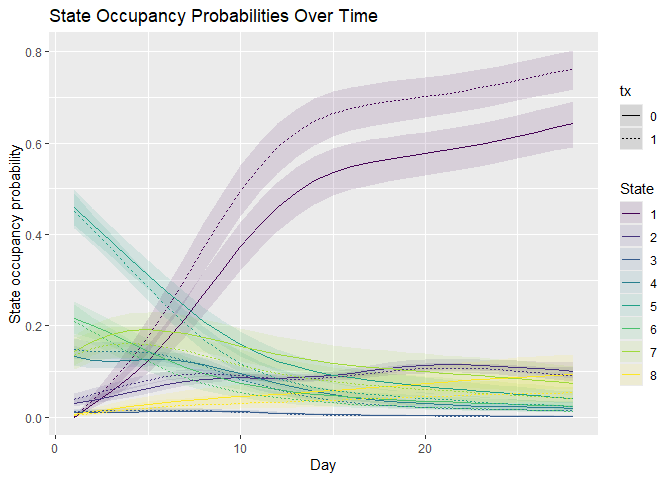

<!-- README.md is generated from README.Rmd. Please edit that file. -->

# mostr 

Markov Ordinal State Transition models.

Compute and plot state occupancy probabilities (SOPs) and contrasts from
first- and second-order Markov models of ordinal health-state
trajectories.

## Installation

Install the development version from GitHub with `pak`:

``` r
install.packages("pak")
pak::pak("scjohannes/mostr")
```

## SOP Workflow

This example simulates ordinal outcomes from a viral respiratory disease
trial, fits a proportional-odds Markov transition model with `mostm()`,
estimates marginal treatment-arm SOPs, adds uncertainty, and plots the
result.

``` r
library(mostr)
library(rms)
library(ggplot2)

set.seed(20260526)

trial <- sim_markov(
  "actt2",
  n_patients = 300,
  follow_up_time = 28,
  treatment_prob = 0.5,
  treatment_effect = log(0.8),
  seed = 20260526
)

markov_data <- prepare_markov_data(trial, absorbing_state = 8)

fit <- mostm(
  y ~ rms::rcs(time, 4) + tx + yprev,
  data = markov_data,
  id_var = "id",
  opt_method = "LM",
  scale = TRUE
)

sop <- avg_sops(
  fit,
  variables = list(tx = c(0, 1)),
  times = 1:28,
  y_levels = fit$yunique,
  absorb = "8"
) |> inferences(
  method = "delta"
)

# Probability of being at home without limitations (state 1) and of death
# (state 8) on day 28, by treatment
sop[sop$time == 28 & sop$state %in% c("1", "8"), ]
#>     time state tx   estimate  std.error   conf.low  conf.high
#> 28    28     1  0 0.64231935 0.02549514 0.59096237 0.69060408
#> 224   28     8  0 0.09382702 0.01891344 0.06275124 0.13802586
#> 252   28     1  1 0.76158952 0.02166771 0.71657232 0.80143789
#> 448   28     8  1 0.05384236 0.01314013 0.03318549 0.08621089

plot_sops(sop, facet_var = NULL, linetype_var = "tx") +
  labs(
    x = "Day",
    y = "State occupancy probability"
  )
```



`mostm()` fits the model with one of three engines: `engine = "orm"`
(the default) uses `rms::orm()`, `engine = "vglm"` uses `VGAM::vglm()`,
for example for partial proportional-odds models, and `engine = "blrm"`
fits a Bayesian model with `rmsb::blrm()`. The SOP and diagnostic
functions need a model fitted with `mostm()`, which stores the patient
data they use; a model fitted directly with rms, VGAM, or rmsb lacks
these data.

## Learn More

Read the [package website](https://scjohannes.github.io/mostr/) for
tutorials and the function reference. `?mostr` lists the package’s
functions by what you want to do.

After installation, see:

``` r
vignette("mostr", package = "mostr")
vignette("full-po-sops", package = "mostr")
vignette("analytical-confidence-intervals", package = "mostr")
vignette("partial-po-vglm-sops", package = "mostr")
vignette("second-order-orm-sops", package = "mostr")
vignette("many-levels-previous-state-spline", package = "mostr")
vignette("factor-time-orm-sops", package = "mostr")
vignette("bayesian-rmsb-sops", package = "mostr")
vignette("mvn-vs-bootstrap-orm-sops", package = "mostr")
vignette("fractional-weighted-bootstrap-sops", package = "mostr")
```

## Methodological Foundations

The statistical methods behind `mostr` were developed by Frank Harrell
and colleagues. `mostr` wraps these methods in a workflow for fitting
models, computing estimates, adding uncertainty, and plotting. If you
use `mostr`, please consider citing the foundational paper:

> Rohde MD, French B, Stewart TG, Harrell FE Jr (2024). “Bayesian
> Transition Models for Ordinal Longitudinal Outcomes.” *Statistics in
> Medicine*, 43(18), 3539–3561.
> [doi:10.1002/sim.10133](https://doi.org/10.1002/sim.10133)

For a detailed introduction with worked case studies, see the chapter
[Semiparametric Ordinal Longitudinal
Models](https://hbiostat.org/rmsc/markov) in Frank Harrell’s *Regression
Modeling Strategies*.

## Inspiration

The design of `mostr` is heavily inspired by the philosophy and workflow
of the [`marginaleffects`](https://marginaleffects.com/) package: fit a
model first, then compute the quantities you care about from it.
Functions such as `avg_sops()`, `avg_state_time()`, and
`avg_comparisons()` average predictions over patients, `inferences()`
adds uncertainty in a separate step, and results are plain data frames
with `estimate`, `std.error`, `conf.low`, and `conf.high` columns. If
you use `mostr`, please also consider citing `marginaleffects`:

> Arel-Bundock V, Greifer N, Heiss A (2024). “How to Interpret
> Statistical Models Using marginaleffects for R and Python.” *Journal
> of Statistical Software*, 111(9), 1–32.
> [doi:10.18637/jss.v111.i09](https://doi.org/10.18637/jss.v111.i09)

## Data Provenance

The included `violet_baseline` dataset and the model in
`sim_markov("violet")` come from `simlongord`, a simulated trial that
Frank Harrell based on the VIOLET trial ([Harrell,
2022](https://hbiostat.org/data/repo/simlongord)).

## Funding

This project has received funding from the European Union’s Horizon
Europe research and innovation program under grant agreement No
101156304.
